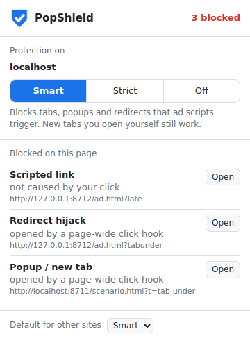
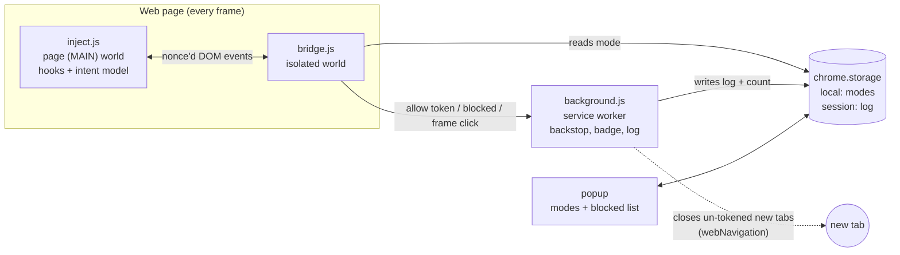

<div align="center">



<br>

<a href="https://developer.chrome.com/docs/extensions/develop/migrate/what-is-mv3"></a>

<a href="https://github.com/madironman/popshield/actions/workflows/ci.yml"></a>


<a href="LICENSE"></a>

### Blocks ad popups, popunders, ad tabs and tab-hijack redirects. The tabs you open still work.

[Install](#-install) · [How it works](#-how-it-works) · [Privacy](#-privacy) · [Limitations](#-known-limitations) · [Tests](#-testing) · [Contributing](CONTRIBUTING.md)

</div>

---

## Why

On many free streaming sites, link shorteners and file hosts, **every click on the page opens an ad tab**, even a click on the video's play or volume button. Ad networks with "OnClick" popunder formats (Monetag-style scripts are a common example) attach one listener to the whole page. Any click anywhere then runs `window.open(ad)`.

**Chrome's built-in popup blocker lets these through.** It only blocks popups opened *without* a user gesture, and here a real click did happen. It just wasn't a click on anything that should open a tab.

PopShield looks at **where the click was handled**, not only *whether* there was a click. A page may open a new tab only while your real click is being delivered to a listener **on a specific element**, such as a Share button or a link. Page-wide hooks, invisible overlays, ad layers and timers don't count.

> [!NOTE]
> **Real-world result.** On a free streaming site, 8 clicks on the player controls opened **2 ad tabs** without the extension, one of them a push-notification spam page. With PopShield: **0 tabs opened, 4 ad popups blocked**, and the player kept working.

## ✨ Features

<table>
<tr>
<td width="50%" valign="top">

**🛡️ Intent-based blocking**<br>
Blocks popups and popunders fired from page-wide click hooks, invisible overlays and max z-index ad layers. Share buttons, `target="_blank"` links, ctrl / middle-click and "Open link in new tab" keep working.

</td>
<td width="50%" valign="top">

**↪️ Redirect and tab-under guard**<br>
Stops cross-site redirects of the current tab driven by ad click hooks, including tab-unders ("open this page in a new tab, send this tab to an ad") and hijacks from an embedded video player frame.

</td>
</tr>
<tr>
<td valign="top">

**🧱 Several layers**<br>
Hooks `window.open`, scripted link clicks, `dispatchEvent`, form submits and fresh iframes in every frame. A background backstop closes any new tab that arrives without a "the user asked for this" signal.

</td>
<td valign="top">

**⚙️ Works with real sites**<br>
Understands React ≤16 and 17+ event delegation, jQuery `.on(selector)` handlers, and `window.open` after `await` in a button's click handler.

</td>
</tr>
<tr>
<td valign="top">

**🎚️ Per-site modes**<br>
**Smart** (default), **Strict** or **Off**, set per site from the toolbar popup. Embedded frames follow the mode of the page around them.

</td>
<td valign="top">

**🔒 Private by design**<br>
No telemetry, no network requests, no remote filter lists, no accounts. Plain JavaScript with no build step, so the code you read is the code that runs.

</td>
</tr>
</table>

## 🖼️ Demo

The toolbar popup lists everything blocked on the current page, with the reason. Each item has an **Open** button in case you wanted it after all. The badge on the icon shows the count.

<p align="center">
  <picture>
    <source media="(prefers-color-scheme: dark)" srcset="docs/assets/popup-dark.png">
    
  </picture>
</p>

<p align="center"><sub>Screenshot from the automated UI test (<code>test/popup-ui.mjs</code>) after it triggers three blocks on a local test page.</sub></p>

## 📦 Install

### Chrome Web Store

*Coming soon.* The store listing isn't published yet. Until then, load it unpacked.

### Load unpacked (developer mode)

1. Download this repository ([ZIP](https://github.com/madironman/popshield/archive/refs/heads/main.zip) or `git clone https://github.com/madironman/popshield.git`) and unzip it.
2. Open `chrome://extensions` and turn on **Developer mode** (top right).
3. Click **Load unpacked** and select the folder that contains `manifest.json`.
4. Pin PopShield to the toolbar. The badge shows how many items were blocked on the current page.

Requires Chrome or another Chromium browser, version **111 or newer**. Pages that were already open before you installed it need a reload.

## 🧠 How it works

<p align="center">
  <picture>
    <source media="(prefers-color-scheme: dark)" srcset="docs/assets/how-it-works-dark.svg">
    
  </picture>
</p>

PopShield runs a small script in the page's own JavaScript world, in every frame, before any page script. When the page tries to open a tab, it asks: *is the code running right now handling a real click on a specific element?* An open is **blocked** when:

| Check | Fails when | Reason shown in the popup |
|---|---|---|
| **1. Real gesture** | no trusted user action is in progress (timers, async callbacks) | not caused by your click |
| **2. Full click** | the open fires on mouse-down or pointer-down instead of a full click | fired on mouse-down, not a real click |
| **3. On an element** | the listener is on `window`, `document`, `<html>` or `<body>`: a page-wide hook | opened by a page-wide click hook |
| **4. Real target** | the click landed on an **invisible overlay** (a transparent element with no content covering most of the screen) | click landed on an invisible overlay |
| | …or on an **ad layer**: a visible element at near-maximum z-index (≥ 2147480000), positioned fixed/absolute, covering ≥ 25% of the viewport, where the click hit an image or blank area rather than a button, link or input | click landed on an ad layer stacked over the page |

<details>
<summary><b>Refinements that keep legitimate sites working</b></summary>

<br>

- **Framework delegation.** Old React (≤16) runs every click handler from one listener on `document`, and jQuery's `$(document).on('click', '.btn', fn)` does the same. During each click, PopShield wraps the handler that belongs to the clicked element: React's `__reactEventHandlers$…` / `__reactProps$…` props, or a jQuery delegated handler with a specific selector. An open made inside that handler counts as element-scoped. A catch-all selector such as `*` doesn't get this pass.
- **Opens after `await`.** V8 async stack traces keep the listener's receiver across `await`, for example `at async HTMLButtonElement.<anonymous>`. An open that comes from an element's handler, or from a framework handler (marked with a `__popshieldFramework__` frame), is allowed while the user activation lasts. A page-wide hook that awaits shows `HTMLDocument` or `Window` and stays blocked. So do timers and plain promise callbacks.
- **Legitimate max z-index UI.** The ad-layer check only applies when the click hit non-interactive content, so buttons inside cookie banners and modals stacked at the maximum z-index still work.
- **Tab-unders.** Even an otherwise-allowed open is blocked if a script uses it to open **this same page** in a new tab. A cross-site script navigation of the current tab within **2 seconds** after a script-opened new tab is blocked as a tab-under redirect.
- **Same-site and on-load redirects** are never touched. Neither are reloads, back/forward, downloads or URLs you type.

</details>

<details>
<summary><b>Architecture</b></summary>

<br>



- `inject.js` makes the decisions and talks to `bridge.js` over DOM events whose names include a random per-page nonce.
- When it allows an open, it sends an **allow token** to the background worker, which accepts one new tab from that tab within a few seconds.
- A new tab that arrives with **no token** (code PopShield couldn't hook) is closed by the backstop after a short grace period.

</details>

### Protection layers

| Layer | Where | Stops |
|---|---|---|
| `window.open` hook | page world, every frame | scripted popups and popunders, same-page tab-unders |
| `a.click()`, `dispatchEvent(click)`, `form.submit()` / `requestSubmit()` hooks | page world | fake clicks on `_blank` links and forms |
| Fresh-iframe patching | page world | grabbing an unhooked `window.open` from a new iframe |
| Overlay-click guard | capturing listener on `window` | invisible full-page `<a target=_blank>` ad layers |
| Redirect guard (Navigation API) | top frame | tab-under and click-hijack redirects, including ones driven by an embedded player iframe |
| Frame-hijack guard (`beforeunload`) | top frame | a cross-site player iframe doing `top.location = ad` right after you click in it (Chrome asks "Leave site?") |
| Backstop | background worker (`webNavigation.onCreatedNavigationTarget`) | any new tab the page opened without a matching user-intent token is closed |

### Modes

Set per site from the toolbar popup. A default for all other sites is at the bottom of the popup.

| Mode | What it does |
|---|---|
| **Smart** *(default)* | The rules above. Blocks tabs, popups and redirects that ad scripts trigger; new tabs you open yourself still work. |
| **Strict** | No script may open a tab at all. Links you click yourself, ctrl / middle-click and "Open link in new tab" still work. |
| **Off** | PopShield does nothing on the site. |

Embedded frames, such as a video player from another domain, follow the mode of the page that contains them.

## 🌍 Real-world results

Measured with `npm run test:live` (real Chromium, real clicks, with and without the extension) and manual checks:

| Sites | Without PopShield | With PopShield |
|---|---|---|
| A free streaming site (8 clicks on the player controls) | 2 ad tabs opened, one a push-notification spam page | 0 tabs opened, 4 ad popups blocked |
| 13 link shorteners, file hosts, torrent indexes and manga readers | 8 of 13 opened ads or hijacked the tab | Everything blocked on 6 of those 8 |

The two leaks in the second survey:

- **A cuty.io-style shortener** that puts a max z-index offerwall image over its Continue button. This is what the ad-layer and tab-under checks were added for, and it's now covered by the test suite.
- **A fake "Direct Download" button** on a file host. It's a plain link you really click, so it's allowed by design (see [limitations](#-known-limitations)).

No false positives: legitimate `target=_blank` torrent download links, same-site Continue flows and manga chapter navigation all kept working.

## 🔒 Privacy

- **No telemetry, no analytics, no network requests.** PopShield never contacts any server.
- **No remote lists.** All decisions are made locally from what happens on the page.
- **Minimal storage.** Your per-site modes live in `chrome.storage.local`. The blocked-items log lives in `chrome.storage.session`: it is kept per tab (up to 50 items), cleared when the tab navigates to a new page or closes, and gone when the browser closes.

<details>
<summary><b>Permissions and why each one is needed</b></summary>

<br>

| Permission | Why |
|---|---|
| `storage` | Save your per-site modes and the default mode; keep the per-tab blocked log and badge count for the popup. |
| `webNavigation` | `onCreatedNavigationTarget` tells the backstop which tab opened a new tab, so un-tokened ad tabs can be closed. `onCommitted` resets the log when a tab loads a new page. |
| Host access `<all_urls>` | The content scripts must run at `document_start` in **every frame of every site**, before any ad script, so that `window.open` and friends are hooked first. Ads appear on arbitrary sites and inside cross-site player iframes. |

PopShield does not request `tabs`, `scripting`, `webRequest`, `cookies` or `history`.

</details>

See also [SECURITY.md](SECURITY.md) for reporting vulnerabilities.

## ⚖️ Comparison

PopShield's niche is **click-triggered** popups, which Chrome lets through. Its goal is to block them without asking you to approve each tab and without breaking the tabs you open on purpose.

| | Chrome's built-in blocker | PopShield (Smart) |
|---|:---:|:---:|
| Popup opened with no user gesture (timer, on load) | ✅ blocked | ✅ blocked |
| Popunder from a page-wide click hook (click on a player control) | ❌ allowed | ✅ blocked |
| Invisible overlay / max z-index ad layer over the page | ❌ allowed | ✅ blocked |
| Tab-under / click-hijack redirect of the current tab | ❌ allowed | ✅ blocked (frame hijacks: "Leave site?" prompt) |
| Share button or `_blank` link you click | ✅ works | ✅ works |
| Shows what was blocked, with one-click "open anyway" | Address-bar icon | Popup list with Open button |

Other popup and tab blockers in the Chrome Web Store take different approaches. Summarised from their public descriptions; behaviour may have changed, so check each listing:

| Extension | General approach | How PopShield differs |
|---|---|---|
| **Popup Blocker (strict)** | Blocks popups opened by page scripts and lets you allow them | Lets element-scoped opens (Share buttons, React / jQuery handlers) through automatically, and adds a backstop, redirect guard and tab-under detection |
| **Poper Blocker** | Blocks popups, popunders and overlay ads | Open source (MIT), with no network requests and no remote lists; decisions use the intent model |
| **No New Tabs**, **Tab Blocker** | Stop sites from opening new tabs | Doesn't block all new tabs, only ones not tied to a click on a specific element; also guards same-tab redirects |

If a description above is wrong or outdated, please [open an issue](https://github.com/madironman/popshield/issues). PopShield isn't a content blocker. For banner ads, trackers and fake download buttons, use it **alongside** a list-based blocker such as uBlock Origin.

## 🚧 Known limitations

- **Ads disguised as real links.** An ad that is a plain `<a href=ad target=_blank>` styled as the site's own button (for example a fake "Direct Download" button on a file host) is a link you really clicked, so the intent model allows it by design. Catching it needs a list of ad domains: pair PopShield with a content blocker such as uBlock Origin.
- **Opens scheduled with `setTimeout` or `.then()`** from an element handler carry no receiver in the stack, so Smart blocks them, even though `await` is handled. Use **Open** in the popup or set the site to Off.
- **A cross-site player iframe that hijacks the whole tab** (`top.location = ad`) can't be cancelled silently, because Chrome sends no Navigation API event for it. PopShield holds the page and Chrome asks "Leave site?". Click **Cancel** to stay. The prompt only appears within 1.5 s of a click inside the player: the frame relays its pointer-down to the top page through the background worker. Reloading or typing a URL later is never interrupted.
- **Other delegation frameworks** that put their handler on `document` (rare today) are treated like page-wide hooks.
- **Ad networks keep changing their tricks.** The backstop catches most new ways to open tabs, but same-tab redirects rely on the Navigation API guard.

Found a site where ads get through, or where something legitimate is blocked? See [CONTRIBUTING.md](CONTRIBUTING.md#reporting-a-site-where-ads-still-get-through).

## 🧪 Testing

```bash
npm install
npx playwright install chromium
npm test
```

`npm test` runs two suites in a real (headless) Chromium with the unpacked extension loaded and Chrome's own popup blocker left on:

| Suite | Checks | What it does |
|---|---|---|
| `test/run.mjs` (e2e) | **100** (53 scenarios) | Runs the scenarios twice. First **without** the extension (47 checks), to record what Chrome alone does: the attacks succeed (except two that Chromium already refuses) and legitimate patterns work. Then **with** PopShield, checking that every attack is blocked, every legitimate pattern still works, and nothing else gets logged. |
| `test/popup-ui.mjs` | **8** | Triggers real blocks, then checks the badge count, the blocked list, the mode buttons, per-site overrides and the Open button. Saves light and dark screenshots to `test/screenshots/`. |

<details>
<summary><b>What the e2e suite covers</b></summary>

<br>

**Attacks (must be blocked):** popunders from `document` click, `window` mousedown and `<body>` pointerup hooks · invisible overlay links and overlay listeners · scripted `_blank` anchors (timer, `dispatchEvent`) · scripted `_blank` form submits and submit-button clicks · pristine `window.open` from fresh iframes and `frames[i]` · tab-under and click-hijack redirects, `window.open(_self)` redirects · timer popups · popups and top-frame hijacks from a cross-site player iframe (including a second click later) · a jQuery `*` delegated popunder · a popunder on a React 16 site · page-wide hooks that open after `await` or in `.then()` · a max z-index ad layer over a Continue button · a same-page tab-under from an element handler · the backstop closing a tab opened through an unhooked JS world.

**Legitimate patterns (must keep working):** button `window.open` · React root listeners, React 16 and 17+ (sync and after `await`) · jQuery delegated handlers · `_blank` links, ctrl- and middle-click, big image links · scripted anchors from element handlers · downloads · same-site, on-load and link navigations · leaving or reloading the page, or typing a URL, after using the player · `_blank` forms via click and Enter · `window.open` after `await` · buttons in a max z-index consent modal.

**Modes:** Off allows popunders and redirects, Strict blocks scripted popups while real links and ctrl+click still work, and a per-site Off override applies only to its site.

</details>

`npm run test:live -- <url> [clicks]` clicks the player and controls on a real page, with and without the extension, and reports the tabs that opened, any hijacks and what PopShield blocked.

> [!TIP]
> On very new Node versions (v26), `npx playwright install` can hang while unzipping. If that happens, unzip the downloaded archive from `/tmp` into `~/.cache/ms-playwright/chromium-<rev>/` yourself.

## 📁 Project structure

```text
popshield/
├── manifest.json          # MV3 manifest: content scripts in every frame at document_start
├── icons/                 # toolbar and store icons (16, 32, 48, 128)
├── src/
│   ├── inject.js          # page (MAIN) world: API hooks, intent model, redirect + frame-hijack guards
│   ├── bridge.js          # isolated world: relays between inject.js, storage and the background
│   ├── common.js          # shared helpers: site parsing, per-site mode storage
│   ├── background.js      # service worker: new-tab backstop, badge, blocked log
│   ├── popup.html         # toolbar popup UI (light + dark)
│   └── popup.js           # per-site mode switch, blocked list with Open buttons
├── test/
│   ├── run.mjs            # e2e suite: baseline vs. with-extension
│   ├── popup-ui.mjs       # popup UI test + screenshots
│   ├── live.mjs           # before/after check against a real URL
│   ├── server.mjs         # serves fixtures on localhost:8711 ("site") and 127.0.0.1:8712 ("ad network")
│   └── fixtures/          # attack and legitimate scenario pages
└── docs/assets/           # README images
```

## 🤝 Contributing

Bug reports, site reports (ads getting through, or legitimate tabs blocked) and new test scenarios are very welcome. Please read [CONTRIBUTING.md](CONTRIBUTING.md) and the [Code of Conduct](CODE_OF_CONDUCT.md). Report security issues privately as described in [SECURITY.md](SECURITY.md).

## 📄 License

[MIT](LICENSE)
