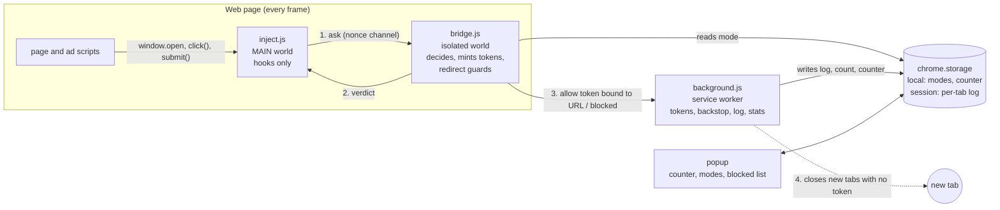

<div align="center">


<br>

<a href="https://developer.chrome.com/docs/extensions/develop/migrate/what-is-mv3"></a>

<a href="https://github.com/madironman/popshield/actions/workflows/ci.yml"></a>


<a href="LICENSE"></a>

### Blocks ad popups, popunders, ad tabs and tab-hijack redirects. The tabs you open still work.

[Install](#-install) · [How it works](#-how-it-works) · [Privacy](#-privacy) · [Security](#-security) · [Limitations](#-known-limitations) · [Tests](#-testing) · [Contributing](CONTRIBUTING.md)

</div>

> [!IMPORTANT]
> **PopShield never records which sites you visit.** It keeps only an anonymous count of blocks (total, per day, per kind) on this device. The list of what was blocked on a page lives only in that tab and is wiped when the tab navigates or closes, and when the browser exits. No telemetry, no network requests, no remote code. A report is sent only if you click **Report** and submit the GitHub form yourself. [Details](#-privacy)

---

## Why

On many free streaming sites, link shorteners and file hosts, **every click on the page opens an ad tab**, even a click on the video's play or volume button. Ad networks with "OnClick" popunder formats attach one listener to the whole page. Any click anywhere then runs `window.open(ad)`.

**Chrome's built-in popup blocker lets these through.** It only blocks popups opened *without* a user gesture, and here a real click did happen. It just wasn't a click on anything that should open a tab.

PopShield looks at **where the click was handled**, not only *whether* there was a click. A page may open a new tab only while your real click is being delivered to a listener **on a specific element**, such as a Share button or a link. Page-wide hooks, invisible overlays, ad layers and timers don't count.

> [!NOTE]
> **Real-world result.** On a free streaming site, 8 clicks on the player controls opened **2 ad tabs** without the extension, one of them a push-notification spam page. With PopShield: **0 tabs opened, 4 ad popups blocked**, and the player kept working.

## ✨ Features

<table>
<tr>
<td width="50%" valign="top">

**🛡️ Intent-based blocking**<br>
Blocks popups and popunders fired from page-wide click hooks (including wrappers that cover a large part of the page), invisible overlays (judged by what they actually paint) and max z-index ad layers. Share buttons, `target="_blank"` links, ctrl / middle-click and "Open link in new tab" keep working.

</td>
<td width="50%" valign="top">

**↪️ Redirect, tab-under and hijack guards**<br>
Stops cross-site redirects of the current tab driven by ad click hooks or fired right after a click, tab-unders ("open this page in a new tab, send this tab to an ad"), popups sent to another site before you use them, and hijacks from an embedded video player frame. Same-site redirectors that bounce on to an ad are followed and undone.

</td>
</tr>
<tr>
<td valign="top">

**🧱 Hardened against hostile pages**<br>
The page's world only hosts hooks. Every decision and every "allow" token is made in Chrome's isolated extension world, which pages can't touch, and a background backstop closes any new tab that wasn't approved there.

</td>
<td valign="top">

**⚙️ Works with real sites**<br>
Understands React ≤16 and 17+, Solid and jQuery event delegation, sign-in and payment popups after `await`, links inside closed shadow roots, and SVG links.

</td>
</tr>
<tr>
<td valign="top">

**📊 Local counter and per-site modes**<br>
The popup shows how many popups and redirects were blocked since install, with a 14-day sparkline, and lets you pick **Smart** (default), **Strict** or **Off** per site.

</td>
<td valign="top">

**🔒 Private by design**<br>
Never records which sites you visit. No telemetry, no network requests, no remote filter lists, no accounts. Plain JavaScript with no build step, so the code you read is the code that runs.

</td>
</tr>
</table>

## 🖼️ Demo

The toolbar popup shows the lifetime counter, lists everything blocked on the current page with the reason, and gives each item an **Open** button in case you wanted it after all. The badge on the icon shows the count for the current page.

<p align="center">
  <picture>
    <source media="(prefers-color-scheme: dark)" srcset="docs/assets/popup-dark.png">
    
  </picture>
</p>

<p align="center"><sub>Screenshot from the automated UI test (<code>test/popup-ui.mjs</code>) after it triggers three blocks on a local test page.</sub></p>

The popup also has:

- **Report ads that got through** and **Report something blocked by mistake**: open a pre-filled public GitHub issue (site address without query string, mode, versions, a summary of blocks) that you review and submit yourself. PopShield sends nothing.
- **Feedback**: opens GitHub Discussions (Ideas).
- **Reset stats**: resets the lifetime counter on this device.

A welcome page opens once, on first install.

## 📦 Install

### Chrome Web Store

*Coming soon.* The store listing isn't published yet. Until then, load it unpacked.

### Load unpacked (developer mode)

1. Download this repository ([ZIP](https://github.com/madironman/popshield/archive/refs/heads/main.zip) or `git clone https://github.com/madironman/popshield.git`) and unzip it.
2. Open `chrome://extensions` and turn on **Developer mode** (top right).
3. Click **Load unpacked** and select the folder that contains `manifest.json`.
4. Pin PopShield to the toolbar. The badge shows how many items were blocked on the current page.

Requires Chrome or another Chromium browser, version **119 or newer**. Pages that were already open before you installed it need a reload.

## 🧠 How it works

<p align="center">
  <picture>
    <source media="(prefers-color-scheme: dark)" srcset="docs/assets/how-it-works-dark.svg">
    
  </picture>
</p>

PopShield puts small hooks into the page's own JavaScript world, in every frame, before any page script. When the page tries to open a tab, the hook asks PopShield's isolated script: *is the code running right now handling a real click on a specific element?* An open is **blocked** when:

| Check | Fails when | Reason shown in the popup |
|---|---|---|
| **1. Real gesture** | no trusted user action is in progress (timers, async callbacks) | not caused by your click |
| **2. Full click** | the open fires on mouse-down or pointer-down instead of a full click | fired on mouse-down, not a real click |
| **3. On an element** | the listener is on `window`, `document`, `<html>`, `<body>`, a shadow root, a wrapper element covering **at least 40% of the viewport**, or an element that wasn't on the click's path at all: a page-wide hook | opened by a page-wide click hook |
| | …or, for a script-opened tab or popup to **another site**, nothing between the element you clicked and the listener looks clickable: no link, button, input or other interactive element, and no pointer-style cursor (ad scripts that attach a listener to every element on the page) | opened by a script on something that isn't a button or link |
| **4. Real target** | the click landed on an **invisible overlay**: an element covering ≥ 35% of the screen that paints nothing you can see, however it was stacked on top | click landed on an invisible overlay |
| | …or on an **ad layer**: a visible element at near-maximum z-index (≥ 2147480000), positioned fixed/absolute, covering ≥ 25% of the viewport, where the click hit an image or blank area rather than a button, link or input | click landed on an ad layer stacked over the page |

Checks 3 and 4 measure the page **the moment your click arrives** (as you release the button), before any page code has run for it. The pointer-up, mouse-up and click events of one physical click share that one snapshot, so an ad can't shrink its wrapper or pull its overlay away in between and then ask.

PopShield also remembers **what you pressed**, at the moment you press. If a script then re-points the link under your pointer to another site, or attaches the button you pressed to a different form (or changes where that form submits) before you release, the click or submit is refused. Ordinary typing doesn't trigger this bookkeeping; only Enter and Space, which can activate something, do.

**What "invisible" means.** PopShield looks at what the element actually paints. It counts as invisible when its effective opacity (multiplied up the ancestor chain, including `filter: opacity()`) is below 0.2, or when nothing inside it is visible: no text with a visible colour (transparent `color` and `-webkit-text-fill-color` both count as invisible), no background colour or picture that shows (a gradient made only of transparent colour stops counts as empty), and no picture, video or canvas taking up a real share of it. PopShield looks at up to 300 elements inside it; if none of them shows anything, the element counts as invisible, so an overlay can't escape by padding itself with hundreds of empty children. How it got on top doesn't matter: `position: fixed`, a grid cell, negative margins or a transform are all treated the same. When the element under your pointer sits inside a closed shadow root, PopShield looks inside it with `chrome.dom.openOrClosedShadowRoot`.

<details>
<summary><b>Refinements that keep legitimate sites working</b></summary>

<br>

- **Framework delegation.** React ≤16 runs click handlers from one listener on `document`, React 17+ from the root container, Solid from `document` (`$$click`), and jQuery's `$(document).on('click', '.btn', fn)` the same way. During each click, PopShield wraps the handler that belongs to the clicked element, and an open made inside it counts as element-scoped. React props only count if they were already on the element when you pressed, so props a page plants from its own press handler are ignored. jQuery only gets this for a real jQuery and specific selectors (containing `.`, `#` or `[`, not matching `<body>`, at most 50 matches); a catch-all such as `*` doesn't.
- **Opens after `await`.** V8 async stack traces keep the listener's receiver across `await`, for example `at async HTMLButtonElement.<anonymous>`. An open after `await` is allowed when the element's (or framework's) handler is the bottom of the resumed stack, your click was less than 5 s ago and landed on a real target, **and the address is on the same site or is the start of a sign-in or payment flow at a known provider** (Google, Apple, Microsoft, GitHub, PayPal, Stripe and others). That list (`PROVIDER_FLOWS` in [`src/common.js`](src/common.js)) names exact hosts and the path where each flow begins, such as GitHub's OAuth authorize page or Stripe's checkout host. Nothing broader counts: not the rest of a provider's domain (where open redirectors live), not identity services where anyone can rent a subdomain, and not an arbitrary address that merely carries a `client_id=` parameter. If the page tampers with stack formatting, the hint is ignored. Because this rests on a hint the page could influence, the background follows the new tab for 8 s and closes it if it lands on an unrelated site.
- **Legitimate max z-index UI.** The ad-layer check only applies when the click hit non-interactive content, so buttons inside cookie banners and modals stacked at the maximum z-index still work.
- **Links you click.** A `_blank` link, ctrl / middle-click and right-click "Open link in new tab" on a real, visible link get an allow token for **exactly that page** (origin and path). If a script swaps the link's address during a left, middle or modifier click, the ad tab is closed and the page you actually clicked is opened instead. Right-click opens aren't repaired this way, only blocked, because the menu can sit open for a while. A decoy `#` link's new tab must stay on the same site, and a modifier-click where PopShield sees no link allows only a same-site tab.
- **Forms you submit.** A `target="_blank"` form submitted natively counts only when it happens in the same task as your click on a visible submit button of that form, or your Enter inside it.
- **Same-site and on-load redirects** are left alone (a same-site hop right after a suspicious click is followed, see below). Reloads, back/forward, downloads, link clicks, bookmarks and URLs you type are never touched, by the page guard or by the background's redirect follower.

</details>

### Redirects of the tab you're on

In the top frame, the Navigation API guard cancels cross-site, script-driven navigations of the current tab when:

- **Click hijack.** It happens within 5 s of a click but doesn't come from an element-scoped handler (page-wide hook, overlay, ad layer, mouse-down), or it is a timer / `<meta refresh>` redirect right after a click.
- **Tab-under.** This tab opened a new tab in the last 60 s and you haven't pressed anything since (a press within half a second is the same click). The worker remembers the opened tab per tab, so hopping to another page of the same site doesn't reset it; going somewhere yourself (typing an address, using a bookmark) does. A tab opened by a link you click counts once the new tab has really appeared. Opening this same page (any `?query`) in a new tab during a click is blocked too.
- **Popup hijack.** A popup that hasn't received any click yet is sent to another site. This also covers a tab opened with `noopener` when its approval rested on weaker evidence, because the background tells the new tab's first page how it was opened.
- **Embedded-frame hijack.** You clicked inside a child frame (such as a video player) less than 6 seconds ago, haven't clicked on the main page since, and the page still has focus. A cross-site frame doing `top.location = ad` can't be cancelled silently, so PopShield holds the page and Chrome asks **"Leave site?"**.

A hand-off to a known sign-in or payment flow is allowed when none of the tab-under, popup-hijack or Strict rules applies; those are checked first, so a provider address can't be used to launder them. A suspicious navigation to **the same site** isn't cancelled, because sites hop between their own pages all the time. In both cases the worker follows the tab for 8 s, judging only real redirect hops: if it ends up on an unrelated site (a same-site redirector or a provider page bouncing on to an ad), the tab is sent back.

### Smart or Strict: the one trade-off

Smart mode lets a script move the tab to another site **more than about 5 seconds after your last click**, as long as none of the rules above applies. That keeps checkouts and bank hand-offs working, which often redirect after a wait. The price is that an ad script patient enough to wait out that window gets through in Smart. **Strict** closes the gap: once you have interacted with a page, no script may send the tab to another site on its own, however long it waits, and that includes sign-in and payment pages (a redirect made directly by the button you clicked, while the click is being handled, still works). Use Smart as the everyday setting and Strict for sites you don't trust.

### Architecture



1. **`inject.js` (page's MAIN world) only hooks.** It wraps the APIs that open tabs (`window.open`, `click()` on links, `dispatchEvent(click)` on HTML and SVG links, `form.submit()`, Document Picture-in-Picture) and synchronously asks the bridge for a verdict over a private channel. The channel's 128-bit nonce is exchanged once at `document_start`, before any page script runs, and never re-broadcast. All built-ins it uses are captured up front.
2. **`bridge.js` (isolated world) decides.** Pages can't see or tamper with this world, so it judges with clean APIs, watches your clicks itself, and runs the redirect, embedded-frame and form-submit guards.
3. **Only the bridge mints allow tokens**, each bound to the URL it is for: to the site for script opens, to the exact page for links you click. The background worker accepts them only from PopShield's own scripts, keeps them for 3 s (8 s for right-click "Open link in new tab"), at most 4 per tab.
4. **The backstop** closes any new tab that arrives without a fitting token. When the decision rested on weaker evidence (a framework or `await` hint, a decoy link), it follows the new tab for 8 s and closes it if it lands on an unrelated site.

So if a hostile page manages to subvert `inject.js`, the worst it gets is skipping the early block: the backstop still closes any tab the bridge didn't approve. See [docs/ARCHITECTURE.md](docs/ARCHITECTURE.md) for the full design.

### Protection layers

| Layer | Where | Stops |
|---|---|---|
| `window.open` hook | page world, every frame | scripted popups and popunders, same-page tab-unders |
| `a.click()`, `dispatchEvent(click)` (HTML and SVG links), `form.submit()` hooks | page world | fake clicks on `_blank` links and forms |
| Document Picture-in-Picture hook | page world | always-on-top `requestWindow()` windows |
| Fresh-iframe patching | page world | grabbing an unhooked `window.open` from a new iframe |
| Verdict and token minting | isolated world (`bridge.js`) | everything above; the page can't forge an approval |
| Overlay-click guard | isolated world, capturing listener on `window` | invisible full-page `<a target=_blank>` ad layers, decoy links in pinned ad boxes, links re-pointed to another site between your press and your click |
| Native form-submit guard | isolated world | `_blank` forms submitted by `requestSubmit()`, a scripted submit-button click, a button re-wired to another form between press and click, or anything other than your own click / Enter in that task |
| Redirect guard (Navigation API) | isolated world, top frame | click-hijack, timer-after-click, tab-under and popup-hijack redirects; in Strict, any script redirect to another site after you've interacted |
| Frame-hijack guard (`beforeunload`) | isolated world, top frame | a cross-site player iframe doing `top.location = ad` right after you click in it (Chrome asks "Leave site?") |
| Backstop | background worker (`webNavigation.onCreatedNavigationTarget`) | any new tab the bridge didn't approve is closed; a tab opened from a link whose address a script swapped is replaced by the page you clicked |
| Redirect-chain follower | background worker (`webNavigation.onCommitted`) | a weakly-approved new tab, a same-site hop or a sign-in/payment hand-off that redirects on to an unrelated site within 8 s |

### Modes

Set per site from the toolbar popup. A default for all other sites is at the bottom of the popup.

| Mode | What it does |
|---|---|
| **Smart** *(default, the normal setting)* | The rules above. Blocks tabs, popups and redirects that ad scripts trigger; new tabs you open yourself still work. A script redirect more than ~5 s after your last click is allowed, so checkouts and bank hand-offs keep working. |
| **Strict** *(maximum protection)* | No script may open a tab at all, and once you've interacted with the page no script may send the tab to another site, however long it waits, sign-in and payment pages included. Links you click yourself, ctrl / middle-click, "Open link in new tab" and forms you submit still work. |
| **Off** | PopShield does nothing on the site. |

Embedded frames, such as a video player from another domain, follow the mode of the page that contains them. A mode you pick for a site in an incognito window applies to incognito tabs only and is kept in memory, never on disk.

## 🌍 Real-world results

Measured with `npm run test:live` (real Chromium, real clicks, with and without the extension) and manual checks:

| Sites | Without PopShield | With PopShield |
|---|---|---|
| A free streaming site (8 clicks on the player controls) | 2 ad tabs opened, one a push-notification spam page | 0 tabs opened, 4 ad popups blocked |
| 13 link shorteners, file hosts, torrent indexes and manga readers | 8 of 13 opened ads or hijacked the tab | Everything blocked on 6 of those 8 |

The two leaks in the second survey:

- **A link shortener** that puts a max z-index offerwall image over its Continue button. This is what the ad-layer and tab-under checks were added for, and it's now covered by the test suite.
- **A fake "Direct Download" button** on a file host. It's a plain link you really click, so it's allowed by design (see [limitations](#-known-limitations)).

No false positives: legitimate `target=_blank` torrent download links, same-site Continue flows and manga chapter navigation all kept working.

## 🔒 Privacy

**PopShield never records which sites you visit.**

- **Only an anonymous counter is kept.** `chrome.storage.local` holds the total number of blocks, the count per day (last 30 days) and the count per kind of block, plus the date counting started. No site, URL or page address is ever part of it. **Reset stats** in the popup clears it.
- **The per-page list stays in the tab.** What was blocked on a page (up to 50 items, with the blocked address and the page's address without query string) lives in `chrome.storage.session` under that tab only. It is wiped when the tab navigates to a new page or closes, and when the browser exits.
- **Working memory is short-lived.** To follow a redirect chain or match a new tab to your click, the background worker holds the address or site involved for a few seconds (up to 8 s for a right-click "Open link in new tab"), plus a timestamp of when each tab last opened a tab. This lives only in the worker's memory, is never written to storage, and is dropped when the tab closes or the worker stops.
- **Your settings.** The default mode and the per-site modes *you chose* (for example `example.com → Strict`) are stored in `chrome.storage.local`. A site appears there only if you set a mode for it. Modes you choose in incognito are kept only in memory (`chrome.storage.session`) and forgotten when the browser exits.
- **No telemetry, no analytics, no network requests, no remote code, no remote lists.** PopShield never contacts any server. All decisions are made locally.
- **Reports are yours to send.** The Report buttons only open a pre-filled public GitHub issue in a new tab. Nothing is sent unless you submit that form yourself.
- **No share or social features.**
- **Pages can tell PopShield is there.** Like most extensions that change page behaviour, its effects (a blocked popup, a wrapped function) are observable, so a site could detect it and use that as one more fingerprinting signal. PopShield sends nothing to sites, but it does not try to hide.

Full policy: [PRIVACY.md](PRIVACY.md).

<details>
<summary><b>Permissions and why each one is needed</b></summary>

<br>

| Permission | Why |
|---|---|
| `storage` | Save your default mode and per-site modes and the anonymous block counter; keep the per-tab blocked list and badge count for the popup. |
| `webNavigation` | `onCreatedNavigationTarget` tells the backstop which tab opened a new tab, so tabs without a token can be closed. `onCommitted` resets the per-tab list when a tab loads a new page. |
| Host access `<all_urls>` | The content scripts must run at `document_start` in **every frame of every site**, before any ad script, so that `window.open` and friends are hooked first. Ads appear on arbitrary sites and inside cross-site player iframes. |

PopShield does not request `tabs`, `scripting`, `webRequest`, `cookies` or `history`. The `chrome.dom` API it uses to find links inside closed shadow roots needs no permission.

</details>

## 🔐 Security

PopShield assumes the page is hostile: ad scripts can install listeners anywhere, create overlays and iframes, and poison any built-in function in the page's JavaScript world.

- **Nothing in the page's world decides.** `inject.js` only hooks and asks. The verdict, every allow token, the redirect guards and the block log come from `bridge.js` in the isolated world, which the page can't reach.
- **Private channel.** The 128-bit nonce is exchanged once at `document_start`, before any page script exists, and never re-broadcast.
- **Defence in depth.** If a page subverts `inject.js`, the worst it gets is skipping the early block; the backstop still closes any tab the bridge didn't approve.
- **A strict worker.** `background.js` trusts only messages from PopShield's own scripts, whitelists the kinds and reasons in the log, rate-limits per tab, takes the frame address from Chrome (`sender.url`, origin and path only), and binds, caps and expires tokens.
- **Exact sign-in and payment exemptions.** Only listed provider hosts and paths are exempt, never a whole domain, a multi-tenant domain or an address with a `client_id=` parameter, and the exemption is checked after the tab-under, popup-hijack and Strict rules.
- **Audited.** Three internal security audits and two performance audits; after the fixes from the latest round, no release blockers remain. A click costs PopShield about 0.1 ms, with no forced layouts and no leaks.
- **Residual risk.** A page that fakes framework data on the element you click, specifically to fool PopShield, can still get the framework exemption. For React this now has to be done before you press (props planted by the page's own press handler are ignored); Solid- and jQuery-shaped handlers aren't snapshotted. The bridge then approves the open. Because that approval rests on a hint, the worker follows the new tab and closes it if it bounces on to a site other than the page's or the approved address's, but an open straight to the ad's own address still gets through.

Threat model: [docs/ARCHITECTURE.md](docs/ARCHITECTURE.md#threat-model). Report vulnerabilities privately as described in [SECURITY.md](SECURITY.md).

**Supply chain.** CI and release workflows pin every action to a commit SHA, check out with `persist-credentials: false` and install with `npm ci --ignore-scripts`. A release is built and tested by a read-only job; a separate minimal job publishes the GitHub Release with a build-provenance attestation.

## ⚖️ Comparison

PopShield's niche is **click-triggered** popups, which Chrome lets through. Its goal is to block them without asking you to approve each tab and without breaking the tabs you open on purpose.

| | Chrome's built-in blocker | PopShield (Smart) |
|---|:---:|:---:|
| Popup opened with no user gesture (timer, on load) | ✅ blocked | ✅ blocked |
| Popunder from a page-wide click hook (click on a player control) | ❌ allowed | ✅ blocked |
| Invisible overlay / max z-index ad layer over the page | ❌ allowed | ✅ blocked |
| Tab-under / click-hijack redirect of the current tab | ❌ allowed | ✅ blocked (frame hijacks: "Leave site?" prompt) |
| Share button or `_blank` link you click | ✅ works | ✅ works |
| Shows what was blocked, with one-click "open anyway" | Address-bar icon | Popup list with Open button |

Other popup and tab blockers in the Chrome Web Store take different approaches. Summarised from their public descriptions; behaviour may have changed, so check each listing:

| Extension | General approach | How PopShield differs |
|---|---|---|
| **Popup Blocker (strict)** | Blocks popups opened by page scripts and lets you allow them | Lets element-scoped opens (Share buttons, React / jQuery handlers) through automatically, and adds a backstop, redirect guard and tab-under detection |
| **Poper Blocker** | Blocks popups, popunders and overlay ads | Open source (MIT), with no network requests and no remote lists; decisions use the intent model |
| **No New Tabs**, **Tab Blocker** | Stop sites from opening new tabs | Doesn't block all new tabs, only ones not tied to a click on a specific element; also guards same-tab redirects |

If a description above is wrong or outdated, please [open an issue](https://github.com/madironman/popshield/issues). PopShield isn't a content blocker. For banner ads, trackers and fake download buttons, use it **alongside** a list-based blocker such as uBlock Origin.

## 🚧 Known limitations

- **Ads disguised as real links.** An ad that is a plain `<a href=ad target=_blank>` styled as the site's own button (for example a fake "Direct Download" button), which you really click, is out of scope. Catching it needs a list of ad domains: pair PopShield with a content blocker such as uBlock Origin.
- **Fake in-page dialogs and ads aren't hidden.** PopShield stops tabs and redirects; it doesn't remove page content.
- **Pages written against PopShield.** A page that fakes framework data on the element you click can get the framework exemption. React props must already be there when you press, so this takes planning ahead; an open straight to the ad's address then gets through, because the bridge does approve. In the same way, a page can make non-clickable content look clickable (for example with a pointer cursor) to get past the check for listeners on non-clickable content.
- **Smart mode allows patient redirects.** A script that waits more than about 5 seconds after your last click and then sends the tab to another site is allowed in Smart, so that payment pages handing off to a bank keep working. Strict blocks it. This is a deliberate trade-off, and the test suite reports it as an accepted known bypass rather than hiding it.
- **Opens after `await` to arbitrary third-party sites** are blocked; only the same site and the listed sign-in / payment flows of known providers pass; a provider not on that exact list is treated like any other site. Opens scheduled with `setTimeout` or `.then()` are blocked too. Use **Open** in the popup, or set the site to Off.
- **Cross-site script redirects right after a click** (for example a timer that sends you to a partner site) are blocked, unless they go to a sign-in or payment page. So is a cross-site script redirect within 60 s of the tab opening another tab, until you press something again.
- **Delegation on a full-page container.** A plain listener on a wrapper that covers 40% or more of the page and opens windows is treated as page-wide unless it belongs to a recognised framework (React, Solid, jQuery).
- **Cross-site popups from non-clickable content.** A site that opens a popup to another site from a listener on plain text or an image, with no link, button or pointer cursor in between, is blocked in Smart. Use **Open** in the popup.
- **Detectable.** Pages can detect that PopShield is installed (see [Privacy](#-privacy)).
- **Player-iframe hijacks still show "Leave site?".** A cross-site frame doing `top.location = ad` can't be cancelled silently. Click **Cancel** to stay. The prompt only appears within 6 s of a click inside the frame, not after a click on the main page, and only while the page has focus; reloading or typing a URL is never interrupted.

Found a site where ads get through, or where something legitimate is blocked? Use the **Report** buttons in the popup, or see [CONTRIBUTING.md](CONTRIBUTING.md#reporting-a-site-where-ads-still-get-through).

## 🧪 Testing

```bash
npm install
npx playwright install chromium
npm test
```

`npm test` runs two suites in a real (headless) Chromium with the unpacked extension loaded and Chrome's own popup blocker left on:

| Suite | What it does |
|---|---|
| `test/run.mjs` (e2e, 120 scenarios, 223 counted checks, about 50 s) | Runs each attack scenario first **without** the extension, to record what Chrome alone does and prove the attack works, then **with** PopShield, checking that every attack is blocked, every legitimate pattern still works, and nothing else gets logged. Both passes run at once in parallel browsers (`E2E_WORKERS` overrides the automatic count). |
| `test/popup-ui.mjs` | Triggers real blocks, then checks the badge count, the blocked list, the mode buttons, per-site overrides, the Report link and the Open button. Saves light and dark screenshots to `test/screenshots/`. |

<details>
<summary><b>What the e2e suite covers</b></summary>

<br>

**Attacks (must be blocked):** popunders from `document` click, `window` mousedown and `<body>` pointerup hooks · a popunder on a page-sized wrapper element · invisible overlay links and overlay listeners · scripted `_blank` anchors (timer, `dispatchEvent`, SVG links) · scripted `_blank` form submits and submit-button clicks · pristine `window.open` from fresh iframes and `frames[i]` · tab-under and click-hijack redirects, `window.open(_self)` redirects · timer popups · popups and top-frame hijacks from a cross-site player iframe (including a second click later) · a jQuery `*` delegated popunder · a popunder on a React 16 site · page-wide hooks that open after `await` or in `.then()` · an element handler that opens a third-party site after `await` · a max z-index ad layer over a Continue button · a same-page tab-under from an element handler · decoy-link `href` swaps and ad-box frames · retry loops · the backstop closing a tab opened through an unhooked JS world.

**Red-team regressions:** 58 scenarios written during three internal red-team rounds, each an attempt to get past PopShield: poisoned built-ins, forged stack traces and spoofed receivers, a leaked channel nonce, planted React props and fake jQuery, overlays hidden behind transparent text, transparent gradients, grid stacking, closed shadow roots or a parent's opacity, overlays and wrappers that change between press and click, near-invisible cross-site frames, scripted and keystroke-triggered form submits, tab-unders that wait, hop to another page of the same site or ride on a link you clicked, same-site redirectors, links whose address is swapped during the click, and hijacked popups. Several run in Strict mode too.

**Legitimate patterns (must keep working):** button `window.open` · React root listeners, React 16 and 17+ (sync and after `await`) · jQuery delegated handlers · `_blank` links, ctrl- and middle-click, big image links, `#top` links, chat-widget links · scripted anchors from element handlers · downloads · same-site, on-load and link navigations · leaving or reloading the page after using the player · `_blank` forms via click and Enter · `window.open` after `await` · buttons in a max z-index consent modal.

**Modes:** Off allows popunders and redirects, Strict blocks scripted popups while real links, ctrl+click and links inside closed shadow roots still work, and a per-site Off override applies only to its site.

**Known bypasses** are cases marked `knownBypass`: they still run and are reported (`OPEN` while PopShield doesn't stop them, `FIXD` once it does), but they don't fail the run. Only one remains: the patient redirect in Smart mode described under [Known limitations](#-known-limitations), which is an accepted trade-off; its Strict twin must and does pass.

</details>

`npm run test:live -- <url> [clicks]` clicks the player and controls on a real page, with and without the extension, and reports the tabs that opened, any hijacks and what PopShield blocked.

> [!TIP]
> On very new Node versions (v26), `npx playwright install` can hang while unzipping. If that happens, unzip the downloaded archive from `/tmp` into `~/.cache/ms-playwright/chromium-<rev>/` yourself.

## 📁 Project structure

```text
popshield/
├── manifest.json          # MV3 manifest: content scripts in every frame at document_start
├── icons/                 # toolbar and store icons (16, 32, 48, 128)
├── src/
│   ├── inject.js          # page (MAIN) world: API hooks only; asks the bridge, supplies two hints
│   ├── bridge.js          # isolated world: verdicts, allow tokens, overlay/form/redirect/frame guards
│   ├── common.js          # shared helpers: site parsing, per-site modes, sign-in/payment flow list
│   ├── background.js      # service worker: tokens, new-tab backstop, redirect-chain follower, badge, per-tab log, local counter
│   ├── popup.html         # toolbar popup UI (light + dark)
│   ├── popup.js           # counter + sparkline, per-site mode, blocked list, Report / Feedback
│   └── welcome.html       # first-install welcome page
├── test/
│   ├── run.mjs            # e2e suite: baseline vs. with-extension
│   ├── popup-ui.mjs       # popup UI test + screenshots
│   ├── live.mjs           # before/after check against a real URL
│   ├── server.mjs         # serves fixtures on localhost:8711 ("site") and 127.0.0.1:8712 ("ad network")
│   └── fixtures/          # attack and legitimate scenario pages
└── docs/                  # LEARN.md + learn/ (guide from zero), ARCHITECTURE.md (reference), RELEASING.md, assets/
```

## 🤝 Contributing

Bug reports, site reports (ads getting through, or legitimate tabs blocked) and new test scenarios are very welcome. Please read [CONTRIBUTING.md](CONTRIBUTING.md) and the [Code of Conduct](CODE_OF_CONDUCT.md). Report security issues privately as described in [SECURITY.md](SECURITY.md).

## 📄 License

[MIT](LICENSE)
