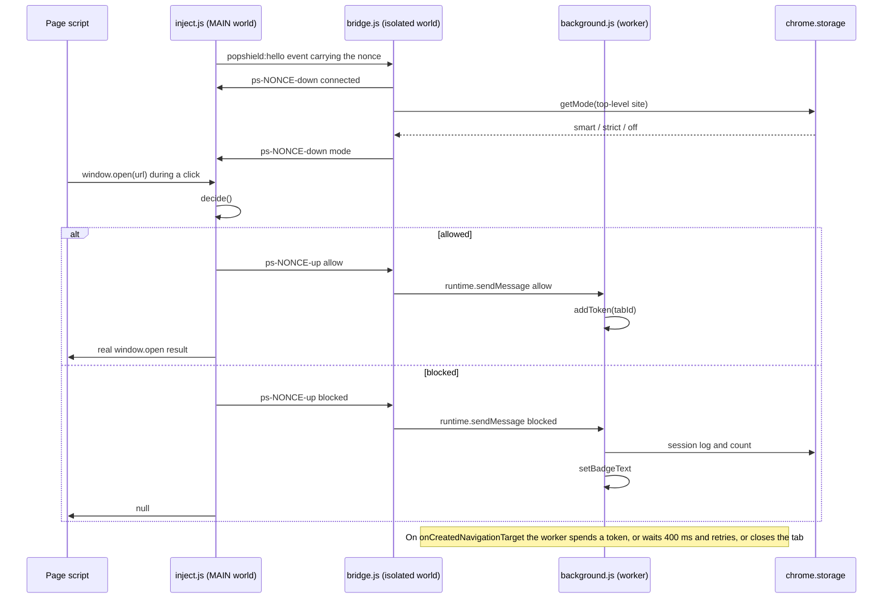
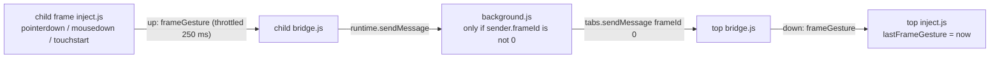
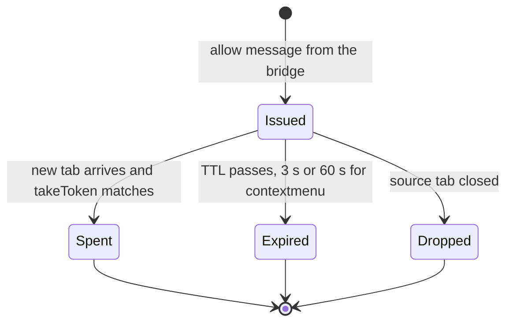

# PopShield architecture

A concise technical reference for maintainers. For a gentle introduction see
[LEARN.md](LEARN.md); for contribution rules see [../AGENTS.md](../AGENTS.md) and
[../CONTRIBUTING.md](../CONTRIBUTING.md).

- [Components](#components)
- [Message flow](#message-flow)
- [Verdict algorithm](#verdict-algorithm)
- [Hooks and guards](#hooks-and-guards)
- [Token lifecycle](#token-lifecycle)
- [Storage schema](#storage-schema)
- [Block log vocabulary](#block-log-vocabulary)
- [Threat model](#threat-model)
- [Known limitations](#known-limitations)
- [Design decisions](#design-decisions)

## Components

| Component | World / context | Runs where | Responsibility |
|---|---|---|---|
| `src/inject.js` | Content script, `world: "MAIN"` | every frame, `document_start`, `match_origin_as_fallback` | Gesture tracking, verdict, API hooks, overlay/ad-layer/ad-box detection, framework and async attribution, tab-under, Navigation API guard, `beforeunload` guard |
| `src/common.js` | Shared (`PS` global) | isolated world, worker (`importScripts`), popup | `siteOf`, `siteOfUrl`, settings read/write |
| `src/bridge.js` | Content script, isolated world | every frame, `document_start` | Nonce handshake with `inject.js`, mode lookup for the top-level site, message relay |
| `src/background.js` | Service worker | once per profile | Allow tokens, new-tab backstop, block log, badge, frame-gesture relay |
| `src/popup.*` | Extension page | toolbar popup | Per-site mode, default mode, blocked list, Open button |

Permissions: `storage`, `webNavigation`, host `<all_urls>` (needed to inject at
`document_start` into every frame). Minimum Chrome 111 (MAIN-world content
scripts declared in the manifest).

## Message flow



Frame-gesture relay (cross-site player iframe -> top frame):



## Verdict algorithm

State in `inject.js`: `curEvent` (last trusted gesture event, never cleared;
`eventPhase === 0` once its dispatch is over), `lastAct`, `frameworkDepth`,
`lastNewOpen`, `lastFrameGesture`, `mode` (defaults to `smart` until the bridge
reports).

```text
ACTIVATING = click auxclick dblclick mouseup pointerup touchend keydown keyup submit

verdict():
  e = curEvent
  if e is null or e.eventPhase == 0          -> 'no-gesture'
  if e.type not in ACTIVATING                -> 'non-activating-event'
  if e.currentTarget in {window, document, <html>, <body>, null}
     and frameworkDepth == 0                 -> 'page-wide-listener'
  t = composedPath(e)[0]
  if isOverlay(t)                            -> 'invisible-overlay'
  if isAdLayer(t)                            -> 'ad-layer'
  return 'ok'

asyncOrigin():                       # "opened after await in an element handler"
  require navigator.userActivation.isActive
  require lastAct exists, not on overlay/ad-layer, < 5000 ms old
  stack = new Error().stack (stackTraceLimit 50), drop chrome-extension:// frames
          except __popshieldFramework__
  if stack has 'at [async] HTMLDocument|Document|Window|HTMLHtmlElement|HTMLBodyElement.' -> false
  return stack has 'at [async] (HTML|SVG)*Element.' or '__popshieldFramework__'

decide():
  if mode == 'strict'                        -> 'strict-mode'
  v = verdict()
  if v == 'no-gesture' and asyncOrigin()     -> 'ok'
  return v

window.open(url, target):
  if mode == 'off' or target does not open a new browsing context -> real open
  v = decide()
  if v == 'ok' and url is this same page (ignoring #hash)          -> 'tab-under'
  if v == 'ok': lastNewOpen = now, send allow, return real open
  send blocked {kind: popup, reason: v}, return null
```

Detectors:

- `isOverlay(el)`: element (not html/body/img/video/canvas/iframe/svg) covering
  >= 35% of the viewport, no text, no media descendants, `position` fixed or
  absolute, and `opacity < 0.15` or a fully transparent background with no image.
- `isAdLayer(el)`: click target not inside an interactive element
  (`a[href]`, `button`, inputs, `[role=button]`, `[onclick]`...); the target or one
  of its 3 nearest ancestors is fixed/absolute, `z-index >= 2147480000`, and covers
  >= 25% of the viewport.
- `inAdBoxFrame()`: this frame is `about:` / `data:`, same-origin with its parent,
  and its `<iframe>` element is `position: fixed` at `z-index >= 2147480000`.
- `isDeadHref(a)`: `href` empty, starting with `#`, `javascript:`, or the same page.

Framework attribution (`attributeFrameworks`, on every trusted activating event,
in the capture listener before page code runs): for each element in the
composed path, wrap `__reactProps$*` / `__reactEventHandlers$*` props
(`onClick`, `onClickCapture`, `onAuxClick`, `onDoubleClick`, `onMouseUp`,
`onPointerUp`, `onTouchEnd`, `onKeyDown`, `onKeyUp`) and jQuery delegated
`handleObj.handler` entries on document/html/body whose selector contains `.`,
`#` or `[` and matches an element in the path. The wrapper bumps
`frameworkDepth`, and if the handler returns a promise, awaits it inside
`__popshieldFramework__` so later async frames carry the marker. Wrappers are
restored by a `setTimeout(0)`. Frozen props (React dev builds) are skipped.

## Hooks and guards

| Hook / guard | Installed on | Blocks (kind) |
|---|---|---|
| Capture listeners for 12 gesture types | `window` (each frame) | sets `curEvent`; overlay / ad-box link clicks are swallowed (`overlay-link`); sends `allow` for real `_blank`/modifier link clicks and context-menu on links |
| `submit` capture listener | `window` | `_blank` form submits not caused by the user's click/Enter on that form (`scripted-form`) |
| `window.open` (non-configurable getter) | every patched realm | `popup` |
| `HTMLElement.prototype.click` | every patched realm | `_blank` link `click()` without intent (`scripted-link`); skips `download` links |
| `EventTarget.prototype.dispatchEvent` | every patched realm | synthetic `click` on/inside a `_blank` link (`scripted-link`) |
| `HTMLFormElement.prototype.submit` / `requestSubmit` | every patched realm | `_blank` form submits (`scripted-form`) |
| `contentWindow` / `contentDocument` getters on iframe/frame/object | every patched realm | patches the child realm before the caller gets it |
| Navigation API `navigate` listener | top frame | cross-site redirects (`redirect`) |
| `beforeunload` listener + `blur` tracker | top frame | cross-site iframe `top.location` hijack (`redirect` / `embedded-frame`, "Leave site?") |
| `webNavigation.onCreatedNavigationTarget` | background | un-tokened new tabs (`new-tab` / `no-user-intent`) |

Navigation guard (top frame, `navigation.navigate`): ignore if mode `off`,
`userInitiated`, not cancelable, `traverse`/`reload`, hash change, download,
same-site destination, or `navigator.userActivation.isActive` is false.
Strict: block unless `verdict() == 'ok'` or (`no-gesture` and `asyncOrigin()`).
Smart: block if verdict is `page-wide-listener`, `invisible-overlay` or
`ad-layer`; or `no-gesture` while a child iframe was clicked in the last 1.5 s
(`frameJustClicked()`); or a script-opened new tab was allowed less than 2 s ago
(tab-under).

`beforeunload` guard (top frame): mode not `off`, `document.activeElement` is a
cross-site `<iframe>`/`<frame>`, `frameJustClicked()`, and no top-frame event is
being dispatched -> `preventDefault()` so Chrome asks "Leave site?".

## Token lifecycle



- `tokens: Map<tabId, [{ exp, sameSiteOnly }]>` lives in worker memory only.
- `takeToken(tabId, url, srcSite)` consumes the first unexpired token that is
  not `sameSiteOnly`, or is `sameSiteOnly` and the new tab's site equals the
  source tab's site.
- `sameSiteOnly` is set when the user clicked a dead-href link (`#`,
  `javascript:`, same page): ad scripts swap such decoy links to an ad URL during
  the click.
- A new tab with no usable token: wait `GRACE` (400 ms) for a late allow message,
  try again, then `chrome.tabs.remove` and log `new-tab` / `no-user-intent`.
- The backstop is skipped when the source tab is not http(s) or its site is `off`.

## Storage schema

`chrome.storage.local` (persistent, user settings):

```js
{
  defaultMode: 'smart' | 'strict' | 'off',   // default 'smart'
  sites: { [site: string]: 'smart' | 'strict' | 'off' }  // per-site overrides
}
```

`site` is the registrable domain from `PS.siteOf` (last two labels, or three for
a short list of multi-part suffixes such as `co.uk`; IPs and hosts with `:` as is).
Choosing the default mode in the popup deletes the override.

`chrome.storage.session` (cleared when the browser closes):

```js
{
  'log:<tabId>': [ { kind, reason, url, frameUrl, source?, time } ],  // newest first, max 50
  'count:<tabId>': number  // total blocks on this page; badge text (999+ cap)
}
```

Both keys are removed on a top-frame `onCommitted` that is not a reload, and when
the tab closes. Writes are serialised through `logChain`.

## Block log vocabulary

Kinds: `popup`, `new-tab`, `overlay-link`, `scripted-link`, `scripted-form`,
`redirect`. Reasons: `page-wide-listener`, `invisible-overlay`, `ad-layer`,
`ad-box-frame`, `no-gesture`, `non-activating-event`, `strict-mode`,
`tab-under`, `embedded-frame`, `no-user-intent`. Labels live in `KINDS` and
`REASONS` in `src/popup.js`.

## Threat model

In scope: ad and popunder scripts running in the page or in its frames, which
can install listeners anywhere, create overlays and iframes, call any DOM API,
swap `href`s mid-click, and navigate the top window.

Assumptions and boundaries:

- `inject.js` runs before page scripts (`document_start`) and captures originals
  then. A page cannot replace `window.open` afterwards (non-configurable getter).
- `event.isTrusted`, `navigator.userActivation` and browser-provided
  `webNavigation` / `sender` data are trusted. Everything the page can write
  (DOM attributes, React props, `jQuery._data`, event details) is not.
- MAIN-world code is visible to the page. The nonce keeps page scripts from
  casually talking to the bridge, but it is not a hard boundary: a page that
  subverts PopShield in its own tab can at worst disable protection for itself
  (e.g. spoof allow tokens or log entries for that tab). It cannot read storage,
  change settings for other sites, or reach other tabs. The bridge only forwards
  `allow`, `blocked` and `frameGesture`, and the worker only relays
  `frameGesture` from non-zero frames to frame 0.
- Anything the hooks miss (unhooked realm, cross-origin frame, new API) is caught
  for new tabs by the backstop. Same-tab redirects have no backstop.

## Known limitations

- **Ads disguised as real links.** A plain `<a href=ad target=_blank>` styled as
  the site's own button (e.g. a fake "Direct Download") is a real click on a real
  link, so it is allowed by design. Use a list-based blocker alongside.
- **`setTimeout` / `.then()` opens** from an element handler carry no receiver in
  the async stack, so Smart blocks them (only `await` is attributed). Workaround:
  **Open** in the popup, or set the site to Off.
- **Other document-level delegation frameworks** (only React and jQuery are
  recognised) are treated like page-wide hooks.
- **Cross-site iframe top-navigation** (`top.location = ad`) fires no Navigation
  API event in the top frame, so it cannot be cancelled silently; PopShield holds
  the page and Chrome shows "Leave site?". Only within 1.5 s of a click inside
  the frame; reloads and typed URLs are not interrupted.
- **Ad networks keep changing.** The backstop catches most new ways to open
  tabs, but same-tab redirects rely on the Navigation API guard.
- Tokens are in worker memory; if the worker were restarted between an allow
  message and the new tab, that tab would be closed (the allow message itself
  wakes the worker, so this is unlikely in practice).

## Design decisions

| Decision | Rationale |
|---|---|
| Judge **where** the click was handled (`currentTarget`), not just whether there was one | Chrome already blocks gesture-less popups; the remaining ads ride on real clicks via page-wide listeners |
| Run in the MAIN world at `document_start` in all frames | Only the page's own realm can wrap `window.open` before ad scripts copy it; `match_origin_as_fallback` covers `about:blank` / `srcdoc` ad frames |
| Separate isolated-world bridge | MAIN-world scripts have no `chrome.*` APIs; keeps storage and messaging out of page reach |
| Nonce'd `CustomEvent` channel with JSON strings | Works across worlds on the shared DOM; strings avoid cross-world object quirks |
| Background backstop with tokens | Defence in depth: any open the hooks don't see still needs a matching intent signal |
| `sameSiteOnly` tokens for dead-href links | Lets "open this page in a new tab" `#` links work while defeating mid-click `href` swaps |
| Only activating events count (click, mouseup, pointerup, touchend, keys, submit) | Popunders hooked on `mousedown`/`pointerdown` fire before the user has finished a click on anything; legit openers use click-like events |
| Framework attribution instead of allowing `document` listeners | Keeps React 16 / jQuery delegation working without whitelisting the exact pattern ad scripts use; catch-all selectors are excluded |
| Async attribution via V8 async stack traces | Allows `await fetch(); window.open()` from a button without allowing timers or page-wide hooks; no instrumentation of promises needed |
| Ad-layer rule requires a non-interactive hit | Max-z-index consent modals and banners are common and legitimate |
| `beforeunload` prompt for frame hijacks | No silent cancel is possible; a prompt is better than losing the page, and it is limited to 1.5 s after a frame click |
| Mode follows the top-level site | Users think in terms of the page they visit; a player iframe inherits the page's setting |
| Fail open in detectors, fail closed in the backstop | Breaking real sites is worse than missing one ad; the backstop still guards new tabs |
| Plain JS, no build, no network | Auditable: the code in the repo is the code that runs, and nothing leaves the browser |
