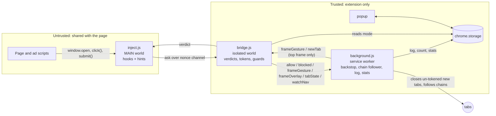
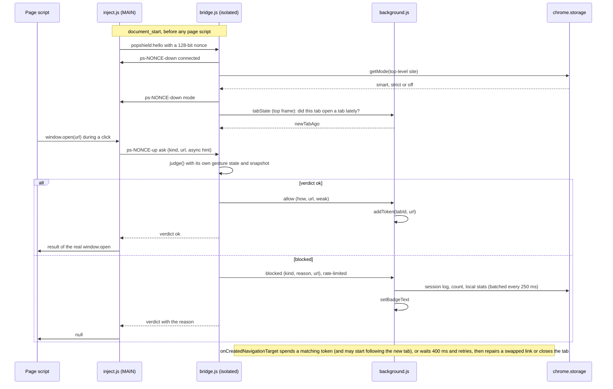
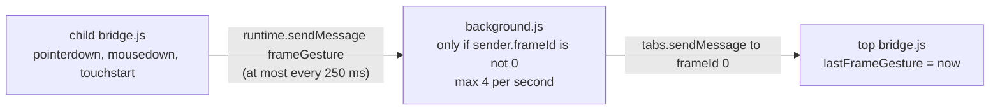
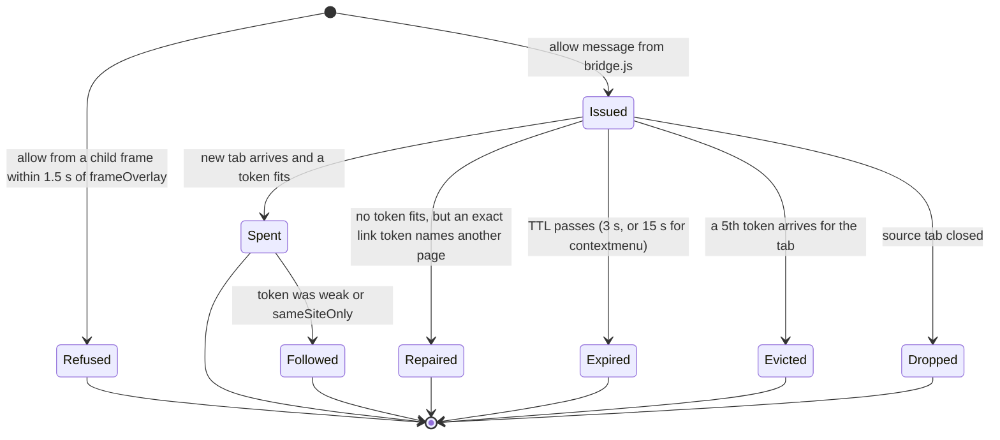

# PopShield architecture

A concise technical reference for maintainers. For a gentle introduction see
[LEARN.md](LEARN.md); for contribution rules see [../AGENTS.md](../AGENTS.md) and
[../CONTRIBUTING.md](../CONTRIBUTING.md). The code in [`src/`](../src) is the
source of truth; if this file disagrees with it, the code wins.

- [Components](#components)
- [Trust boundaries](#trust-boundaries)
- [Message flow](#message-flow)
- [Verdict algorithm](#verdict-algorithm)
- [Hooks and guards](#hooks-and-guards)
- [Token lifecycle](#token-lifecycle)
- [Following redirect chains](#following-redirect-chains)
- [Storage schema](#storage-schema)
- [Block log vocabulary](#block-log-vocabulary)
- [Threat model](#threat-model)
- [Known limitations](#known-limitations)
- [Design decisions](#design-decisions)

## Components

| Component | World / context | Runs where | Responsibility |
|---|---|---|---|
| `src/inject.js` | Content script, `world: "MAIN"` | every frame, `document_start`, `match_origin_as_fallback` | **Hooks only.** Wraps the APIs that open tabs (`window.open`, `HTMLElement.prototype.click`, `EventTarget.prototype.dispatchEvent` for clicks on HTML and SVG links, `HTMLFormElement.prototype.submit`, `documentPictureInPicture.requestWindow`) in its own realm and in same-origin child realms, and synchronously **asks the bridge** for a verdict. Supplies two hints: framework attribution and async origin. Decides nothing. |
| `src/bridge.js` | Content script, isolated world | every frame, `document_start`, `match_origin_as_fallback` | **The decision maker.** Watches trusted gestures with clean APIs, snapshots the page's geometry when each gesture starts, judges every ask, mints every allow token (bound to a URL), blocks overlay / ad-box link clicks, judges native `_blank` form submits, and in the top frame runs the Navigation API redirect guard and the `beforeunload` embedded-frame guard. Writes the block log (rate-limited) through the background. |
| `src/common.js` | Shared (`PS` global) | isolated world, worker (`importScripts`), popup | `siteOf`, `siteOfUrl`, settings read/write (`getSettings`, `getMode`, `setSiteMode`, `setDefaultMode`), the sign-in/payment provider list `PROVIDERS` and `looksLikeAuthOrPay(url)` |
| `src/background.js` | Service worker | once per profile | Trusts only bridge messages. Allow tokens (TTL, cap, URL binding, exact-page binding for link clicks), the new-tab **backstop** (including link-swap repair), the **redirect-chain follower**, the per-tab "opened a tab at" memory for tab-under detection, per-tab block log and badge, local lifetime stats, frame-gesture relay, `frameOverlay`, welcome page on first install |
| `src/popup.*` | Extension page | toolbar popup | Lifetime counter and 14-day sparkline, Reset stats, per-site mode, default mode, blocked list with **Open**, Report buttons, Feedback link |
| `src/welcome.html` | Extension page | opened once, on first install | Static introduction: what is blocked, modes, privacy |

Permissions: `storage`, `webNavigation`, host `<all_urls>` (needed to inject at
`document_start` into every frame). `chrome.dom.openOrClosedShadowRoot`, used
by the bridge, needs no permission; neither do the `chrome.tabs` calls the
worker makes (`get`, `remove`, `create`, `goBack`, `sendMessage`).
`minimum_chrome_version` is `119`.

## Trust boundaries



| Boundary | What crosses it | What the receiver checks |
|---|---|---|
| Page -> `inject.js` | calls to hooked APIs | nothing is trusted; `inject.js` uses built-ins captured before any page script ran |
| `inject.js` -> `bridge.js` | `ask` (kind, URL, async hint) and `fw` (framework depth) over `ps-<nonce>-up` | the kind must be one of `popup`, `scripted-link`, `scripted-form`; the bridge re-derives the gesture itself from its own listener and treats both hints as untrusted input that can only *relax* a check in narrow, bounded ways, and marks the resulting token `weak` |
| `bridge.js` -> `background.js` | `allow`, `blocked`, `frameGesture`, `frameOverlay`, `tabState`, `watchNav` via `chrome.runtime.sendMessage` | `sender.id` is PopShield, `sender.tab` exists; `how`, `kind` and `reason` are whitelisted; per-tab rate limits; `frameUrl` comes from `sender.url`, not the message; `tabState`, `watchNav` and `frameOverlay` are honoured only from `frameId` 0, `frameGesture` only from other frames |
| `background.js` -> top frame | `frameGesture` relay, `newTab` notice | sent only to `frameId: 0` of the same tab |

The page's MAIN world cannot call `chrome.runtime.sendMessage`, so only
PopShield's isolated-world scripts can talk to the worker. That is why moving
the decision and token minting into `bridge.js` matters: the worker's inputs
now come only from code the page cannot reach.

## Message flow



The ask is synchronous: `inject.js` dispatches a `CustomEvent` on `document`,
the bridge's listener runs inside that dispatch, judges, and dispatches the
answer back before `dispatchEvent` returns. If the bridge never connected, the
ask returns `no-bridge` and the open is refused (fail closed).

Frame-gesture relay (cross-site player iframe -> top frame):



## Verdict algorithm

State in `bridge.js` (per frame): `cur` (the last trusted gesture event; its
`eventPhase` is 0 once dispatch is over), `snap` (the geometry snapshot of the
current physical click), `lastAct` (`{ t, verdict }` of the last trusted
activating gesture), `gestures` (count of activating gestures in this
document), `fwDepth` (from `inject.js`), `lastNewTabAt` (when this tab last
opened a tab), `lastPressAt` (last trusted pointer, touch or key press),
`lastFrameGesture`, `lastTopGesture`, `clickTask` / `enterTask` (the trusted
click / Enter of the current task), `mode` (treated as `smart` until storage
answers).

```text
ACTIVATING = click auxclick dblclick mouseup pointerup touchend keydown keyup

snapshotFor(e):                      # taken in the bridge's capture listener, before page code
  reuse the snapshot if e is the same event, or the same target within 1 s
  (pointerup, mouseup and click of one physical click share one snapshot)
  t      = targetOf(e)               # composedPath()[0], descending into closed shadow roots
  path   = set of every node on e.composedPath()
  big    = non-interactive elements on the path (not html/body) covering >= 40% of the viewport
  target = isOverlay(t) ? 'invisible-overlay' : isAdLayer(t) ? 'ad-layer' : 'ok'

gestureVerdict():
  e = cur
  if e is null or e.eventPhase == 0            -> 'no-gesture'
  if e.type not in ACTIVATING                  -> 'non-activating-event'
  s = snapshotFor(e)
  if fwDepth == 0 and isPageWide(e.currentTarget, s) -> 'page-wide-listener'
  return s.target                              # 'ok', 'invisible-overlay' or 'ad-layer'

activationActive():                    # tracked by the bridge itself
  lastAct exists and is < 5000 ms old    # (navigator.userActivation is not reliable
                                         #  from extension worlds)

asyncAllowed(url):                     # only consulted when inject.js says "async"
  require lastAct exists and is < 5000 ms old
  require lastAct.verdict == 'ok'        # not an overlay or ad layer
  require site(url) == this page's site, or providerFlow(url)

providerFlow(url):
  site(url) in PS.PROVIDERS and PS.looksLikeAuthOrPay(url)
  # path segment such as /oauth, /oauth2, /authorize, /signin, /login, /logon,
  # /checkout..., /pay, /payment, or a client_id / redirect_uri / response_type
  # query parameter; a provider's open redirector does not qualify

judge(url, async):
  if mode == 'off'                             -> 'ok'
  if mode == 'strict'                          -> 'strict-mode'
  v = gestureVerdict()
  if v == 'no-gesture' and async and asyncAllowed(url) -> 'ok'
  return v

handleAsk(kind, url, async):             # kind: popup | scripted-link | scripted-form
  v = judge(url, async)
  if v == 'ok' and kind == 'popup' and url is this same page
     (same origin + path, any ?query or #hash) -> 'tab-under'
  if v == 'ok': send allow(kind, url, weak = fwDepth > 0 or no event in dispatch)
                (no token for Document Picture-in-Picture, which opens no tab)
  else:         send blocked(kind, v, url)
  answer v
```

`inject.js` asks only when the call would open a new browsing context:
`window.open` with a target other than `_self` / `_parent` / `_top` (same-tab
opens fall through to the redirect guard), `click()` or a synthetic `click`
dispatched on or inside a `_blank` link (HTML or SVG, not `download`),
`form.submit()` into a new tab, and every Document Picture-in-Picture
`requestWindow()` (asked as `popup` for `about:blank#picture-in-picture`).

### The two hints from `inject.js`

Both come from the page's world, so the bridge treats them as claims, not
facts, and any token that rests on them is marked `weak` (see
[Following redirect chains](#following-redirect-chains)).

- **Async origin** (`m.async`). `asyncOrigin()` does nothing more than 5 s
  after the last trusted gesture. Otherwise it reads a V8 async stack trace
  (with `stackTraceLimit` 50). It returns `false` if `Error.prepareStackTrace`
  is set (the page reformats stacks) or `stackTraceLimit` is not a writable
  data property, and `false` if any frame is
  `at [async] HTMLDocument|Document|Window|HTMLHtmlElement|HTMLBodyElement.`.
  Skipping PopShield's own frames, it returns `true` only if PopShield's
  `__popshieldFramework__` marker is present, or if the **bottom of the
  synchronous stack** (the last frame that isn't `at async ...`) is
  `at (HTML|SVG)…Element.`. That is what a resumed `await` in an element's
  listener looks like; a timer that calls into an element listener (for
  example by dispatching a fake event from `setTimeout`) leaves the timer's
  callback at the bottom instead.
- **Framework attribution** (`fw` +1 / -1 -> `fwDepth`). On trusted `click`,
  `auxclick`, `dblclick`, `mouseup`, `pointerup`, `touchend` and Enter/Space
  `keydown`/`keyup`, a capturing listener walks the composed path (skipping
  `<html>` and `<body>`) and wraps the handler that belongs to the clicked
  element for the duration of the event:
  - React ≤16 `__reactEventHandlers$*` and React 17+ `__reactProps$*` props
    (`onClick`, `onClickCapture`, `onAuxClick`, `onDoubleClick`, `onMouseUp`,
    `onPointerUp`, `onTouchEnd`, `onKeyDown`, `onKeyUp`), **only if that props
    object was already on the path when the user pressed**. A capturing
    listener on `pointerdown` (and `touchstart`, `keydown`, or a `mousedown`
    with no `pointerdown` in the last second) records every `__react*` object
    on the path before page handlers run; props planted later in the same
    click don't count;
  - Solid's `$$<type>` delegated handler;
  - delegated handlers of a **real** jQuery (`_data`, `fn.jquery` and `expando`
    present) on `document`, `<html>` or `<body>`, only for specific selectors:
    containing `.`, `#` or `[`, no `:not(`, not matching `<body>` or `<html>`,
    and matching at most 50 elements.

  The wrapper posts `fw 1` / `fw -1` around the call; if the handler returns a
  promise, it is awaited inside `__popshieldFramework__` so later async frames
  carry the marker. Wrappers are restored after `setTimeout(0)`; frozen props
  (React dev builds) are skipped. While `fwDepth > 0`, a page-wide
  `currentTarget` does not fail the check.

### Detectors (all in `bridge.js`, all fail open)

- `isPageWide(currentTarget, snap)`: `null`, `window`, a document, a shadow
  root or fragment, `<html>` or `<body>` of any frame -> page-wide. With a
  snapshot: an element that was **not on the event's path** when the gesture
  started (detached or moved since) -> page-wide; an element in the snapshot's
  `big` set -> page-wide; any other element -> not. Without a snapshot: an
  interactive element (`a[href]`, `button`, inputs, `label`, `summary`,
  `[role=button]`, `[role=link]`, `[onclick]`, `[contenteditable]`) -> not;
  otherwise page-wide if it covers **≥ 40% of the viewport**.
- `isOverlay(el)`: not `html`/`body`/`video`/`img`/`canvas`/`svg`; covers
  ≥ 35% of the viewport; and either its **effective opacity** (product of
  `opacity` and `filter: opacity()` up the ancestor chain, 0 if
  `visibility: hidden` or `display: none`) is < 0.2, or `hasVisiblePaint(el)`
  is false. **There is no positioning requirement**: an element stacked on top
  by grid placement, negative margins or a transform is judged like a fixed
  one.
- `hasVisiblePaint(el)`: walks the element's subtree (elements and text, up to
  300 nodes, skipping hidden subtrees) and returns `true` at the first thing
  that paints visibly:
  - non-blank text whose `color` **and** `-webkit-text-fill-color` both have
    alpha ≥ 0.1, with `font-size` ≥ 6px and effective opacity ≥ 0.2;
  - a background colour with alpha ≥ 0.1, or a `background-image` that is a
    `url()` or a gradient with at least one colour stop of alpha ≥ 0.1, on an
    element with effective opacity ≥ 0.2;
  - an `img`, `video`, `canvas`, `svg`, `picture`, `object`, `embed` or
    `iframe` covering ≥ 10% of the element's box with effective opacity ≥ 0.2.

  A subtree larger than 300 nodes is assumed visible.
- `targetOf(e)`: `composedPath()[0]`; if that element hosts a shadow root
  (open or closed, via `chrome.dom.openOrClosedShadowRoot`), the element under
  the pointer inside it, up to 4 levels deep. Overlays hidden inside closed
  shadow roots are measured this way.
- `isAdLayer(el)`: the target is not inside an interactive element, and it or
  one of its 3 nearest ancestors is fixed/absolute with `z-index >= 2147480000`
  and covers ≥ 25% of the viewport.
- `inAdBoxFrame(win)`: a child frame whose `<iframe>` (reachable, so same
  origin) has no `src` or an `about:` / `data:` one, or `srcdoc`, and is
  `position: fixed` at `z-index >= 2147480000`.
- `isDeadHref(a)`: `href` empty, starting with `#`, `javascript:`, or the same
  page (origin + path).
- `clickedLink(e)`: the first link in `composedPath()`; if none, and the target
  hosts a shadow root (open or closed), the link under the pointer inside it.

### `PS.PROVIDERS`

Sign-in and payment providers, by registrable domain, in `src/common.js`:
`google.com`, `apple.com`, `microsoftonline.com`, `live.com`, `microsoft.com`,
`github.com`, `gitlab.com`, `facebook.com`, `x.com`, `twitter.com`,
`linkedin.com`, `paypal.com`, `stripe.com`, `razorpay.com`, `auth0.com`,
`okta.com`, `amazon.com`, `yahoo.com`, `discord.com`, `slack.com`, `zoom.us`,
`dropbox.com`, `atlassian.com`. A URL on one of them is exempt only when
`PS.looksLikeAuthOrPay(url)` also holds. Used for opens after `await`, for the
redirect guard (an auth/pay URL is never a hijack), and by the worker's
redirect-chain follower.

## Hooks and guards

| Hook / guard | Lives in | Installed on | Blocks (kind) |
|---|---|---|---|
| `window.open` (non-configurable getter) | `inject.js` | every patched realm | `popup` |
| `HTMLElement.prototype.click` | `inject.js` | every patched realm | `click()` on a `_blank` link, not `download` (`scripted-link`) |
| `EventTarget.prototype.dispatchEvent` | `inject.js` | every patched realm | synthetic `click` on or inside a `_blank` HTML or SVG link (`scripted-link`) |
| `HTMLFormElement.prototype.submit` | `inject.js` | every patched realm | `submit()` into a new tab (`scripted-form`) |
| `documentPictureInPicture.requestWindow` | `inject.js` | every patched realm | always-on-top PiP windows (`popup`, rejected with `NotAllowedError`) |
| `contentWindow` / `contentDocument` getters on iframe/frame/object | `inject.js` | every patched realm | patch the child realm before the caller gets it |
| `document.open` / `write` / `writeln` | `inject.js` | every patched realm | re-arm attribution listeners and the channel after a rewrite (the bridge re-arms its own listeners from a `MutationObserver`) |
| Press snapshot listeners (`pointerdown`, `mousedown`, `touchstart`, `keydown`) | `inject.js` | `window` of each realm | record which React props objects existed at the press |
| Gesture capture listeners (12 types) | `bridge.js` | `window` of each frame | record `cur`, `lastAct`, `lastPressAt`, the geometry snapshot, `clickTask` / `enterTask`; swallow clicks on overlay links and decoy links in ad boxes (`overlay-link`); mint `user-link` / `contextmenu` tokens |
| `submit` capture listener | `bridge.js` | `window` of each frame | `_blank` submits not caused by the user's own click / Enter in the same task (`scripted-form`); `requestSubmit()` and submit-button `click()` land here |
| Navigation API `navigate` listener | `bridge.js` | top frame | cross-site redirects (`redirect`); suspicious same-site ones are handed to the worker to follow |
| `blur` + `beforeunload` listeners | `bridge.js` | top frame | cross-site iframe `top.location` hijack (`redirect` / `embedded-frame`, "Leave site?"); `frameOverlay` for near-invisible frames |
| `webNavigation.onCreatedNavigationTarget` | `background.js` | worker | un-tokened new tabs (`new-tab` / `no-user-intent`), swapped link targets (`new-tab` / `link-swapped`) |
| `webNavigation.onCommitted` | `background.js` | worker | followed tabs that land on an unrelated site (`new-tab` or `redirect` / `redirect-chain`) |

### Link clicks and tokens (bridge `onGesture`)

On trusted `click`, `auxclick` and `contextmenu`, with `a = clickedLink(e)` and
`modifier` = ctrl / meta / shift / middle button:

1. `a` is an overlay, or a dead-href link inside an ad-box frame (not on
   `contextmenu`): `preventDefault()` + `stopImmediatePropagation()`, log
   `overlay-link` / `invisible-overlay` or `ad-box-frame`. No token.
2. `contextmenu` on a real, non-decoy, non-overlay link: `contextmenu` token
   bound to the link's URL ("Open link in new tab" may come a few seconds later).
3. A link clicked with a modifier or with a new-tab target: `user-link` token
   bound to the link's URL, `sameSiteOnly` if the href is dead (a decoy whose
   `href` the ad script swaps during the click).
4. A modifier click with no link visible to PopShield: `user-link` token with no
   URL, `sameSiteOnly`.

`user-link` and `contextmenu` tokens with a URL are **exact**: the new tab must
open at the same origin and path (the query may differ). See
[Token lifecycle](#token-lifecycle) for what happens when it doesn't.

### Native form-submit guard

A `submit` event is trusted even when a script caused it, so the bridge judges
it by its cause. If a gesture is still being dispatched (the submit came from
inside a handler, for example `requestSubmit()`), `judge()` applies. Otherwise
the submit is the browser's own default action, and it counts as the user's
only when it happens **in the same task** as:

- a trusted `click` whose target is inside the form's submitter, whose
  snapshot verdict was `ok` (not an overlay or ad layer), on a submitter that
  is not itself an overlay; or
- a trusted Enter `keydown` inside that form.

The bridge clears `clickTask` / `enterTask` with `setTimeout(0)`, so a page
timer that submits later finds nothing. Anything else is `no-gesture` (or
`strict-mode` in Strict). A user's own submit is allowed in Strict too.

### Redirect guard (top frame, `navigation.navigate`)

```text
ignore if: mode off, e.userInitiated, not cancelable, traverse, reload,
           hash change, download, destination not http(s)

redirectReason(dest):
  if providerFlow(dest)                                   -> none
  if now - lastNewTabAt < 60 s and lastPressAt < lastNewTabAt + 0.5 s
                                                          -> 'tab-under'
  if gestures == 0 and window.opener                      -> 'popup-hijack'
  if mode == 'strict' and gestures > 0 and nothing in dispatch
                                                          -> 'strict-mode'
  if not activationActive()                               -> none (on-load, SSO, Smart's
                                                             delayed redirects)
  v = gestureVerdict()
  v == 'ok'                                               -> none
  v == 'no-gesture':  frameJustClicked() ? 'embedded-frame' : 'no-gesture'
  otherwise                                               -> v (page-wide-listener,
                                                             non-activating-event,
                                                             invisible-overlay, ad-layer)

if there is a reason:
  destination on this page's site -> let it go, send watchNav (the worker follows it)
  otherwise                       -> preventDefault(), log redirect / reason
```

`lastNewTabAt` is set when the bridge mints any token, when the worker reports
`newTab` (a token was spent on a tab opened from any frame of this tab), and at
startup from the worker's answer to `tabState` (the worker keeps "this tab
opened a tab at" per tab, for 60 s of relevance), so a hop to another page of
the same site doesn't reset it.

`frameJustClicked()`: the last click inside a child frame was < 6 s ago, no
activating gesture happened in the top frame since, **and** the top document
still has focus (`document.hasFocus()`: reloading or typing a URL moves focus
to Chrome's toolbar, an ad hijacking from inside the player does not).

**Smart and Strict.** The only rule that differs is the Strict line above.
Smart lets a script redirect to another site once the 5 s activation window
after the last click has passed, so that payment pages handing off to a bank
after a wait keep working. That is an accepted trade-off: an ad script that
waits it out gets through in Smart (`rt-delayed-redirect`, a `knownBypass` in
the test suite). Strict blocks every script-driven cross-site redirect once the
user has interacted with the document, except auth/pay URLs and redirects made
by an element-scoped handler while the click is still being dispatched.

### Embedded-frame guard (top frame, `beforeunload`)

A cross-site iframe doing `top.location = ad` fires no `navigate` event in the
top frame. On `beforeunload`, if mode is not `off`, `frameJustClicked()` holds,
no top-frame event is being dispatched, and the page contains a cross-site
`<iframe>` / `<frame>`, PopShield calls `preventDefault()` so Chrome asks
"Leave site?", and logs `redirect` / `embedded-frame`.

Timing comes from two sources: the top frame's `blur` when focus moves into an
iframe, and the `frameGesture` relay for later clicks inside the same frame. On
`blur`, if the focused iframe's effective opacity is < 0.5, whatever its size,
the top bridge sends `frameOverlay`, and the worker refuses tokens from child
frames of that tab for 1.5 s: a frame you can barely see that receives a click
is an overlay.

## Token lifecycle



- Only `bridge.js` mints tokens. The worker accepts `allow` only with a
  whitelisted `how` (`popup`, `scripted-link`, `scripted-form`, `user-link`,
  `user-form`, `contextmenu`), at most 12 per 10 s per tab (the bridge also
  stops sending after 12 per 10 s per frame, so a retry loop doesn't flood
  the worker).
- `tokens: Map<tabId, [{ exp, url, sameSiteOnly, frameId, weak, exact }]>`
  lives in worker memory only; at most 4 per tab (oldest dropped). `exact` is
  set for `user-link` and `contextmenu`.
- `tokenFits(t, url, srcSite)`:
  - `sameSiteOnly` tokens fit only a new tab on the source tab's site;
  - a token with no URL fits any (other) tab;
  - an `about:blank` token fits only an `about:blank` tab, and an `about:blank`
    tab needs an `about:blank` token;
  - an `exact` token fits only a tab at the same origin and path;
  - otherwise the new tab's site must equal the token URL's site (registrable
    domain, `PS.siteOfUrl`).
- A token is spent: the worker records `newTabAt[sourceTab] = now` and sends
  `newTab` to the source tab's top frame (tab-under detection). If the token
  was `weak` or `sameSiteOnly`, the new tab is followed for 8 s (next section).
- No fitting token: wait `GRACE` (400 ms) for a late `allow`, try again. Still
  none: if an unexpired, exact, not-`sameSiteOnly` `http(s)` link token names a
  **different** address, a script swapped the link during the click. The worker
  closes the new tab, opens the token's address in its place (same index, same
  focus, same opener) and logs `new-tab` / `link-swapped`. Otherwise it closes
  the tab and logs `new-tab` / `no-user-intent`.
- The backstop is skipped for source tabs on `chrome:`, `chrome-extension:`,
  `devtools:`, `edge:`, `chrome-untrusted:` and `view-source:` pages, and for
  sites in `off` mode. It stays **on** for `blob:` (judged by the inner origin),
  `about:`, `data:` and `file:` source tabs (default mode).

## Following redirect chains

A token, or a same-site navigation, vouches only for the **first** address. A
same-site redirector (`/out?to=...`) or a forged hint can still bounce the tab
on to an ad. So when the decision rested on weaker evidence, the worker
watches where the tab actually lands, using `webNavigation.onCommitted` in the
top frame, for `WATCH_MS` = 8 s:

| Watch | Started when | Allowed landing sites | On an unrelated landing |
|---|---|---|---|
| `tabWatch` (new tab) | a `weak` token (framework or async hint) or a `sameSiteOnly` token (decoy link, link-less modifier click) was spent | the source tab's site, the token URL's site | close the new tab; log `new-tab` / `redirect-chain` on the source tab |
| `navWatch` (this tab) | the bridge let a suspicious same-site navigation through (`watchNav`) | this page's site; the watch is renewed while the tab stays on it | `tabs.goBack()`; log `redirect` / `redirect-chain`, keeping the tab's log |

A landing on a sign-in or payment page (`PS.PROVIDERS` + `looksLikeAuthOrPay`)
is always fine, and so is a non-http(s) one (`about:blank`, `data:`), which
says nothing yet.

## Storage schema

`chrome.storage.local` (persistent, this device only, never synced):

```js
{
  defaultMode: 'smart' | 'strict' | 'off',              // default 'smart'
  sites: { [site: string]: 'smart' | 'strict' | 'off' }, // per-site mode overrides
  stats: {
    total: number,                  // blocks since `since`
    since: number,                  // ms epoch: first install or last "Reset stats"
    days: { 'YYYY-MM-DD': number }, // local-date counts, last 30 days kept
    kinds: { [kind: string]: number } // counts per block kind
  }
}
```

- `sites` holds only the **mode overrides the user chose** in the popup (e.g.
  `example.com: 'strict'`). It is not visit history: a site appears there only
  if the user set a mode for it, and choosing the default mode again deletes it.
- `stats` is an anonymous counter. It never contains a site, URL or page
  address; `bumpStatsMany()` even deletes a stray `sites` field if one exists.
- `site` is the registrable domain from `PS.siteOf` (last two labels, or three
  for a short list of multi-part suffixes such as `co.uk`; IPs and hosts with
  `:` as is).

`chrome.storage.session` (memory only, cleared when the browser exits):

```js
{
  'log:<tabId>': [ { kind, reason, url, frameUrl, source?, time } ], // newest first, max 50
  'count:<tabId>': number  // blocks on this page; badge text (999+ cap)
}
```

- `frameUrl` is `sender.url` reduced to origin + path. `url` is the blocked
  address (max 2000 chars); `source` is an overlay link's text (max 120 chars).
- Both keys are removed on a top-frame `onCommitted` that is not a reload
  (except when the worker itself sent the tab back), and when the tab closes.
- Blocks are buffered and flushed every 250 ms in one batch (one session
  read/write, one badge update per tab, one stats write), serialised through
  `logChain`; at most about 100 items wait at once.
- Rate limits: the bridge logs each distinct block at most once per 5 s and at
  most 20 per 10 s per frame; the worker accepts at most 30 `blocked` messages
  per 10 s per tab.

Worker memory (never stored, dropped when the tab closes or the worker stops):
`tokens` (URLs, seconds), `tabWatch` / `navWatch` (site names, 8 s),
`newTabAt` (a timestamp per tab), `frameOverlayAt` (a timestamp per tab),
`restoring` (tab ids), rate-limit buckets.

## Block log vocabulary

Kinds (whitelisted in `background.js`): `popup`, `new-tab`, `overlay-link`,
`scripted-link`, `scripted-form`, `redirect`.

Reasons: `page-wide-listener`, `invisible-overlay`, `ad-layer`,
`ad-box-frame`, `no-gesture`, `non-activating-event`, `strict-mode`,
`no-user-intent`, `embedded-frame`, `tab-under`, `popup-hijack`,
`redirect-chain`, `link-swapped`.

Labels live in `KINDS` and `REASONS` in `src/popup.js`. A new kind or reason
must be added to both whitelists (`background.js`) and labels (`popup.js`).

## Threat model

**Attacker:** ad and popunder scripts running in the page or in its frames.
They can install listeners anywhere, create overlays and iframes, call any DOM
API, swap `href`s mid-click, change the page between press and click, navigate
the top window, chain redirects through same-site pages, and **poison any
built-in in the MAIN world** (`Function.prototype.call`, `JSON.parse`,
`EventTarget.prototype.dispatchEvent`, `Error.prepareStackTrace`, getters on
`Event.prototype`, ...). They may also know PopShield's source.

**What is trusted:** the isolated world (`bridge.js`) and its built-ins,
`event.isTrusted` and the gesture state and snapshots the bridge records from
trusted events, the Navigation API's `userInitiated`, and browser-provided data
in the worker (`sender.id`, `sender.tab`, `sender.frameId`, `sender.url`,
`webNavigation` events).

**What is not:** anything the page can write: DOM attributes, `href`s, styles
after the press, React/Solid props, `jQuery._data`, stack traces, iframe `src`,
and everything `inject.js` says.

**Design consequences:**

- `inject.js` decides nothing. It captures every built-in it uses before any
  page script runs, so later poisoning doesn't affect it, but the design does
  not rely on that: every decision and every token comes from `bridge.js`.
- The channel nonce is 128 bits from `crypto.getRandomValues`, exchanged once at
  `document_start` and never re-broadcast. `inject.js` answers `popshield:req`
  only until it is connected. A page cannot read the nonce or forge asks.
- **If a page subverts `inject.js`** (for example by finding a way to call the
  real `window.open`), the worst it gets is skipping the early block: the
  resulting tab has no token from the bridge, so the backstop closes it.
- Geometry is judged from a snapshot taken before page code runs for the
  click, so moving, shrinking or removing elements mid-click doesn't help.
- Tokens that rest on hints, and same-site navigations that looked
  suspicious, are followed for 8 s, so a first hop to a harmless address
  can't launder an ad behind it.
- The worker accepts only messages from PopShield's own content scripts,
  whitelists `how`, `kind` and `reason`, rate-limits per tab, takes `frameUrl`
  from `sender.url` (origin + path only), caps and binds tokens, and relays
  `frameGesture` only from non-zero frames to frame 0.
- A page cannot read storage, change settings, reach other tabs, or learn which
  sites the user visits from PopShield.

**Residual risks:**

- **Framework spoofing.** A page can fake React props (`__reactProps$…`), a
  Solid `$$click`, or a real-looking jQuery on the element the user clicks, so
  its handler gets the framework exemption from the page-wide rule. React props
  must already be on the element at the press (planting them in a press handler
  no longer works); Solid and jQuery shapes are not snapshotted. The bridge
  then genuinely approves the open. The token is `weak`, so a redirect chain
  is caught, but an open straight to the ad's address is not.
- **Async hint spoofing** is bounded: even a forged "async" claim only allows
  same-site or provider auth/pay destinations within 5 s of a real, non-overlay
  activating gesture, and the resulting tab is followed.
- **Smart's delayed-redirect window.** A cross-site script redirect more than
  5 s after the last click, with no new tab involved, is allowed in Smart by
  design. Strict blocks it.
- **Same-tab redirects have no backstop.** They rely on the Navigation API and
  `beforeunload` guards in the bridge, plus the worker's chain follower for
  same-site hops.
- Cross-origin frames that PopShield cannot patch from the parent are still
  covered by their own copy of the content scripts (`all_frames`,
  `match_origin_as_fallback`) and by the backstop.

## Known limitations

- **Ads disguised as real links.** A plain `<a href=ad target=_blank>` styled as
  the site's own button, which the user really clicks, is out of scope. Use a
  content blocker alongside.
- **Fake in-page dialogs and ads are not hidden.** PopShield is not a content
  blocker.
- **Opens after `await` to arbitrary third-party sites** are blocked; only
  same-site and provider auth/pay destinations pass. Use **Open** in the popup.
- **`setTimeout` / `.then()` opens** from an element handler leave the timer
  or promise callback at the bottom of the stack and are blocked in Smart.
- **Cross-site script redirects right after a click** (other than to provider
  auth/pay URLs) are blocked, including legitimate timer-driven ones, and so
  are cross-site script redirects within 60 s of the tab opening another tab
  until the user presses something again.
- **Smart allows a patient redirect** (more than 5 s after the last click);
  Strict doesn't. See the redirect guard above.
- **Delegation on a full-page container.** A listener on a wrapper covering
  ≥ 40% of the viewport that opens windows needs a recognised framework (React,
  Solid, jQuery); otherwise it is treated as page-wide.
- **Framework spoofing** aimed at PopShield (see the threat model).
- **Player-iframe hijacks** (`top.location = ad` from a cross-site frame) can't
  be cancelled silently; Chrome shows "Leave site?". Click Cancel to stay.
- **Same-site chain follow-up undoes, it doesn't prevent.** When a followed
  same-site hop lands on an ad, the ad page has already loaded before the tab
  is sent back.
- Tokens are in worker memory; if the worker were restarted between an allow
  message and the new tab, that tab would be closed (the allow message itself
  wakes the worker, so this is unlikely in practice).

## Design decisions

| Decision | Rationale |
|---|---|
| Judge **where** the click was handled (`currentTarget`), not just whether there was one | Chrome already blocks gesture-less popups; the remaining ads ride on real clicks via page-wide listeners |
| **Decide in the isolated world**, hook in the MAIN world | Only the MAIN world can wrap `window.open` for the page, but everything there can be poisoned. The isolated world has clean built-ins, so verdicts and tokens are made there |
| Only `bridge.js` mints tokens | The worker's backstop then enforces bridge approval: subverting `inject.js` gains nothing beyond skipping the early block |
| Capture every built-in up front in `inject.js` | Keeps the hooks themselves reliable against later prototype poisoning |
| Synchronous ask over a nonce'd `CustomEvent` channel with JSON strings | Works across worlds on the shared DOM, inside the page's call; strings avoid cross-world object quirks; the nonce is exchanged before page scripts exist |
| Hints are bounded, not trusted, and their tokens are followed | Async-origin can only allow same-site / provider auth-pay destinations; framework attribution only lifts the page-wide rule; both produce `weak` tokens whose tabs are watched |
| Geometry snapshot at gesture start, shared by one physical click | Page handlers run between pointerup, mouseup and click; measuring later lets them remove the overlay or shrink the wrapper first |
| Overlays judged by **paint**, not by positioning | Ads stack invisible layers with grid, margins and transforms as easily as with `position: fixed`; what matters is that the user can't see them |
| Wrappers ≥ 40% of the viewport count as page-wide; off-path listeners too | Two side-by-side 49% wrappers defeated a 50% rule; a listener element detached or moved before the open can't be element-scoped for this click |
| Script-open tokens bound to a site; link tokens bound to the exact page | A token minted for one link cannot be spent on an ad tab to another site, nor on a same-site redirector swapped in mid-click |
| Repair swapped links instead of only closing the tab | The user did click a real link; closing the ad and opening what they clicked is the least surprising outcome |
| `sameSiteOnly` tokens for dead-href links and link-less modifier clicks | Keeps "open in new tab" working while defeating mid-click `href` swaps |
| Native submits only in the same task as the user's click / Enter | A trusted `submit` can be triggered by script later; the task boundary is something a page timer can't cross |
| Effective opacity up the ancestor chain | Ad overlays hide through a transparent parent or `filter: opacity()` |
| Only activating events count | Popunders hooked on `mousedown` / `pointerdown` fire before the user finished a click on anything |
| Tab-under window: 60 s, ended only by a new press, remembered by the worker | A short timer can be waited out; a per-document flag is erased by a same-site hop |
| Provider exemption only for auth/pay-looking URLs | Providers also run open redirectors that would otherwise launder any destination |
| Smart allows redirects > 5 s after a click; Strict doesn't | Checkout and bank hand-offs redirect after a wait; blocking them in the default mode would break payments, so the strict alternative is one click away |
| `beforeunload` prompt for frame hijacks | No silent cancel is possible; a prompt is better than losing the page, and only within 6 s of a frame click with no top-page click since, while the page has focus |
| Mode follows the top-level site | Users think in terms of the page they visit; a player iframe inherits the page's setting |
| Fail open in detectors, fail closed in the channel and the backstop | Breaking real sites is worse than missing one ad; a missing bridge or a missing token still blocks |
| Anonymous counters only, per-tab log in session storage | Users get a counter without PopShield ever recording which sites they visit |
| Plain JS, no build, no network | Auditable: the code in the repo is the code that runs, and nothing leaves the browser |
