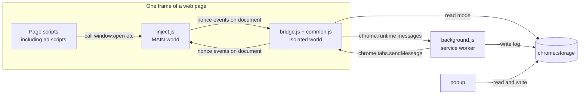
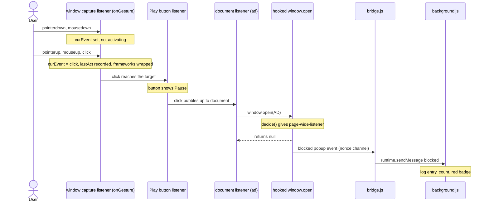
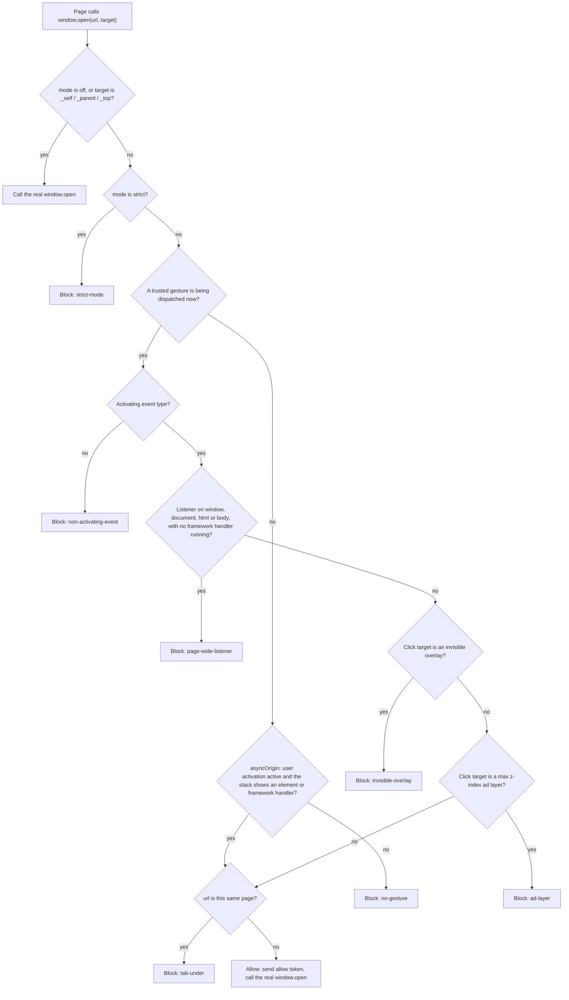
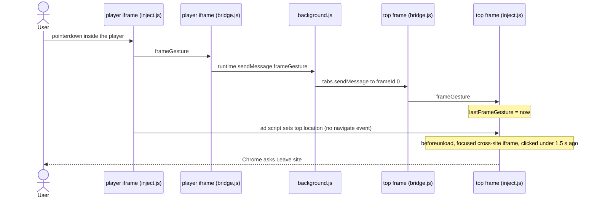

# PopShield from scratch

A beginner-friendly, deep guide to how PopShield works, for curious humans and
for AI agents that have never looked at a browser extension before. No prior
knowledge assumed: we start at "what is a tab?" and end inside the code that
decides whether a new tab is allowed to open.

Every claim here is meant to match the code in [`src/`](../src). If you find a
mismatch, the code wins; please open an issue or a PR fixing this guide.

> **Short on time?** Read [chapter 9](#9-the-big-idea-the-intent-model) (the big
> idea) and [chapter 10](#10-a-guided-tour-one-click-from-press-to-verdict) (one
> click, traced end to end). The maintainer reference is
> [ARCHITECTURE.md](ARCHITECTURE.md); contribution rules are in
> [../AGENTS.md](../AGENTS.md) and [../CONTRIBUTING.md](../CONTRIBUTING.md).

## Table of contents

**Part I: The web, ads and the problem**

1. [Browsers, tabs, windows and popups](#1-browsers-tabs-windows-and-popups)
2. [How ads make money, and the tricks they use](#2-how-ads-make-money-and-the-tricks-they-use)
3. [Why Chrome's built-in popup blocker lets them through](#3-why-chromes-built-in-popup-blocker-lets-them-through)

**Part II: Chrome extensions**

4. [What a Chrome extension is](#4-what-a-chrome-extension-is)
5. [Manifest V3 basics](#5-manifest-v3-basics)
6. [Content scripts: worlds, timing and frames](#6-content-scripts-worlds-timing-and-frames)
7. [The background service worker](#7-the-background-service-worker)
8. [DOM events: the part everything depends on](#8-dom-events-the-part-everything-depends-on)

**Part III: PopShield**

9. [The big idea: the intent model](#9-the-big-idea-the-intent-model)
10. [A guided tour: one click, from press to verdict](#10-a-guided-tour-one-click-from-press-to-verdict)
11. [The protection layers, one attack at a time](#11-the-protection-layers-one-attack-at-a-time)
12. [Talking across worlds: the bridge](#12-talking-across-worlds-the-bridge)
13. [The backstop, tokens, the log and the popup](#13-the-backstop-tokens-the-log-and-the-popup)
14. [Modes: Smart, Strict, Off](#14-modes-smart-strict-off)
15. [Testing philosophy: the baseline proves the attack](#15-testing-philosophy-the-baseline-proves-the-attack)
16. [What PopShield cannot do](#16-what-popshield-cannot-do)

**Part IV: Reference and practice**

17. [Glossary](#17-glossary)
18. [Try it yourself: exercises](#18-try-it-yourself-exercises)
19. [Further reading](#19-further-reading)

---

# Part I: The web, ads and the problem

## 1. Browsers, tabs, windows and popups

A **browser** (Chrome, Edge, Brave...) downloads web pages and runs them. A web
page is three things:

- **HTML**: the structure (`<button>`, `<a href="...">`, `<iframe>`).
- **CSS**: the looks (colours, sizes, positions, which element sits on top).
- **JavaScript (JS)**: code that reacts to what you do and changes the page.

Each **tab** shows one page. A **window** holds one or more tabs. Inside a page
there can be **frames** (`<iframe>`): small pages embedded in a bigger page, each
with its own document and its own JavaScript. A video player on a streaming
site is very often an iframe loaded from a different website.

A page can ask the browser to open something new in three main ways:

```html
<!-- 1. A link with a target: opens a new tab when the user clicks it -->
<a href="https://example.com" target="_blank">Open</a>
```

```js
// 2. JavaScript: open a new tab or popup window
window.open('https://example.com');

// 3. JavaScript: send the *current* tab somewhere else (a "redirect")
location.href = 'https://example.com';
```

A **popup** is a new window or tab the page opened itself. Some are useful
(a "Share on ..." window, a sign-in window, a "View receipt" tab). Many are ads.

Two more words you will need:

- **Origin**: scheme + host + port, e.g. `https://video.example.com:443`.
  Browsers isolate pages of different origins from each other.
- **Site**: roughly the registrable domain, e.g. `example.com` for both
  `www.example.com` and `cdn.example.com`. PopShield compares *sites* (see
  `siteOf` in [`src/common.js`](../src/common.js)), so moving between
  `www.` and `cdn.` of the same site is never treated as a hijack.

## 2. How ads make money, and the tricks they use

Many ad networks pay per **impression** (the ad was shown) or per **click**. A
full-page ad in a fresh tab is shown in its entirety, so a "popunder" or
"new-tab" format pays well. Sites with little other income (free streaming,
link shorteners, file hosts) add these scripts, and the scripts compete to
force as many tabs as they can.

Here are the tricks, each as a tiny piece of attacker code. Every one of these
has a matching scenario in [`test/fixtures/scenario.js`](../test/fixtures/scenario.js).

**Popunder from a page-wide click hook.** The ad listens to *every* click on the
page. You click the video's Play button; the ad opens a tab.

```js
document.addEventListener('click', () => window.open('https://ad.example/'));
```

A *popunder* is the variant that then focuses the original window again, so the
ad hides behind it and you only notice later.

**Mouse-down variant.** Same idea, but fired on `mousedown` / `pointerdown`,
before your click has even finished:

```js
window.addEventListener('mousedown', () => window.open(AD), true);
```

**Invisible overlay.** A transparent link covering the whole page. You think you
are clicking Play; you are clicking the ad.

```html
<a href="https://ad.example/" target="_blank"
   style="position:fixed; inset:0; z-index:99999; background:transparent"></a>
```

**Visible ad layer.** An ad image placed at the maximum `z-index` (so it sits on
top of everything) right over the site's own "Continue" button.

**Scripted link click.** The script creates a hidden `target="_blank"` link and
clicks it from code, or dispatches a fake click event to it:

```js
const a = document.createElement('a');
a.href = AD; a.target = '_blank'; a.click();
// or: a.dispatchEvent(new MouseEvent('click', { bubbles: true }));
```

**Scripted form.** A hidden form with `target="_blank"` submitted from code:

```js
form.submit(); // <form action="https://ad.example/" target="_blank">
```

**Pristine `window.open` from a fresh iframe.** If something has wrapped
`window.open`, create a brand-new iframe and borrow *its* untouched copy:

```js
const f = document.createElement('iframe'); document.body.append(f);
f.contentWindow.open(AD);
```

**Tab-under.** Open *this same page* in a new tab (which gets focus, so you
think nothing happened), then turn the original tab into an ad:

```js
document.addEventListener('click', () => {
  window.open(location.href);
  location.href = AD;
});
```

**Click-hijack redirect.** Simply send the current tab to an ad on click:

```js
document.addEventListener('click', () => { location.href = AD; });
```

**Hijack from a player iframe.** The cross-site video player iframe has its own
ad script that navigates the *whole tab*:

```js
// inside the player iframe
document.addEventListener('click', () => { top.location.href = AD; });
```

**Decoy `#` link.** A visible link with `href="#"` and `target="_blank"`. During
your click, a script swaps the `href` to an ad, so the browser opens the ad.

```js
link.addEventListener('click', (e) => { e.currentTarget.href = AD; });
```

**Ad box frame.** A blank (`about:blank`) iframe pinned over the page at the
maximum `z-index`, filled by the parent with a fake "CONFIRM YOU ARE NOT A
ROBOT" link that opens an ad.

## 3. Why Chrome's built-in popup blocker lets them through

Chrome has a popup blocker. It is built on **user activation**: a page can open
a popup only shortly after the user did something (clicked, pressed a key,
tapped). Chrome tracks this as *transient activation*, which starts on the
user's input and expires after a few seconds. You can see it from JavaScript:

```js
navigator.userActivation.isActive   // true right after a real click or key press
```

This stops the oldest trick (popups on page load or from timers). But look at
every attack in chapter 2: **they all run inside a real user click**. Chrome
asks "did the user do something?" and the answer is yes. It does not ask "did
the user click on something that is supposed to open a tab?".

That missing question is PopShield's whole job.

> The test suite proves this: for every attack it first runs plain Chromium,
> with Chrome's popup blocker on, and checks that the attack **succeeds**. Two
> cases (`iframe-pristine-open`, `frames-index-open`) are already refused by
> Chromium itself and are marked with a `note`.

---

# Part II: Chrome extensions

## 4. What a Chrome extension is

An **extension** is a bundle of HTML, CSS, JS and a `manifest.json` file that
Chrome loads to add features. Extensions can:

- run scripts inside web pages (**content scripts**),
- run a background script that reacts to browser events (**service worker**),
- show a small page when you click the toolbar icon (**popup**),
- use `chrome.*` APIs (storage, tabs, navigation events...) that normal pages
  cannot, as far as their **permissions** allow.

PopShield has exactly these parts:

| Part | File | Role |
|---|---|---|
| Manifest | [`manifest.json`](../manifest.json) | declares everything below |
| Page-world content script | [`src/inject.js`](../src/inject.js) | watches clicks, hooks APIs, decides |
| Isolated-world content script | [`src/bridge.js`](../src/bridge.js) + [`src/common.js`](../src/common.js) | settings and messaging |
| Service worker | [`src/background.js`](../src/background.js) | backstop, log, badge |
| Popup | [`src/popup.html`](../src/popup.html), [`src/popup.js`](../src/popup.js) | modes and blocked list |

There is no build step: these files are exactly what Chrome runs.

## 5. Manifest V3 basics

**Manifest V3 (MV3)** is the current extension platform. The big changes from
V2 that matter here: background pages became **service workers** (they start
on demand and stop when idle), and extensions may not run **remotely hosted
code**. PopShield goes further and makes no network requests at all.

Here is PopShield's manifest, annotated:

```jsonc
{
  "manifest_version": 3,
  "minimum_chrome_version": "111",        // needed for "world": "MAIN" in the manifest
  "permissions": ["storage", "webNavigation"],
  "host_permissions": ["<all_urls>"],     // run on every site, in every frame
  "background": { "service_worker": "src/background.js" },
  "action": { "default_popup": "src/popup.html" },
  "content_scripts": [
    { // 1) isolated world: has chrome.* APIs, can't touch page JS objects
      "matches": ["<all_urls>"],
      "js": ["src/common.js", "src/bridge.js"],
      "run_at": "document_start", "all_frames": true, "match_origin_as_fallback": true
    },
    { // 2) MAIN world: same JS world as the page itself
      "matches": ["<all_urls>"],
      "js": ["src/inject.js"],
      "world": "MAIN",
      "run_at": "document_start", "all_frames": true, "match_origin_as_fallback": true
    }
  ]
}
```

Why each permission is needed:

- `storage`: save per-site modes and keep the per-tab blocked log.
- `webNavigation`: learn when a tab opens a new tab
  (`onCreatedNavigationTarget`, for the backstop) and when a tab loads a new
  page (`onCommitted`, to reset the log).
- `<all_urls>`: ads appear on any site and inside cross-site iframes; the
  scripts must be there first, everywhere.

## 6. Content scripts: worlds, timing and frames

A **content script** is extension JS that Chrome runs inside a web page. Four
manifest settings shape how PopShield's content scripts behave.

### Isolated world vs MAIN world

Every page has a JavaScript **world**: its global object (`window`), its
built-in functions, and every variable page scripts create.

- By default a content script runs in an **isolated world**: it sees the same
  DOM (elements, attributes, events), but has its *own* `window` object and its
  *own* copy of built-ins. If the page replaces `window.open`, an isolated
  script does not see that, and vice versa. Isolated scripts may use
  `chrome.runtime`, `chrome.storage` and friends.
- With `"world": "MAIN"`, the script runs **in the page's own world**. It can
  replace `window.open` *for the page*, which is exactly what PopShield needs.
  The price: it has no `chrome.*` extension APIs, and the page can see and poke
  at anything it leaves behind.

That is why PopShield has two content scripts: `inject.js` (MAIN, the hooks and
decisions) and `bridge.js` (isolated, storage and messaging), connected by DOM
events ([chapter 12](#12-talking-across-worlds-the-bridge)).



### `run_at: "document_start"`

The script runs **before any of the page's own scripts**, right when the
document is created. This is crucial: if an ad script ran first, it could save
a copy of the real `window.open` and PopShield's hook would be useless. Because
`inject.js` runs first, it also saves its *own* copies of browser functions
(`addEventListener`, `getComputedStyle`, `composedPath`...) before the page can
tamper with them. See the top of [`src/inject.js`](../src/inject.js).

### `all_frames: true`

Run in **every frame**, not only the top page. Ads live inside iframes too,
especially inside video players.

### `match_origin_as_fallback: true`

Frames like `about:blank`, `srcdoc` iframes, `data:` and `blob:` URLs don't have
a normal URL to match against `<all_urls>`. With this flag Chrome matches them
using the origin of the frame that created them, so PopShield runs inside the
blank iframes that ad scripts create to grab a fresh `window.open`, and inside
"ad box" frames written with `document.write`.

## 7. The background service worker

The **service worker** ([`src/background.js`](../src/background.js)) is the
extension's background script. It has no page and no DOM. Chrome starts it
when an event it listens to happens (a message arrives, a tab opens a new tab)
and may stop it when idle, so it must not rely on long-lived memory for
anything important. PopShield keeps only short-lived things in memory (the
allow tokens, which expire after seconds anyway) and puts the log in
`chrome.storage.session`.

It listens to:

- `chrome.runtime.onMessage`: `allow`, `blocked` and `frameGesture` messages
  from the bridge.
- `chrome.webNavigation.onCreatedNavigationTarget`: "tab X just opened new tab
  Y". This is the **backstop**.
- `chrome.webNavigation.onCommitted`: "the top frame of tab X loaded a new
  page". Reset that tab's log (unless it was a reload).
- `chrome.tabs.onRemoved`: forget the tab's tokens and log.

## 8. DOM events: the part everything depends on

When you click, the browser creates an **event** object and *dispatches* it
through the page. Understanding exactly how is the key to PopShield.

### Capture, target, bubble

The event travels along a **path**: from `window` down to the clicked element,
then back up.

```text
 capture phase (eventPhase 1)                 bubble phase (eventPhase 3)
 window -> document -> <html> -> <body> -> ... -> <button>  (target, phase 2) -> ... -> <body> -> <html> -> document -> window
```

- A listener added with `{ capture: true }` runs on the way **down**.
- A normal listener runs on the way **up** (bubbling) or at the target.
- After dispatch has finished, `event.eventPhase` is `0` (`NONE`).

PopShield registers its own capturing listener on `window` at `document_start`,
before any page script exists, so for every click it is the **first** listener
to run.

### `isTrusted`

`event.isTrusted` is `true` only when the browser created the event from real
user input. An event built in JavaScript (`new MouseEvent('click')` +
`dispatchEvent`, or `element.click()`) has `isTrusted === false`. Pages cannot
fake it. PopShield ignores untrusted events when tracking gestures.

### `currentTarget` vs `target`

- `event.target`: the element that was clicked.
- `event.currentTarget`: the node **whose listener is running right now**. It
  changes as the event travels.

So if the user clicks a Play button and an ad listener on `document` runs,
`event.target` is the button but `event.currentTarget` is `document`. That one
property tells PopShield whether the code running is "the button's handler" or
"a page-wide hook".

### `composedPath()`

`event.composedPath()` returns the full list of nodes the event travels
through, starting at the real target, including nodes inside shadow DOM
(`event.target` is "retargeted" at shadow boundaries and can hide the real
element). PopShield uses `composedPath()[0]` as the true click target
(`realTarget()`), and searches the path for the clicked link.

### Synchronous dispatch

Listeners run one after another, synchronously, while the event is being
dispatched. If a listener calls `window.open()`, that call happens *during*
dispatch, so PopShield can look at "the event currently being dispatched" and
its `currentTarget` at the exact moment of the call. Code scheduled for later
(`setTimeout`, promise callbacks, code after `await`) runs after dispatch has
finished, when `eventPhase` is back to `0`.

---

# Part III: PopShield

## 9. The big idea: the intent model

Chrome asks: *did the user do something recently?*
PopShield asks: **is the code that is running right now handling a real user
click on a specific element?**

In practice, a page may open a new tab only while:

1. a **trusted** user event is being dispatched,
2. it is a full, **activating** event (click, key press, pointer *up*, ...),
   not a `mousedown` / `pointerdown`,
3. the listener running is attached to a **specific element**, not to
   `window`, `document`, `<html>` or `<body>`,
4. the click landed on a **real target**, not an invisible overlay or an ad
   layer stacked over the page.

Real links the user clicks (including ctrl/middle-click and "Open link in new
tab" from the context menu) always work. Two refinements keep real sites
working: **framework attribution** (React and jQuery attach one listener on the
document for all buttons) and **async attribution** (`await fetch(...)` then
`window.open(...)` from a button). On top of that, extra layers catch
tab-unders, redirects, iframe hijacks and anything the hooks miss.

## 10. A guided tour: one click, from press to verdict

Let's follow one click on a page running the classic popunder:

```js
// the site's player
play.addEventListener('click', () => { play.textContent = 'Pause'; });
// the ad network
document.addEventListener('click', () => window.open(AD + '?doc', '_blank'));
```

(This is the `doc-click-popunder` scenario.)

### Step 0: page load

1. `inject.js` runs at `document_start`. It saves the original browser
   functions, generates a random nonce and announces itself to the bridge
   (`sayHello()`).
2. It installs `onGesture` as a **capturing** listener on `window` for 12
   gesture types (`GESTURES`: click, auxclick, dblclick, mousedown, mouseup,
   pointerdown, pointerup, touchstart, touchend, keydown, keyup, contextmenu),
   plus a capturing `submit` listener.
3. `patchRealm(window)` replaces `window.open`, `HTMLElement.prototype.click`,
   `EventTarget.prototype.dispatchEvent`, `HTMLFormElement.prototype.submit` and
   `requestSubmit`, and the iframe `contentWindow` / `contentDocument` getters.
4. In the top frame it adds the Navigation API guard and the `beforeunload`
   guard.
5. `bridge.js` reads the mode for this site from `chrome.storage.local` and
   sends it down. Until then `inject.js` assumes `smart`.
6. Page scripts run and add their listeners: the player's (on the button) and
   the ad's (on `document`).

### Step 1: the press

The user presses the mouse button: `pointerdown` and `mousedown` are
dispatched. `onGesture` runs first and records `curEvent = event`. These are
not *activating* events in PopShield's list, so nothing else happens. (In a
child frame this is also when the frame relays "user is clicking in here" to
the top frame; see [11.12](#1112-hijack-from-a-cross-site-player-iframe).)

### Step 2: the release and the click

`pointerup`, `mouseup` and then `click` arrive. For each activating event,
`onGesture`:

- sets `curEvent` and `lastAct = { t: now, overlay: isOverlay(target) || isAdLayer(target) }`,
- runs `attributeFrameworks()` (wraps React/jQuery handlers for the clicked
  element; nothing to do here),
- for `click`: looks for a link in `composedPath()`. There is none (the user
  clicked a `<button>`), so no allow token is sent.

### Step 3: the event travels

The click continues along its path. At the target, the player's listener runs
and the button shows "Pause". Then the click bubbles up to `document`, and the
ad's listener runs and calls `window.open(AD)`. At this moment
`curEvent.currentTarget === document`.

### Step 4: the verdict

The hooked `open` runs: `mode` is `smart`, the target `_blank` opens a new tab,
so it calls `decide()` -> `verdict()`:

| Check | Value | Result |
|---|---|---|
| `curEvent` exists and `eventPhase !== 0` | click is still being dispatched | pass |
| type in `ACTIVATING` | `click` | pass |
| `currentTarget` is a page-wide node and `frameworkDepth === 0` | `document`, 0 | **fail: `page-wide-listener`** |

`decide()` returns `'page-wide-listener'`. The hook sends
`{ type: 'blocked', kind: 'popup', reason: 'page-wide-listener', url }` to the
bridge and returns `null` to the ad script, as if a popup blocker had refused.

### Step 5: logging

The bridge adds `frameUrl` and forwards the message with
`chrome.runtime.sendMessage`. The worker's `logBlocked()` prepends the entry to
`log:<tabId>` in `chrome.storage.session`, increments `count:<tabId>`, and
sets the red badge. The popup shows "Popup / new tab - opened by a page-wide
click hook" with an **Open** button.



### The whole decision as a flowchart

This is `decide()` plus the extra checks in the `window.open` hook:



If the ad had instead been attached to the Play button itself
(`play.addEventListener('click', () => window.open(AD))`), `currentTarget`
would be the button and the open would be **allowed**. That is deliberate: from
the page's point of view, that is indistinguishable from a Share button. See
[chapter 16](#16-what-popshield-cannot-do).

## 11. The protection layers, one attack at a time

Each section: **the attack** -> **how we catch it** -> **where in the code**.
Test scenario names are in `code` so you can run them:
`npm run test:e2e -- <name>`.

### 11.1 Page-wide click hooks

- **Attack:** `document.addEventListener('click', () => window.open(AD))`, or on
  `window` / `<body>`. (`doc-click-popunder`, `body-pointerup-popunder`)
- **Catch:** `verdict()` returns `page-wide-listener` when
  `curEvent.currentTarget` is `window`, `document`, `<html>` or `<body>`
  (`isGlobalNode()`) and no framework handler is running.
- **Code:** `src/inject.js` -> `isGlobalNode()`, `verdict()`.

### 11.2 Mouse-down popunders

- **Attack:** open on `mousedown` / `pointerdown`, before the click.
  (`window-mousedown-popunder`)
- **Catch:** only event types in `ACTIVATING` (click, auxclick, dblclick,
  mouseup, pointerup, touchend, keydown, keyup, submit) may open. Others give
  `non-activating-event`. This check comes before the page-wide check.
- **Code:** `ACTIVATING`, `verdict()`.

### 11.3 Invisible overlays

- **Attack:** a transparent full-page `<a target="_blank">`
  (`overlay-anchor`), or an almost invisible full-page `<div>` with its own click
  listener (`overlay-div-listener`).
- **Catch:** `isOverlay(el)` is true for an element (not html, body, or a
  media element) that covers at least 35% of the viewport, has no text and no
  media inside, is `position: fixed` or `absolute`, and is either nearly
  transparent (`opacity < 0.15`) or has a fully transparent background with no
  image.
  - An overlay **link** is handled in `onGesture`: the click is cancelled with
    `preventDefault()` and `stopImmediatePropagation()` before any page
    listener sees it, and logged as `overlay-link`.
  - An overlay with a **listener** that calls `window.open` gets
    `invisible-overlay` from `verdict()`.
- **Code:** `isOverlay()`, `onGesture()`, `verdict()`.

### 11.4 Visible ad layers

- **Attack:** a big ad image at `z-index: 2147483643` over the site's Continue
  button, whose click handler opens a tab-under. (`ad-layer-tab-under`)
- **Catch:** `isAdLayer(el)`: the click target is **not** inside an
  interactive element (link, button, input, `[role=button]`, `[onclick]`...),
  and the target or one of its 3 nearest ancestors is fixed/absolute with
  `z-index >= 2147480000` and covers at least 25% of the viewport. The
  interactive-element exception is why a cookie banner's "Manage options" button
  at maximum z-index still works (`legit-max-z-modal`).
- **Code:** `INTERACTIVE`, `isAdLayer()`.

### 11.5 Ad box frames

- **Attack:** a same-origin blank iframe pinned at maximum z-index, filled with
  a fake CAPTCHA link that opens an ad. (`adbox-frame`)
- **Catch:** `inAdBoxFrame()` (which runs inside that frame, thanks to
  `match_origin_as_fallback`): the frame is `about:` or `data:`, its
  `frameElement` is reachable (same origin), and that `<iframe>` is
  `position: fixed` with `z-index >= 2147480000`. A link click inside it is
  swallowed and logged as `overlay-link` / `ad-box-frame`.
- **Code:** `inAdBoxFrame()`, `onGesture()`.

### 11.6 Decoy `#` links

- **Attack:** a visible `<a href="#" target="_blank">` whose `href` is swapped
  to an ad during the click. (`decoy-hash-swap`)
- **Catch:** when the user really clicks a `_blank` link, `onGesture` sends an
  **allow token** to the background. If the link's `href` is "dead" at that
  moment (`#...`, empty, `javascript:` or this same page: `isDeadHref()`), the
  token is marked `sameSiteOnly`. The browser then opens the swapped ad URL
  (no hook sees this, it's a native link navigation), and the background
  backstop refuses to spend a `sameSiteOnly` token on a tab that opens on
  another site, so it closes the tab (`new-tab` / `no-user-intent`). A real
  `href="#top" target="_blank"` link still opens this page
  (`legit-hash-blank`).
- **Code:** `isDeadHref()`, `onGesture()` in `inject.js`; `takeToken()` in
  `background.js`.

### 11.7 Scripted link clicks

- **Attack:** a hidden `_blank` link clicked with `a.click()` from a timer
  (`synthetic-anchor-timer`) or with `dispatchEvent(new MouseEvent('click'))`
  from a page-wide hook (`dispatch-anchor`).
- **Catch:** the hooked `HTMLElement.prototype.click` and
  `EventTarget.prototype.dispatchEvent` check whether the element is (or, for
  `dispatchEvent`, is inside) a link that opens a new tab, and if so run
  `decide()`. Blocked as `scripted-link`. Links with a `download` attribute
  pass through (`legit-download-anchor`), and a button handler that builds and
  clicks a link is allowed (`legit-scripted-anchor`).
- **Code:** `patchRealm()` -> `click` and `dispatchEvent` hooks,
  `anchorOpensNew()`.

### 11.8 Scripted forms

- **Attack:** `form.submit()` on a hidden `target="_blank"` form
  (`form-submit-blank`), or clicking its hidden submit button from a page-wide
  hook (`submit-button-click`).
- **Catch:** two places.
  - `submit()` / `requestSubmit()` are hooked and run `decide()` when the form
    targets a new tab.
  - A capturing `submit` listener on `window` handles native submits. The
    `submit` event is trusted even when a script caused it, so it is judged by
    its cause: if an event handler is still running, the normal intent rules
    apply; otherwise the submit must follow, within a second, the user's own
    click on the submit button or Enter/key press inside that form
    (`legit-form-blank`, `legit-form-enter-key`), or come from an element's
    handler after `await` (`asyncOrigin()`).
  - Blocked as `scripted-form`.
- **Code:** the `submit` listener and the `submit` / `requestSubmit` hooks in
  `patchRealm()`.

### 11.9 Borrowing `window.open` from a fresh iframe

- **Attack:** create an iframe and call `iframe.contentWindow.open(AD)`
  (`iframe-pristine-open`), or reach it via `window.frames[i]`
  (`frames-index-open`).
- **Catch:** the `contentWindow` and `contentDocument` getters of
  `HTMLIFrameElement`, `HTMLFrameElement` and `HTMLObjectElement` are wrapped:
  before handing the child window to the page, they call `patchRealm()` on it.
  The child's hooks share the parent's state, so the verdict is the same. Since
  `inject.js` also runs inside blank frames (`match_origin_as_fallback`), and
  the backstop closes any un-tokened tab, `frames[i]` is covered too. (Chromium
  already refuses both cases on its own, which the baseline records.)
- **Code:** `patchRealm()`, the `MARK` symbol (`Symbol.for('popshield.installed')`)
  that prevents installing twice.

### 11.10 Tab-unders

- **Attack:** `window.open(location.href); location.href = AD;` (`tab-under`),
  even from a real button handler (`element-tab-under`).
- **Catch:** two parts.
  - In the `window.open` hook, an otherwise-allowed open whose URL is **this
    same page** (ignoring `#hash`, `isSamePage()`) becomes `tab-under`.
  - Every allowed script-opened tab records `lastNewOpen`. In the top frame, a
    cross-site navigation of this tab within **2 seconds** of that is a tab-under
    redirect and is cancelled (next section).
- **Code:** `isSamePage()`, `lastNewOpen`, the `window.open` hook, the
  Navigation API guard.

### 11.11 Click-hijack redirects

- **Attack:** `location.href = AD` (`click-redirect`) or
  `window.open(AD, '_self')` (`open-self-redirect`) from a page-wide hook.
- **Catch:** the **Navigation API** fires a `navigate` event on
  `window.navigation` for navigations of the top frame, and lets you cancel them
  with `preventDefault()`. PopShield's listener ignores anything it should never
  touch: mode `off`, navigations the browser marks `userInitiated` (real link
  clicks, typed URLs), non-cancelable ones, back/forward (`traverse`), reloads,
  hash changes, downloads, same-site destinations, and navigations while
  `navigator.userActivation.isActive` is false (on-load or SSO redirects,
  `legit-onload-redirect`). What's left is a cross-site, script-driven
  navigation during user activation. In **Smart** mode it is blocked when:
  - `verdict()` says `page-wide-listener`, `invisible-overlay` or `ad-layer`, or
  - there is no gesture but the user clicked inside a child frame in the last
    1.5 s (`frameJustClicked()`, reason `embedded-frame`), or
  - a script opened a new tab in the last 2 s (tab-under).
- **Code:** the `navigation.addEventListener('navigate', ...)` block at the end
  of `inject.js`.

### 11.12 Hijack from a cross-site player iframe

- **Attack:** the player iframe (another site) runs `top.location.href = AD` on
  click (`player-iframe-top-redirect`), maybe only on the 2nd click
  (`player-iframe-top-redirect-2nd`).
- **Problem:** Chrome fires no Navigation API event in the top page for this, so
  it cannot be cancelled silently. The top page still receives `beforeunload`.
- **Catch:** in the top frame, a `beforeunload` listener calls
  `preventDefault()`, which makes Chrome ask **"Leave site?"**, only when all of
  these hold: mode not `off`, the focused element is a **cross-site** iframe,
  the user clicked in that frame in the last 1.5 s (`frameJustClicked()`), and no
  top-frame event is being dispatched. The test answers "Stay", like a user
  would.
- **Timing comes from two sources:**
  - When the user first clicks into an iframe, the top window gets a `blur`
    event with the iframe focused: record `lastFrameGesture`.
  - For later clicks (focus is already in the frame, so no new `blur`), the
    child frame's own `inject.js` sees the `pointerdown` / `mousedown` /
    `touchstart` and sends `frameGesture` (at most every 250 ms). Its bridge
    forwards it to the worker, which forwards it to frame 0 of the same tab;
    the top bridge passes it down to the top `inject.js`.
- That is why reloading or typing a URL a few seconds after using the player
  does not prompt (`legit-player-then-reload`, `legit-player-then-type-url`).
- **Code:** `frameJustClicked()`, the `blur` and `beforeunload` listeners in
  `inject.js`; the `frameGesture` branches in `onGesture()`, `bridge.js` and
  `background.js`.



### 11.13 The backstop

- **Attack:** any way of opening a tab that the hooks did not see. The test
  simulates this by opening a tab from a separate, unhooked JavaScript world
  via the DevTools protocol (`backstop`).
- **Catch:** every allowed open in `inject.js` sends an `allow` message, which
  becomes a short-lived **token** for that tab in the worker. When
  `webNavigation.onCreatedNavigationTarget` reports a new tab, the worker
  spends a token; if there is none, it waits 400 ms for a late message, tries
  again, then closes the tab and logs `new-tab` / `no-user-intent`.
- **Code:** `addToken()`, `takeToken()`, the `onCreatedNavigationTarget`
  listener in `background.js`. Details in
  [chapter 13](#13-the-backstop-tokens-the-log-and-the-popup).

### 11.14 Framework attribution (React, jQuery)

- **Problem:** React 16 and earlier attach **one** listener on `document` and
  call the clicked element's `onClick` from it. jQuery's
  `$(document).on('click', '.share', fn)` does the same. Without help, every
  such Share button would look like a page-wide hook.
- **Solution:** in `onGesture` (which runs before any page listener),
  `attributeFrameworks()` walks the clicked element's `composedPath()` and:
  - for React, finds `__reactEventHandlers$...` (React 16) or `__reactProps$...`
    (React 17+) on the elements, and wraps the matching handler props
    (`onClick`, `onClickCapture`, `onKeyDown`...);
  - for jQuery, reads delegated handlers from `jQuery._data(document|html|body, 'events')`
    and wraps those whose selector is **specific** (contains `.`, `#` or `[`) and
    matches an element in the path. A catch-all `*` selector, which an ad
    would use, gets no pass (`jquery-star-popunder`).
  - The wrapper increments `frameworkDepth` while the handler runs, and
    `verdict()` doesn't count `document` as page-wide while
    `frameworkDepth > 0`. The original handlers are put back with a
    `setTimeout(0)`.
- A page that has both an old-React button and a separate ad hook on
  `document` still gets the ad blocked, because the ad's listener runs outside
  the wrapped handler (`react16-site-plus-popunder`). React 17+ puts its
  listener on the root container, a normal element, so it works even without
  attribution (`legit-react-root`).
- **Code:** `HANDLER_PROPS`, `wrapHandler()`, `attributeFrameworks()`.

### 11.15 Opens after `await`

- **Problem:** `button.onclick = async () => { await fetch(...); window.open(url); }`
  is common (checkout, OAuth). After `await`, the click has finished
  dispatching, so `verdict()` says `no-gesture`.
- **Solution:** V8 (Chrome's JS engine) keeps **async stack traces** across
  `await`, including the *receiver* of the original listener call:
  - a button's listener shows `at async HTMLButtonElement.<anonymous>`,
  - a `document` hook shows `at HTMLDocument.<anonymous>` or `Window.`.

  `asyncOrigin()` creates an `Error`, reads its `stack`, drops PopShield's own
  frames, and allows the open if:
  - `navigator.userActivation.isActive` is true and the last activating
    gesture was less than 5 s ago and not on an overlay/ad layer,
  - **no** frame names `HTMLDocument`, `Document`, `Window`,
    `HTMLHtmlElement` or `HTMLBodyElement`,
  - **some** frame names an `HTML...Element` / `SVG...Element`, or the marker
    `__popshieldFramework__`.
- **Framework handlers that await:** when a wrapped React/jQuery handler returns
  a promise, PopShield awaits it inside a function named
  `__popshieldFramework__`, so that name shows up in later async stacks
  (`legit-react16-async`, `legit-react17-async`).
- Timers and `.then()` callbacks carry no receiver and stay blocked
  (`doc-promise-popunder`, and see [chapter 16](#16-what-popshield-cannot-do)).
- **Code:** `PAGE_FRAME`, `ELEM_FRAME`, `asyncOrigin()`, `__popshieldFramework__()`,
  `decide()`.

## 12. Talking across worlds: the bridge

`inject.js` (MAIN world) cannot call `chrome.runtime`. `bridge.js` (isolated
world) can, but cannot touch page JS objects. Both see the same `document`, so
they talk with `CustomEvent`s dispatched on it, carrying JSON strings.

The handshake:

1. `inject.js` makes a random **nonce** and dispatches
   `popshield:hello` with the nonce as `detail`.
2. `bridge.js` accepts the **first** hello it sees, removes its hello listener,
   starts listening on `ps-<nonce>-up` and answers on `ps-<nonce>-down` with
   `{ type: 'connected' }`, then `{ type: 'mode', mode }`.
3. Content scripts may run in either order. If the bridge starts after the
   hello was sent, it dispatches `popshield:req`, and `inject.js` says hello
   again (only while not yet connected).
4. Until connected, `inject.js` queues up to 50 messages.

Direction "up" (page -> extension) carries `allow`, `blocked` and
`frameGesture`; the bridge forwards only those three types, adding
`frameUrl`. Direction "down" carries `connected`, `mode` and `frameGesture`.

The mode follows the **top-level site**: a child frame's bridge finds it via
`location.ancestorOrigins` (last entry), so a player iframe uses the setting of
the page that embeds it. The bridge re-reads the mode whenever
`chrome.storage.local` changes.

All of `inject.js`'s own dispatching uses the saved original `dispatchEvent`
and `addEventListener` (called with `Reflect.apply`, kept as `R_apply`), so a page
that patched those later cannot intercept the channel through them.

## 13. The backstop, tokens, the log and the popup

### Tokens

| Message `how` | Sent when | TTL |
|---|---|---|
| `user-link` | user clicked a `_blank` link, or clicked with ctrl/meta/shift or the middle button | 3 s |
| `contextmenu` | right-click on a link ("Open link in new tab" may come much later) | 60 s |
| `window.open`, `scripted-link`, `scripted-form`, `user-form` | a hook allowed an open | 3 s |

Tokens live in a `Map` in worker memory: `tabId -> [{ exp, sameSiteOnly }]`.
`takeToken()` spends the first unexpired one that fits (a `sameSiteOnly` token
only fits a new tab on the same site as the opener).

The backstop skips tabs whose opener isn't an http(s) page and sites in `off`
mode. It does nothing for same-tab redirects.

### Storage

```js
// chrome.storage.local: your settings
{ defaultMode: 'smart', sites: { 'example.com': 'strict' } }

// chrome.storage.session: per-tab log, cleared when the browser closes
{ 'log:42': [{ kind: 'popup', reason: 'page-wide-listener', url, frameUrl, time }],
  'count:42': 3 }
```

The log keeps the newest 50 entries per tab, is reset when the tab's top frame
commits a new page (not on reload) and removed when the tab closes. Writes are
chained through one promise (`logChain`) so simultaneous blocks don't overwrite
each other.

### The popup

[`src/popup.js`](../src/popup.js) shows the current site, the Smart/Strict/Off
switch (choosing the default mode again deletes the per-site override), the
default mode, and the blocked list with human-readable labels (`KINDS`,
`REASONS`). Each blocked http(s) URL has an **Open** button that opens it with
`chrome.tabs.create`, for when you wanted it after all.

## 14. Modes: Smart, Strict, Off

| Mode | `window.open` and scripted links/forms | Real link clicks | Redirect guard |
|---|---|---|---|
| **Smart** (default) | the intent model | allowed | blocks page-wide, overlay, ad-layer, frame-driven and tab-under redirects |
| **Strict** | always blocked (`strict-mode`) | allowed (incl. ctrl/middle-click, context menu) | blocks every cross-site, script-driven redirect during activation unless it comes from an element handler |
| **Off** | untouched | untouched | off; backstop off too |

## 15. Testing philosophy: the baseline proves the attack

A blocker test that only checks "with the extension, no tab opened" proves
little: maybe the attack never worked. So [`test/run.mjs`](../test/run.mjs)
runs every case **twice** in real headless Chromium, with Chrome's own popup
blocker left on:

1. **Baseline**, no extension: the attack must succeed (`baseline: { tabs: 1 }`,
   `baseline: { url: 'ad' }`), and legitimate patterns must work.
2. **With PopShield**: attacks must fail, legit patterns must still work, the
   page's own buttons must still work (`played`), and the block log must
   contain the expected kinds (`blocked`), or nothing at all for `legit-*` cases
   (`blocked: []`), which catches false positives.

The fixture server ([`test/server.mjs`](../test/server.mjs)) serves the same
files on `localhost:8711` (the site) and `127.0.0.1:8712` (the "ad network"),
two different sites, so cross-site rules are exercised for real. Tests click
with real mouse events (`page.mouse.click`), so events are trusted, exactly as
for a user.

Other tests: [`test/popup-ui.mjs`](../test/popup-ui.mjs) checks the popup (badge,
list, mode switch, Open button) and saves screenshots;
[`test/live.mjs`](../test/live.mjs) clicks around a real site with and without
PopShield.

## 16. What PopShield cannot do

- **Ads disguised as real links.** A plain `<a href=ad target=_blank>` styled as
  the site's own button is a link you really clicked, so it is allowed by
  design. Use a list-based content blocker alongside PopShield.
- **`setTimeout` / `.then()` opens from an element handler** have no receiver in
  the async stack, so Smart blocks them. Use **Open** in the popup, or set the
  site to Off.
- **Other document-level delegation frameworks** (besides React and jQuery) are
  treated like page-wide hooks.
- **Cross-site iframe top-navigation** can't be cancelled silently; Chrome shows
  "Leave site?" instead.
- **Same-tab redirects have no backstop**: they rely on the Navigation API
  guard.
- **MAIN-world code is visible to the page.** A page that targets PopShield
  specifically can interfere with it in its own tab. It cannot affect other tabs,
  settings or storage.

---

# Part IV: Reference and practice

## 17. Glossary

| Term | Meaning |
|---|---|
| **Activating event** | In PopShield, an event type that may open a tab: click, auxclick, dblclick, mouseup, pointerup, touchend, keydown, keyup, submit (`ACTIVATING`). |
| **Ad layer** | A visible element at near-maximum z-index covering at least 25% of the viewport, clicked on non-interactive content (`isAdLayer`). |
| **Ad box frame** | A blank same-origin iframe pinned over the page at maximum z-index (`inAdBoxFrame`). |
| **Allow token** | A short-lived "the user intended a new tab" credit, held by the worker per tab. |
| **Backstop** | The worker's rule that closes new tabs without a token. |
| **Bridge** | `bridge.js`, the isolated-world script connecting `inject.js` to the extension. |
| **Bubbling / capture** | The upward / downward phases of event dispatch. |
| **`composedPath()`** | The list of nodes an event travels through, starting at the real target. |
| **Content script** | Extension JS that runs inside web pages. |
| **`currentTarget`** | The node whose listener is running now. |
| **Dead href** | `#...`, empty, `javascript:` or same-page link; earns only a `sameSiteOnly` token. |
| **`document_start`** | Run before any page script. |
| **Isolated world** | A content script's private JS world, with `chrome.*` APIs. |
| **`isTrusted`** | True only for events created by the browser from real input. |
| **MAIN world** | The page's own JS world. |
| **`match_origin_as_fallback`** | Inject into `about:blank`, `srcdoc`, `data:`, `blob:` frames based on their creator's origin. |
| **Manifest V3** | The current Chrome extension platform. |
| **Navigation API** | `window.navigation`; its `navigate` event can cancel navigations. |
| **Nonce** | A random string naming the private event channel. |
| **Overlay** | An invisible element covering at least 35% of the viewport (`isOverlay`). |
| **Page-wide listener** | A listener on `window`, `document`, `<html>` or `<body>`. |
| **Popunder** | An ad tab/window opened behind the current one. |
| **Realm** | One JS global environment (each window/iframe has one). |
| **Service worker** | The extension's event-driven background script. |
| **Site** | Registrable domain, e.g. `example.com` (`siteOf`). |
| **Tab-under** | Open this page in a new tab, then send the original tab to an ad. |
| **User activation** | Browser state saying the user recently interacted (`navigator.userActivation`). |
| **Verdict** | The result of `verdict()` / `decide()`: `ok` or a reason string. |

## 18. Try it yourself: exercises

Setup once:

```bash
npm install
npx playwright install chromium
npm run test:e2e -- doc-click-popunder
```

Read the output: the baseline line shows `tabs=1` (the attack works in plain
Chrome); the PopShield line shows `blocked: [popup/page-wide-listener]`.

> Only run one test command at a time: the fixture server uses fixed ports 8711
> and 8712.

### Exercise 1: predict, then run

For each scenario, predict the `kind/reason` PopShield logs, then check with
`npm run test:e2e -- <name>`: `window-mousedown-popunder`, `overlay-anchor`,
`decoy-hash-swap`, `tab-under`.

<details>
<summary>Answers</summary>

- `window-mousedown-popunder`: `popup/non-activating-event` (the type check runs
  before the page-wide check).
- `overlay-anchor`: `overlay-link/invisible-overlay` (cancelled in `onGesture`,
  before any page listener).
- `decoy-hash-swap`: `new-tab/no-user-intent`, logged by the **backstop**: the
  click earned a `sameSiteOnly` token, and the swapped ad URL is on another site.
- `tab-under`: `popup/page-wide-listener` and `redirect/page-wide-listener`.
  The attack runs from a `document` hook, so `verdict()` already fails before the
  same-page check is reached. The `tab-under` *reason* only shows up when the
  opener otherwise looks legitimate: try `element-tab-under` (a button handler
  opens a tab, then redirects: `redirect/tab-under`).

</details>

### Exercise 2: write a new attack and watch it get blocked

Add to the `S` object in `test/fixtures/scenario.js`:

```js
'window-pointerup-popunder'() { // popunder hooked on pointerup at window
  playerControls();
  window.addEventListener('pointerup', () => window.open(AD + '?pointerup-win'));
},
```

And to `CASES` in `test/run.mjs`:

```js
{ t: 'window-pointerup-popunder', act: 'play', tabs: 0, url: 'same', played: true,
  blocked: ['popup'], baseline: { tabs: 1 } },
```

Run `npm run test:e2e -- window-pointerup`. Which reason appears, and why isn't
it `non-activating-event`?

<details>
<summary>Answer</summary>

`popup/page-wide-listener`. `pointerup` is in `ACTIVATING`, so the type check
passes, but the listener is on `window`, so `currentTarget` is `window`.

</details>

### Exercise 3: find a limitation

Write a scenario where a button handler opens a tab from `setTimeout(..., 0)`:

```js
'legit-button-timeout'() {
  el('<button id="b">Open</button>');
  $('#b').addEventListener('click', () => setTimeout(() => window.open(AD + '?timeout'), 0));
},
```

With a case `{ t: 'legit-button-timeout', act: '#b', tabs: 1, url: 'same', blocked: [], baseline: { tabs: 1 } }`,
the baseline passes and the PopShield run fails. Why? What would change if the
handler used `await new Promise(r => setTimeout(r, 0))` instead? (Compare with
`legit-async-open`.) Don't commit this case unless you also fix the
limitation.

<details>
<summary>Answer</summary>

The timer callback runs after dispatch (`no-gesture`), and its stack has no
`HTMLButtonElement` receiver, so `asyncOrigin()` returns false. With `await`,
V8's async stack keeps `at async HTMLButtonElement.<anonymous>`, so the open is
allowed.

</details>

### Exercise 4: break it on purpose

In `verdict()`, temporarily comment out the `isAdLayer` line and run
`npm run test:e2e -- ad-layer`. The `ad-layer-tab-under` case should fail.
Notice which other layer still catches part of the attack (hint: the open is
of this same page). Restore the line afterwards.

### Exercise 5: trace a frame hijack

Read `player.html` (`?mode=top`) and the `player-iframe-top-redirect` case.
Write down, in order, every file and function the user's `pointerdown` passes
through until the "Leave site?" dialog appears. Compare with the sequence
diagram in [11.12](#1112-hijack-from-a-cross-site-player-iframe).

### Exercise 6: a real site

`npm run test:live -- <url> 8` on a site you know shows ads. Compare the
baseline and PopShield sections. If something gets through, that's a bug
report (see CONTRIBUTING.md).

## 19. Further reading

Chrome extensions:

- [What is Manifest V3?](https://developer.chrome.com/docs/extensions/develop/migrate/what-is-mv3)
- [Content scripts, including isolated worlds](https://developer.chrome.com/docs/extensions/develop/concepts/content-scripts)
- [Manifest `content_scripts` reference (`world`, `run_at`, `all_frames`, `match_origin_as_fallback`)](https://developer.chrome.com/docs/extensions/reference/manifest/content-scripts)
- [Extension service workers](https://developer.chrome.com/docs/extensions/develop/concepts/service-workers)
- [Message passing](https://developer.chrome.com/docs/extensions/develop/concepts/messaging)
- [`chrome.webNavigation`](https://developer.chrome.com/docs/extensions/reference/api/webNavigation)
- [`chrome.storage`](https://developer.chrome.com/docs/extensions/reference/api/storage)

Web platform:

- [Navigation API (Chrome developers)](https://developer.chrome.com/docs/web-platform/navigation-api)
- [Navigation API (MDN)](https://developer.mozilla.org/en-US/docs/Web/API/Navigation_API)
- [User activation (MDN)](https://developer.mozilla.org/en-US/docs/Web/Security/User_activation)
- [`navigator.userActivation` (MDN)](https://developer.mozilla.org/en-US/docs/Web/API/UserActivation)
- [Event bubbling and capture (MDN)](https://developer.mozilla.org/en-US/docs/Learn_web_development/Core/Scripting/Event_bubbling)
- [`Event.isTrusted`](https://developer.mozilla.org/en-US/docs/Web/API/Event/isTrusted),
  [`Event.currentTarget`](https://developer.mozilla.org/en-US/docs/Web/API/Event/currentTarget),
  [`Event.composedPath()`](https://developer.mozilla.org/en-US/docs/Web/API/Event/composedPath)
- [`beforeunload` (MDN)](https://developer.mozilla.org/en-US/docs/Web/API/Window/beforeunload_event)
- [V8 zero-cost async stack traces](https://v8.dev/docs/stack-trace-api) and
  [Faster async functions and promises](https://v8.dev/blog/fast-async)

Testing:

- [Playwright: Chrome extensions](https://playwright.dev/docs/chrome-extensions)
