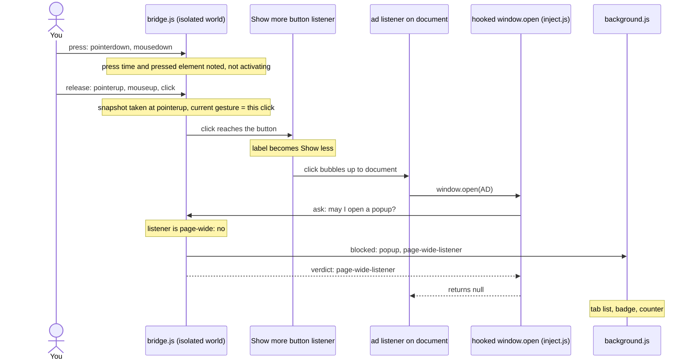
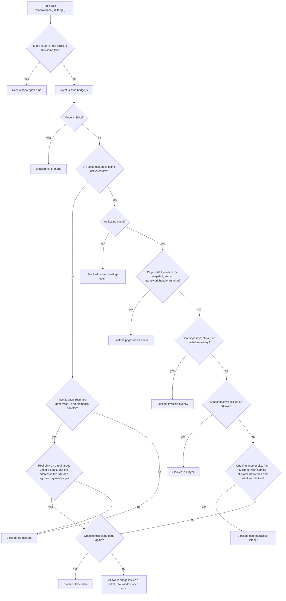
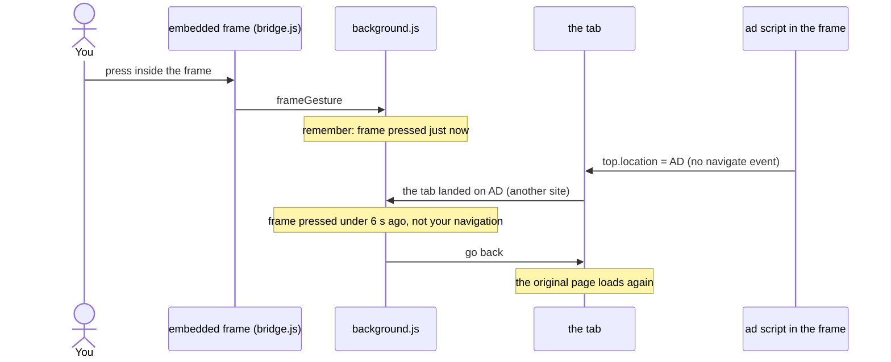

# Part III · How PopShield works

[Index](../LEARN.md) · [Part 0](00-basics.md) · [Part I](01-attacks.md) · [Part II](02-extensions.md) · **Part III** · [Part IV](04-decisions.md) · [Part V](05-contributing.md) · [Glossary](glossary.md)

You know the tricks (Part I) and the tools an extension has (Part II). Now we
put them together. Every claim here matches the code in [`src/`](../../src);
if you find a mismatch, the code wins, and a fix to this guide is welcome.

- [1. The bouncer's question](#1-the-bouncers-question)
- [2. Following one click from start to finish](#2-following-one-click-from-start-to-finish)
- [3. The defences, one trick at a time](#3-the-defences-one-trick-at-a-time)
- [4. Asking through the wall](#4-asking-through-the-wall)
- [5. Tickets for new tabs](#5-tickets-for-new-tabs)
- [6. What PopShield remembers, and what it forgets](#6-what-popshield-remembers-and-what-it-forgets)
- [7. Choosing how strict to be](#7-choosing-how-strict-to-be)
- [8. What PopShield can't do](#8-what-popshield-cant-do)

---

## 1. The bouncer's question

Picture a club with a bouncer at the door. Chrome's popup blocker asks a
simpler question: "did anyone knock in the last few seconds?" Whoever is
standing there gets in. PopShield asks a more careful one: **"Is the person
at the door the one who was actually invited?"**

In browser terms, PopShield asks: *is the code running right now handling a
real click on a specific element?* A page may open a new tab only while all
four of these are true:

1. A **trusted** event (a real click, key press or tap, `isTrusted`) is being
   delivered right now.
2. It's a complete, **[activating](glossary.md#activating-event)** action: a
   click, a key press, a finger lifted. Not a `mousedown`, the moment you
   press the button before you've finished clicking.
3. The listener that's running belongs to a **specific element**, not to the
   whole page. A listener is
   **[page-wide](glossary.md#page-wide-listener)** if it sits on `window`, the
   `document`, `<html>`, `<body>`, or any ordinary element that covers at least
   40% of the screen.
4. The click landed on something you could see: not an **invisible
   overlay**, and not an **ad layer** stacked over the page.

This is PopShield's **[intent model](glossary.md#intent-model)**. Links you
really click (including ctrl-click, middle-click and right-click "Open link in
new tab") keep working. Two refinements keep real websites working, and you'll
meet them in chapter 3: some popular web frameworks run every button's code
from one page-wide listener, and some buttons wait for a server reply
(`await`) before opening a tab.

There's one more idea that runs through everything below. A careful bouncer
**takes a photo of the queue when the doorbell rings**, before anyone has a
chance to shuffle places. PopShield does the same: it measures the page at the
moment your click arrives, before the page's own code has reacted to it, and
judges checks 3 and 4 against that photo. You'll see why in chapter 3.

### Check your understanding

1. A Share button's own listener calls `window.open` during your click. Which
   of the four checks could fail?
2. Why is a `mousedown` not good enough?

<details><summary>Answers</summary>

1. None, unless the click landed on an overlay or ad layer covering the
   button. It's allowed.
2. Ads use it to open a tab the instant you press the button, before you've
   finished clicking on anything. Real "open" buttons react to the full click.

</details>

## 2. Following one click from start to finish

Let's follow one click on a page running the classic popunder from Part I. The
page has a button of its own and an ad script:

```js
more.addEventListener('click', () => {         // the site's own listener, on its "Show more" button
  more.textContent = 'Show less';              // it changes the label to Show less
});                                            // end of the site's listener
document.addEventListener('click', () => {     // the ad's listener, on the whole document
  window.open(AD);                             // it opens the ad in a new tab
});                                            // end of the ad's listener
```

(This is the `doc-click-popunder` scenario.)

### Before the page's scripts run

Both PopShield content scripts start at `document_start`.

1. `inject.js`, in the page's MAIN world, first saves its own copy of every
   built-in tool it will need, before the page can swap any of them. Then it
   picks a random secret, the **[nonce](glossary.md#nonce)**, and hands it to
   `bridge.js`. From now on the two talk over a private channel whose name
   includes that secret.
2. `bridge.js`, in the isolated world, reads this site's mode (Smart, Strict
   or Off) from storage and puts its own listeners on `window` for every kind
   of click, tap and key press, in the capture phase, so it hears every
   gesture before any page listener does.
3. `inject.js` replaces `window.open` and the other tab-opening tools with its
   own versions, called **[hooks](glossary.md#hook)**.
4. Only now do the page's scripts run, adding the two listeners above.

### The press and the click

You press the mouse button: `pointerdown` and `mousedown` events travel
through the page. These events aren't activating, so they can't open
anything. The bridge notes the time of the press, and **what** you pressed:
the link under your pointer and its address, or the button and the form it
belongs to (here, the Show more button). Chapter 3 shows why that matters. You
release: `pointerup`, `mouseup`, then `click`.

The moment `pointerup` arrives, before any page listener has heard it, the
bridge takes its photo, a **[snapshot](glossary.md#snapshot)** of the page:
which element is really under your pointer, whether that element is an
invisible overlay or an ad layer, every element the event will pass through,
and which of them are big enough to count as page-wide. The `mouseup` and the
`click` that follow belong to the same physical click, so they reuse that
same photo. The bridge also records the click as the current gesture, and
looks for a link under your pointer; there isn't one, you clicked a button.

The click travels on. At the target, the site's listener changes the label to
"Show less". Then the click bubbles up to `document`, and the ad's listener calls
`window.open(AD)`.

### The question and the answer

That call lands in PopShield's hook, inside the page's world. The hook doesn't
decide anything. It **asks** the bridge: "May this page open a popup to this
address?" It does this by sending a custom event on the private channel, and
because event delivery is synchronous ([Part 0](00-basics.md#6-how-a-click-travels-through-a-page)),
the bridge's listener runs right away, in the middle of the hook's call.

The bridge looks at the click event with its own clean tools:

| Check | What the bridge sees | Result |
|---|---|---|
| Is a trusted gesture being delivered now? | yes, the click | pass |
| Is it activating? | `click` | pass |
| Is the running listener page-wide? | `currentTarget` is `document` | **fail** |

The verdict is `page-wide-listener`. The bridge records the block, sends the
answer back down the channel, and the hook returns "nothing" (`null`) to the
ad, exactly as if a popup blocker had refused. No new tab.

### Writing it down

The bridge also tells the service worker: "blocked a popup on this tab,
reason: page-wide listener". The worker checks the message is well-formed,
adds it to this tab's list, raises the number on PopShield's button, and adds
one to the anonymous lifetime counter. Open PopShield's popup and you'll see
"Popup / new tab · opened by a page-wide click hook", with an **Open** button
in case you wanted it after all.



If the ad had put its listener on the Show more button itself, `currentTarget`
would have been the button, and the open would have been allowed. From the
page's point of view that is identical to a Share button. Chapter 8 comes
back to this.

The whole decision, as a flowchart:



### Check your understanding

1. Which script decides that the popup is blocked?
2. Why does the bridge already know about the click when the ad calls
   `window.open`?
3. Why does the bridge take its snapshot at `pointerup`, and not when the ad
   asks?

<details><summary>Answers</summary>

1. `bridge.js`. The hook in `inject.js` only asks and obeys.
2. Its capture listeners on `window` ran first, before any page listener, and
   recorded the click as the current gesture.
3. Between `pointerup` and the ad's question, page code has run. An ad could
   use that moment to remove its overlay or shrink its wrapper, so measuring
   later would measure the ad's disguise, not what you clicked.

</details>

## 3. The defences, one trick at a time

Each trick from Part I, and how PopShield answers it. Scenario names are in
`code`; you can run any of them (see [Part V](05-contributing.md)).

### Page-wide hooks, including big wrappers

The bridge's `isPageWide()` treats as page-wide: `window`, any document,
`<html>`, `<body>`, a **[shadow root](glossary.md#shadow-root)** (the hidden
inside of a web component), and any ordinary element covering **at least 40%
of the viewport** (the visible part of the page). Buttons, links and form
fields are never page-wide, however big. An open from a page-wide listener
gets `page-wide-listener`. (`doc-click-popunder`, `body-pointerup-popunder`,
`wrapper-div-popunder`, `rt-two-49pct-wrappers`)

Why 40% and not "half"? Because "half" invited a trick: two wrappers side by
side, each covering 49% of the screen, each listening for clicks. Each one
slipped under the line, and together they heard every click.

Two more rules come from the snapshot:

- The sizes are measured **as your click arrives**, not when the ad asks. A wrapper
  that shrinks itself to one pixel just before calling `window.open`, and
  grows back right after, is judged at its full size
  (`rt-wrapper-shrink-before-open`).
- If the listener's element **wasn't on the path of your click** at all (it
  was removed, or moved somewhere else in the page before asking), it can't
  have been the element you meant to click, so it counts as page-wide too.

### Listeners on everything

Some ad scripts don't use one big listener. They put a small listener on
**every** element of the page: every paragraph, every picture, every bit of
empty space. Each listener sits on a small element, so none of them looks
page-wide, yet together they hear every click.

PopShield answers with a question about the route the click took. Between the
element you clicked and the element whose listener is now asking, was there
anything that **looks clickable**? That means a link, a button, a form
field or another interactive element, or something the page itself styled
with a "you can click this" mouse pointer (any cursor other than the normal
arrow or the text cursor). A real Share button passes easily: you clicked
the button, and the button is clickable. A listener on a plain paragraph
does not.

This rule only applies when the new tab would go to **another site** and no
framework handler is running. An open with nothing clickable on that route
gets `non-interactive-listener`.

### Mouse-down popunders

Only activating events may open a tab: click, auxclick (middle click),
dblclick, mouseup, pointerup, touchend, keydown and keyup. A `mousedown` or
`pointerdown` gets `non-activating-event`. (`window-mousedown-popunder`)

### Invisible overlays

An overlay is a sheet of glass laid over the page: you think you're touching
the picture underneath, but your finger lands on the glass. PopShield's
question is simple: **does this element paint anything you could see?**

`isOverlay()` flags an element that covers at least 35% of the viewport and
is effectively invisible. How it got on top doesn't matter. Pinning it with
`position: fixed` is the classic way, but a grid cell, a negative margin or a
transform can stack an element over the page just as well, so PopShield
doesn't look at positioning at all (`rt-grid-overlay-link`). A picture, a
canvas, an SVG drawing or another media element is never an overlay itself;
it is content.

"Effectively invisible" has two halves.

**The element is see-through as a whole.** An ad can make its overlay
invisible by setting a *parent's* opacity to 0, so the bridge computes the
**[effective opacity](glossary.md#effective-opacity)**: the element's opacity
multiplied by every parent's, including the `filter: opacity()` trick.

```js
let o = 1;                                          // start fully visible
for (let n = el; n; n = n.parentElement) {          // walk up from the element through each parent
  o *= parseFloat(getComputedStyle(n).opacity);     // multiply by that parent's opacity
}                                                   // o is now how visible the element really is
```

Below 0.2, the element counts as invisible.

**Or nothing inside it paints.** An element can be fully opaque and still
show nothing, if everything inside it is transparent. So `hasVisiblePaint()`
walks through the element and everything inside it, looking for one visible
thing:

```js
// a simplified version of hasVisiblePaint(el)
for (const n of everythingInside(el)) {                  // every element and piece of text inside, up to 300
  if (isText(n) && textColourVisible(n)) return true;    // readable text: colour AND fill colour not transparent
  if (backgroundVisible(n)) return true;                 // a background colour or picture that shows
  if (isMedia(n) && coversTenPercent(n, el)) return true;// a picture, canvas or other media of real size
}                                                        // (each also needs effective opacity of at least 0.2)
return false;                                            // nothing visible found: it's glass
```

Notice the limit of 300. Looking through a huge element piece by piece would
make every click slow, so PopShield stops after 300 pieces. If nothing
visible turned up by then, the element counts as **glass**. An earlier
version did the opposite and assumed a huge element was visible, and that
invited a trick: fill an invisible overlay with hundreds of empty pieces and
it passed. Saying "no" when unsure is called
**[failing closed](glossary.md#fail-closed)**.

Each check closes a trick a red team tried:

- **Text that isn't really there.** Text with `color: transparent`, or with
  the lesser-known `-webkit-text-fill-color: transparent` (which overrides the
  colour Chrome actually paints), counts as invisible. Tiny text below 6
  pixels does too (`rt-overlay-transparent-text`).
- **Gradients made of nothing.** A background "gradient" whose every colour
  stop is transparent paints nothing, so it doesn't count as a background
  (`rt-overlay-transparent-gradient`). A real picture (`url(...)`) does.
- **A speck of content.** One tiny visible image in a corner doesn't make a
  full-page sheet visible: media must cover at least 10% of the element.

One more hiding place: a web component with a *closed* shadow root, whose
insides even the event's path doesn't reveal. The bridge looks inside it with
`chrome.dom.openOrClosedShadowRoot`, a helper only extensions have, and
measures the element that's really under your pointer
(`rt-closed-shadow-overlay`).

If you click a link that is an overlay, the bridge cancels the click before
any page listener hears it, and logs `overlay-link`. If an overlay's own
listener calls `window.open`, the verdict is `invisible-overlay`. And because
the verdict comes from the snapshot, an overlay that deletes itself before
asking is still caught (`rt-overlay-detach-before-open`).
(`overlay-anchor`, `overlay-div-listener`)

### Visible ad layers

`isAdLayer()` flags a click that landed on non-interactive content (not a
button, link or form field) of something pinned at a z-index of 2147480000 or
more, covering at least 25% of the viewport. The "non-interactive" part is
why a cookie banner's buttons, which also sit on top of everything, keep
working. (`ad-layer-tab-under` blocked, `legit-max-z-modal` allowed)

### Clicks and forms faked by scripts

`inject.js` hooks `element.click()`, fake click events sent with
`dispatchEvent` (on normal links and on SVG drawing links), and
`form.submit()`. When the call would open a new tab, it asks the bridge, and
the answer depends on whether a real click is behind it. A button handler that
builds and clicks a link is allowed; a timer that does the same isn't.
Download links pass through. (`synthetic-anchor-timer`, `dispatch-anchor`,
`svg-link-dispatch`, `form-submit-blank` blocked; `legit-scripted-anchor`,
`legit-download-anchor` allowed)

Forms can also be sent without `submit()`: by a script clicking the hidden
submit button, or with `requestSubmit()`. Those fire a `submit` event that the
browser marks as trusted even when a script caused it, so the bridge judges it
by its cause. If a listener is still running, the usual rules apply.
Otherwise the browser is submitting the form as the default result of
something, and that something must be **your own action, in the same task**:

- your click on that form's submit button, where the button is visible and
  your click didn't land on an overlay; or
- your Enter key inside that form.

A **task** is one turn of the browser's work loop: it handles one event (your
click, say), runs everything that event triggers, and only then moves on.
Code scheduled with a timer always runs in a later task. So PopShield marks
your click "current" and clears the mark with a zero-length timer; a page
timer that submits afterwards finds the mark gone.

```js
if (type === 'click') {                          // a trusted click just arrived
  clickTask = e;                                 // mark it as "the user's click in this task"
  setTimeout(() => {                             // in the NEXT task...
    if (clickTask === e) clickTask = null;       // ...forget it again
  }, 0);                                         // (0 ms: as soon as the current task is over)
}
```

That is what stops a form submitted a moment after a keystroke in a search
box (`rt-keystroke-requestsubmit`), or by an invisible submit button laid over
the page (`rt-overlay-submit-button`). (`submit-button-click` blocked;
`legit-form-blank`, `legit-form-enter-key` allowed)

One more trick happens *between* your press and your click. You press a
perfectly ordinary button, and while your finger is still down, a script
quietly attaches that button to a different, hidden form, or changes where
its form sends you or which tab it opens in. When you release, the browser
submits the ad's form, and it really was your click. Remember that the bridge
noted what you pressed (chapter 2). If the button's form, its type, or its
`formtarget` / `formaction` settings changed since the press, the submit is
refused and logged as `form-swapped`.

Chrome also has **Document Picture-in-Picture**, which lets a page open a
small always-on-top window. `inject.js` hooks its `requestWindow()` and asks
the bridge exactly as for a popup.

### Borrowing a clean `window.open` from a new frame

The `contentWindow` and `contentDocument` doors of every frame are wrapped:
before the page gets a new frame's window, `inject.js` installs its hooks in
it. And thanks to `match_origin_as_fallback`, PopShield's content scripts run
inside blank frames anyway. (`iframe-pristine-open`, `frames-index-open`)

### Telling real link clicks from decoys

When you really click a link that opens a new tab (or ctrl-click,
middle-click, or right-click it), the bridge gives the service worker a
**ticket** for **exactly that page**: the link's origin and path (chapter 5).
Two tricks try to spend that ticket on an ad.

**The decoy.** If the link's address was a dead end at the moment you clicked
(`#...`, empty, `javascript:`, or this same page), the ticket is also marked
"same site only". So when the ad swaps the address mid-click, the new tab
opens at the ad, finds no ticket that fits, and is closed. A genuine "open
this page in a new tab" link still works. (`decoy-hash-swap` blocked,
`legit-hash-blank` allowed)

**The swap.** A real link to a real page, whose address a page-wide script
changes during your click to something else, perhaps a "redirector" address
on the same site that bounces on to an ad. The new tab doesn't match the
exact page on your ticket. The worker notices that you *did* click a real
link and closes the ad tab, then **opens the page you actually clicked** in
its place, and logs `link-swapped` (`rt-link-href-swap-redirector`).

The bridge also catches a swap earlier, on its own. It noted the link and its
address when you pressed (chapter 2). If, by the time the click arrives, the
same link points to **another site**, a script re-pointed it while your
finger was down, and the bridge cancels the click right there (also logged as
`link-swapped`). A change within the same site is left to the worker's
exact-page check.

The repair (closing the ad tab and opening your page) is only done for left,
middle and ctrl/shift/cmd clicks. A right-click menu can stay open for a
while, and the "Open link in new tab" you pick may come from a different link
than the one the ticket was made for, so for right-clicks PopShield only
closes the unexpected tab.

Some links live inside a *closed* shadow root, where even the event's path
doesn't reveal them. The bridge finds them with `chrome.dom` too
(`legit-closed-shadow-link`).

### Tab-unders

Two layers. First, opening **this same page** in a new tab during a click is
refused as `tab-under`. "Same page" ignores everything after `?` and `#` in
the address, so a cache-busting `?x=123` doesn't disguise it.

Second, the tab you're on is guarded after **any** new tab leaves it. For the
next 60 seconds, a script may not send this tab to another site until you
press something again (a mouse button, a key, a finger). Your press must come
at least half a second after the new tab, so the very click that opened it
doesn't count as "again". This covers a tab you opened yourself with a real
link, too: the ad's favourite moment is right after you've looked away to
the new tab (`rt-tabunder-after-user-link`).

When does that guard start? For a tab a script opened, the moment the bridge
allows it, because the ad may redirect in the very same breath. For a link
you click or right-click, only once the worker confirms that a new tab really
appeared; a right-click that never turns into a new tab doesn't arm it. And
the guard ends when you send the tab somewhere yourself: typing an address,
picking a bookmark, using the address bar.

The bridge lives inside one page, and forgets everything when the tab moves
to another page. An ad could exploit that: hop to another page of the same
site (allowed, it's the same site), and redirect from there. So the service
worker remembers, per tab, when it last opened a tab, and every new page in
that tab asks it at startup: "did this tab open a tab recently?"
(`rt-tabunder-samesite-hop`). (`tab-under`, `element-tab-under`,
`rt-tabunder-pointerup-reset`)

### Redirects of the tab you're on

The **[Navigation API](glossary.md#navigation-api)** is a browser feature
that announces every navigation of the top frame with a `navigate` event
*before* it happens, and lets a listener cancel it. The bridge listens to it.
It never interferes with navigations the browser marks as yours (a link you
clicked, an address you typed), reloads, back and forward, downloads, or
addresses that aren't web pages (`mailto:` and the like). For the rest, it
looks for a reason to object:

- a tab-under (above);
- a **popup hijack**: this is a popup nobody has clicked in yet, being sent
  somewhere else. A page can hide where a tab came from (by opening it with
  `noopener`), so the worker also tells a new tab's first page when it was
  allowed on thin evidence (a weak ticket, chapter 5), and the rule applies
  then too;
- in **Strict** mode, any script-driven move once you've interacted with the
  page (chapter 7);
- a move made during a click by a page-wide listener, an overlay, an ad layer
  or a mouse-down;
- a move made by a timer or a `<meta refresh>` tag within 5 seconds of a
  click.

A move with no click in the last 5 seconds (a redirect when the page loads, a
sign-in round trip) is left alone in Smart mode. A move to a **sign-in or
payment page** of a well-known provider (the exact list is explained under
"Buttons that wait before opening", below) is allowed too, but only after the
first three checks: a provider's address can't excuse a tab-under, a popup
hijack or a Strict-mode move. Even then, the worker follows the tab
afterwards (see below), in case the "provider" page bounces on somewhere
else.

What happens next depends on where the move goes. To **another site**, it is
cancelled and logged. To **this same site**, it's let through, because sites
move between their own pages all the time. But a same-site address can be a
**redirector**, a page whose only job is to bounce you on somewhere else. So
the bridge asks the service worker to keep an eye on the tab for 8 seconds;
if the tab lands on an unrelated site, the worker sends it back and logs
`redirect-chain` (`rt-redirector-navigation`). For a sign-in or payment
hand-off, the provider's site is added to the sites the tab may land on.
Chapter 5 shows how the worker follows a tab.

(`click-redirect`, `open-self-redirect` blocked; `legit-same-site-redirect`,
`legit-onload-redirect` allowed)

### Hijacks from an embedded frame

When a frame embedded from another site (a widget, for example) does
`top.location = AD`, Chrome sends
**no** `navigate` event to the top page, so the guard above never sees it, and
there's no other way for the page to stop it in time. So PopShield doesn't try
to stop it. It lets the move happen and then **undoes** it, from the service
worker, which sees every page a tab lands on.

To do that, the worker needs to know one thing: did you just press inside an
embedded frame, or on the page itself? Every copy of `bridge.js` tells it.
The one in the top page sends `topGesture` when you press; the one inside an
embedded frame sends `frameGesture`. (Frames from different sites can't talk
to each other directly, but each can talk to the worker.) The worker just
writes down the time of each.

When the tab then lands on a new page, the worker asks:

1. Did you press inside a frame less than 6 seconds ago, with no press on the
   page itself since then?
2. Is the new page on a **different site** from the one you were on?
3. Was this move *not* your own doing? Typing an address, picking a bookmark,
   reloading, and the Back and Forward buttons are always yours, and Chrome
   tells the worker which of these happened.
4. Is the new page *not* the start of a sign-in or payment flow, and is
   PopShield not set to Off for the site you were on?

If every answer is yes, the worker presses Back for you
(`chrome.tabs.goBack`) and logs `redirect` / `embedded-frame`. No question
pops up, so closing the tab or typing an address right after clicking inside
a frame is never interrupted.



Sometimes a frame really does have a link meant to open in the whole tab: a
link with `target="_top"` (or `_parent`). When you click one, the frame's
`bridge.js` also sends `frameTopLink` with the link's address. If the tab
then lands on that same page (same origin and path), the worker leaves it
alone, because you asked for it (`legit-frame-top-link`).

There's a price for undoing instead of preventing: the other page may start
loading for a moment before the tab goes back, and going back loads the
original page again, so anything you hadn't saved on it can be lost.

If the frame you clicked into is hard to see (an effective opacity below 0.5,
whatever its size), the click was really meant for what's underneath: a frame
you can barely see that receives a click is an overlay. The top bridge then
tells the worker to refuse tickets from child frames of that tab for 1.5
seconds. (`player-iframe-top-redirect`, `player-iframe-top-redirect-2nd`,
`rt-frame-redirect-after-4s` sent back; `rt-small-invisible-xframe` blocked;
`legit-player-then-reload`, `legit-player-then-type-url` and
`legit-frame-top-link` left alone)

### Frameworks that delegate clicks

Some popular tools for building websites, called
**[frameworks](glossary.md#framework)**, deliberately use one page-wide
listener to run every button's code. Older React does this from `document`,
newer React from a page-sized root `<div>`, Solid from `document`, and jQuery
whenever a site writes `$(document).on('click', '.share', fn)`. To the
page-wide rule, every Share button on such a site would look like an ad.

The bridge can't see a framework's internals: they're page JavaScript objects,
and the bridge lives in the soundproof room. So `inject.js`, which sits at the
page's table, looks at the clicked element during each click, finds *that
element's own* handler in the framework's data, and wraps it for the duration
of the click:

```js
const orig = props.onClick;                    // the clicked element's own React click handler
props.onClick = function () {                  // replace it, for this click only, with a wrapper that...
  fw(+1);                                      // ...tells the bridge "a framework handler is running"
  try { return orig.apply(this, arguments); }  // ...runs the real handler
  finally { fw(-1); }                          // ...and then says "done"
};                                             // (the original is put back right after the click)
```

While a framework handler is running, the bridge doesn't count the page-wide
listener against the open. An ad's own listener on `document` runs outside
any wrapper, so it's still blocked.

Framework data is just a property on an element, and a page can write one
itself. So `inject.js` takes its own little snapshot too: at the **first press
event** of a click (normally `pointerdown`), before any page listener runs, it
notes every React data object already on the elements under your pointer.
Only those count. React data planted by the page's own press handler, in the
moment between your press and your click, is ignored (`rt-fake-react-props`).

jQuery only gets this for a genuine jQuery and for specific selectors (ones
that name a class, id or attribute, match at most 50 elements, and don't match
`<body>`); a catch-all `*` gets nothing (`rt-fake-jquery`).
(`legit-react16`, `legit-react17-root`, `legit-jquery-delegated` allowed;
`react16-site-plus-popunder`, `jquery-star-popunder` blocked)

### Buttons that wait before opening

A checkout button often does `await` (waits for the server) and then
`window.open`. By then the click is over. Two halves handle this.

`inject.js` provides a hint. Chrome's JavaScript engine, V8, keeps a record of
who called whom (a **[stack trace](glossary.md#stack-trace)**), and across
`await` it remembers what the original listener was attached to:

```text
at HTMLButtonElement.<anonymous>         <- the bottom of the running code: a button's listener, resumed after await
at async HTMLButtonElement.<anonymous>   <- (an outer async function that is also waiting)
at HTMLDocument.<anonymous>              <- this would mean: started in a listener on document
```

The hint says "after await, in an element's handler" only if two things are
true: no line names the page as a whole, and the **bottom** of the code that
is running right now (the last line that isn't marked `async`) is an
element's listener. The second rule matters. A timer can't resume an `await`,
but it can call into an element's listener, for example by sending a fake
event to a button. In that case the bottom of the stack is the timer's code,
not the button, and the hint is "no" (`rt-async-forge-redirector`).

A page can still fake stack traces, so the bridge never trusts the hint alone.
It also requires that you really clicked, on a real target (not an overlay or
ad layer), less than 5 seconds ago, and that the address is on this same site
or is a **sign-in or payment page** on a short built-in list.

That list (`PROVIDER_FLOWS` in `common.js`) is very precise. Each entry is one
exact host name plus the beginning of the path where a sign-in or payment
starts: for example, GitHub's "authorize this app" page, Google's accounts
host, or Stripe's checkout host. It covers the big sign-in providers (Google,
Apple, Microsoft, GitHub and others) and the payment providers PayPal, Stripe
and Razorpay. Why so strict? Each looser rule was a hole:

- **A whole domain is too much.** A provider's domain can also contain pages
  that forward elsewhere: addresses that send you on to whatever address they
  are given. Being somewhere on the provider's site isn't enough.
- **Some domains belong to everyone.** Some sign-in services give every
  customer their own sub-address (`yourcompany.<service>.com`). Anyone,
  including an advertiser, can rent one, so those services aren't on the
  list at all.
- **The address's extra details are written by the page.** Everything after
  `?` in an address is chosen by whoever builds it. An address doesn't become
  a sign-in page just because it ends in `?client_id=...`.

```js
function isProviderFlow(u) {                                  // is this the start of a known sign-in or payment?
  const x = new URL(u);                                       // split the address into its parts
  if (x.protocol !== 'https:') return false;                  // only secure addresses
  return PROVIDER_FLOWS.some(([host, path]) =>                // for each entry on the list...
    x.hostname === host && path.test(x.pathname));            // ...the exact host AND the right path start
}                                                             // (simplified from src/common.js)
```

Because a hint can lie, a tab opened this way gets a **weak** ticket, and the
service worker follows it after it opens (chapter 5).

(`legit-async-open`, `legit-react17-async` allowed;
`doc-async-await-popunder`, `async-cross-site-element` blocked)

### Check your understanding

1. An ad hides an overlay by giving its *parent* `opacity: 0`. How does
   PopShield still notice?
2. An overlay is fully opaque, but all its text is
   `-webkit-text-fill-color: transparent` and its background is a gradient of
   transparent colours. Overlay or not?
3. Why does framework attribution happen in `inject.js` and not in the bridge?
4. A button waits for the server, then opens `https://some-ad.example`. What
   happens?
5. You click a `target="_blank"` link to an article. While your click is being
   delivered, a script changes the link to point at an ad. What do you end up
   with?

<details><summary>Answers</summary>

1. It multiplies opacity up the whole parent chain (effective opacity), so the
   overlay's effective opacity is 0.
2. An overlay (if it covers at least 35% of the view). Nothing inside paints
   anything visible: both text colours count, and an all-transparent gradient
   isn't a visible background.
3. The bridge can't see page JavaScript objects such as React's data; only the
   MAIN world can.
4. Blocked: after `await`, only the same site or a listed sign-in or
   payment page is allowed.
5. The article. The ad tab doesn't match your exact-page ticket, so the worker
   closes it and opens the page you clicked instead (`link-swapped`).

</details>

## 4. Asking through the wall

PopShield's hooks have to sit at the page's table, in the MAIN world, because
that's where the page's `window.open` lives. But remember the shared toolboxes
from [Part 0](00-basics.md#5-reading-just-enough-javascript): **anyone at that
table can swap the tools.** If the hooks also made the decisions, a hostile
page could feed them fake tools:

```js
Object.defineProperty(Event.prototype, 'currentTarget', {   // replace the shared "currentTarget" tool for all events...
  get() { return document.querySelector('button'); }        // ...so every listener claims to be on a button
});                                                         // now a document listener looks element-scoped
```

```js
Object.prototype.toJSON = function () {     // replace how every object turns itself into text...
  return { ...this, type: 'allow' };        // ...so a "blocked" message becomes an "allow" message
};                                          // end of the fake tool
```

`inject.js` saves its own copy of every tool before any page script runs, and
that blocks most of this. But one forgotten tool would be enough to fool it.
So PopShield doesn't rely on it: **the decision lives in the soundproof room.**

| | `inject.js` (page's table) | `bridge.js` (soundproof room) |
|---|---|---|
| Can the page tamper with it? | yes | no |
| Can it replace `window.open` for the page? | yes | no |
| Can it see framework data and stack traces? | yes | no |
| Has the extension's `chrome.*` abilities? | no | yes |
| Its job | hook, **ask**, give two hints | **decide**, issue tickets, guard redirects, keep the log |

The bridge sees the same DOM and the same event objects, through its own clean
tools. So it checks the click, the listener and the styles itself.

### A private line with a secret stamp

The two scripts share only the DOM, so they talk with custom events on
`document`. To keep page scripts off the line, the channel's name includes the
**nonce**: a random 128-bit number, like a **wax stamp** only the two of them
know. It's created and handed over once, at `document_start`, before any page
script exists:

```js
const b = new Uint8Array(16);                 // 16 bytes = 128 bits
crypto.getRandomValues(b);                    // fill them with random numbers from the browser
// ...turned into 32 hex characters, e.g. "9f3a...", the stamp
dispatchEvent(new CustomEvent('popshield:hello', { detail: nonce }));  // hand it to the bridge, once
```

The bridge accepts the first hello, and from then on both listen on
`ps-<nonce>-up` and `ps-<nonce>-down`. After that, `inject.js` never says
hello again, so a page script that starts later never sees the stamp. If the
bridge somehow never answered, every question gets "no" (the hooks **fail
closed**).

The question itself is **synchronous**. Sending a custom event runs its
listeners immediately, so the bridge's answer is back before the hook moves
on:

```js
function ask(kind, url) {                       // the hook asks: may I open "kind" at "url"?
  if (!connected) return 'no-bridge';           // no bridge, no permission
  answer = null;                                // clear the answer slot
  post({ type: 'ask', id: ++askSeq, kind, url, async: asyncOrigin() });  // send the question; the bridge runs NOW
  return typeof answer === 'string' ? answer : 'no-answer';  // by this line the bridge has filled the slot
}
```

A stamp on its own isn't a lock, though. It's held by code at the page's
table, and a clever enough page might find a way to read it. That's why the
stamp only keeps casual scripts away. The real protection is that **the
decision and the tickets come from the soundproof room**, and the service
worker accepts tickets only from there.

### Two hints, taken with a pinch of salt

Some facts can only be seen from the page's table, so `inject.js` reports
them. The bridge treats them as claims, and each can only loosen one rule a
little:

- "The clicked element's framework handler is running" only lifts the
  page-wide rule. Overlays, ad layers and the need for a real click still
  apply.
- "This is after `await`, in an element's handler" only allows the same site
  or a listed sign-in or payment page, within 5 seconds of a real click
  on a real target. And if the page has tampered with how stack traces are
  written, `inject.js` reports "no".

Either way, the ticket the bridge issues is marked **weak**, and the service
worker follows where the new tab goes (chapter 5).

### What if a page breaks `inject.js` anyway?

Suppose a page finds a way around the hook and calls the real `window.open`.
It skipped the early block, but the new tab still needs a ticket, and **only
the bridge issues tickets**. The service worker closes the tab. The worst the
page gets is a tab that flickers open and shut.

The one trick the safety net can't fully catch is a page that *fakes a
framework*: for example, planting fake React data on the button you're about
to click, before you press it. The bridge then approves honestly, based on a
lie. That has to be aimed at PopShield on purpose, and only works on the
element you click; it's listed in chapter 8.

### Check your understanding

1. Why isn't saving copies of the tools enough on its own?
2. What does the nonce protect against, and what doesn't it protect against?
3. A page reaches the real `window.open` without going through the hook. What
   happens to the new tab?

<details><summary>Answers</summary>

1. One forgotten tool is enough for the page to fool the code, and there are
   very many tools. Moving the decision to the isolated world removes the
   problem instead of patching it tool by tool.
2. It keeps ordinary page scripts from joining the private channel. It can't
   make decisions in the MAIN world trustworthy, because the code holding it
   is at the page's table.
3. The bridge issued no ticket for it, so the service worker closes it.

</details>

## 5. Tickets for new tabs

No list of hooks is ever complete. So PopShield has a safety net, the
**[backstop](glossary.md#backstop)**, in the service worker.

Think of a **ticket** at a theatre. Every time the bridge approves a new tab,
or sees you really click a link, it gives the service worker a ticket for
that tab: an **[allow token](glossary.md#allow-token)**. When the browser
reports that a tab opened a new tab, the worker looks for a ticket that fits.
No ticket: it waits 400 milliseconds in case a ticket is on its way, and looks
again. Still nothing: it closes the new tab and logs `new-tab` /
`no-user-intent`, unless the swapped-link repair from chapter 3 applies.

```js
if (takeToken(sourceTab, newTabUrl, sourceSite)) return;  // a ticket fits: the user wanted this tab
await sleep(400);                                         // none yet: wait 0.4 s for a late ticket
if (takeToken(sourceTab, newTabUrl, sourceSite)) return;  // look again
const swapped = takeSwappedLink(sourceTab, newTabUrl);    // did the user click a real link to somewhere else?
chrome.tabs.remove(newTab);                               // either way, close the tab nobody approved
if (swapped) chrome.tabs.create({ url: swapped.url });    // and if so, open the page they actually clicked
```

The tickets are deliberately hard to misuse:

| Rule | Why |
|---|---|
| A ticket from a script open names a destination site; the new tab must open on that site | a ticket can't be spent on an ad tab to another site opened in the same instant |
| A ticket from a link you clicked names the **exact page** (origin and path) | a script that swaps the link for a same-site redirector can't use it |
| Valid for 3 seconds (8 seconds for right-click "Open link in new tab") | short enough not to become a standing permission; right-click menus take a human a moment |
| At most 4 per tab | a page can't stockpile them |
| "Same site only" for dead-end links and for modifier-clicks where no link was seen | an address swapped mid-click can't use it |
| Refused from child frames for 1.5 s after a click into a barely visible frame | that click wasn't meant for the frame |
| Accepted only from PopShield's own scripts, at most 12 per 10 s per tab | the page's world can't send messages to the worker at all |

The backstop stays on when the opener is a blank, `data:`, `blob:` or local
file page, and is off for sites in Off mode and for the browser's own pages.

### Following a tab after it opens

A ticket vouches for the **first** address a new tab opens at, and nothing
more. That's a weak spot. A same-site address can be a redirector that
bounces on to an ad a moment later, and a ticket that rests on a hint (a
framework handler, or `await`) rests on something the page could have faked.

So some tickets come with a **tail**, like a detective following a suspect
for a few blocks. When the worker spends a *weak* ticket, or a *same site
only* ticket, it keeps following the new tab for 8 seconds through
`webNavigation.onCommitted`, which the browser fires every time a tab
actually lands on a new page. If the tab lands on a site that is neither the
opener's site nor the site the ticket was for (a listed sign-in or payment
page is fine), the worker closes it and logs `redirect-chain`.

The tail only cares about **redirects**: hops the page or its server made
on its own, which the browser labels as such. If you type an address into
that tab, pick a bookmark, click a link, go back or reload, that's you, not a
redirect, and the worker stops following the tab.

```js
if (tok.weak || tok.sameSiteOnly) {                         // the evidence for this tab was thin...
  tabWatch.set(newTab, {                                    // ...so follow it
    until: Date.now() + 8000,                               // for the next 8 seconds
    allowed: new Set([sourceSite, siteOf(tok.url)]),        // these landing sites are fine
  });
}
// later, every time a followed tab lands on a page:
const follow = tabWatch.get(tabId);                              // the note made above for this tab
if (!landingOk(url, follow.allowed)) chrome.tabs.remove(tabId);  // an unrelated site: close the tab
```

The same tail follows **the tab you're on** after the redirect guard let a
suspicious same-site move, or a sign-in or payment hand-off, through
(chapter 3). If that tab then redirects on to an unrelated site, the worker
presses Back for you.

Spending any ticket also tells the opener's page "a new tab just left you",
which arms the tab-under rule from chapter 3. The worker keeps that moment per
tab, so it survives the opener moving to another page, and forgets it when
you navigate the tab yourself. When the spent ticket was weak, the worker
also remembers that about the *new* tab, until that tab's first page asks
"how was I opened?" (the popup-hijack rule in chapter 3).

### Check your understanding

1. You click a link to a news site. In the same instant, an ad script opens a
   tab to an ad site by a route PopShield didn't hook. What happens to each
   tab?
2. A framework handler (real or faked) opens `/go?to=ad` on the same site,
   which forwards to an ad site. Which part of PopShield stops it, and when?

<details><summary>Answers</summary>

1. The news tab spends the ticket minted for that link. The ad tab needs a
   ticket for the ad site; there is none, so the backstop closes it.
2. The bridge approves the open with a weak ticket, so the tab opens at
   `/go`. The worker is following it, and when the tab lands on the ad site
   a moment later, the worker closes it (`redirect-chain`).

</details>

## 6. What PopShield remembers, and what it forgets

**PopShield keeps no browsing history.** The only site names it saves are the
ones you choose a mode for; everything else is an anonymous count. Here is
everything it stores, all inside your browser:

```js
// chrome.storage.local: kept until you change it or remove PopShield
{
  defaultMode: 'smart',                  // your default mode for all sites
  sites: { 'example.com': 'strict' },    // only sites where YOU picked a mode, nothing else
  stats: {                               // an anonymous counter:
    total: 1234,                         //   blocks since counting started
    since: 1763683200000,                //   when counting started (install or Reset stats)
    days: { '2026-11-21': 17 },          //   blocks per day, last 30 days
    kinds: { popup: 900, redirect: 200 } //   blocks per kind
  }
}

// chrome.storage.session: memory only, under each tab
{
  'log:42': [ { kind: 'popup', reason: 'page-wide-listener', url, frameUrl, time } ],  // what was blocked in tab 42
  'count:42': 3,                         // the number on PopShield's button for tab 42
  incogSites: { 'example.org': 'off' }   // modes you picked in incognito windows (memory only)
}
```

**Incognito** (Chrome's private windows) gets special care. A mode you pick
for a site while in an incognito window is kept only in memory
(`incogSites`), never in `chrome.storage.local`, so the name of a site you
visited privately never reaches your disk. It's forgotten when the browser
exits. Pages in incognito ask the service worker for their mode instead of
reading storage themselves.

The counter is just numbers. The per-tab list does contain addresses (the
blocked address, and the page's address without anything after `?`), because
that's what lets you press **Open**. When PopShield cancels a click on an ad
link laid over the page, the list also keeps up to 120 characters of that
link's text, so you can tell what it was. But the list lives only in that
tab's slot in memory. It is cleared when you go to a new page or close the
tab, and when the browser exits. Reloading the page keeps it, and so does a
page that changes its address without loading a new page.

The service worker also keeps a little **working memory** while it does its
job: the tickets (with the address each is for), the tails from chapter 5
(with the site names they allow), the moment each tab last opened a tab,
which new tabs were opened on thin evidence, and, for the frame check in
chapter 3, when you last pressed inside a frame or on the page, the last
whole-tab link you clicked inside a frame, and the address each tab is on.
None of it is ever written to storage. Tickets expire within seconds, tails
after 8 seconds, and all of it is dropped when the tab closes or the worker
is stopped.

PopShield's own code makes no network requests, and it has no telemetry. Two
honest caveats belong here.

First, a page *can* notice that PopShield is installed, for example because
its popups get refused or because `window.open` has been replaced. A tracker
could use that as one more clue to tell browsers apart (this is called
**fingerprinting**). PopShield doesn't try to hide; it simply has nothing to
tell the page.

Second, the **Report** buttons in the popup are the one place where details
leave your browser, and only when you ask. A web address can carry extra
details after a `?`, and that is how the GitHub issue form arrives already
filled in. PopShield opens github.com in a new tab, and written into that
tab's address are the page's address (without anything after `?` or `#`),
your mode, the Chrome and PopShield version numbers, and a summary of what
was blocked (types and ad hostnames). So GitHub receives those details the
moment the tab opens, before you press anything on the form. That is why
PopShield shows you the list first and asks you to confirm. Nothing becomes
public unless you sign in to GitHub and submit the form. In incognito windows
the Report buttons aren't shown at all. There are no share buttons.

Ad scripts often retry a blocked popup hundreds of times. To keep the list
readable, the bridge writes each distinct block at most once every 5 seconds
and at most 20 per 10 seconds per frame, and the worker accepts at most 30 per
10 seconds per tab (`retry-loop-popunder`). The worker also gathers blocks for
a quarter of a second and writes them in one go, instead of one storage write
per block.

### Check your understanding

1. Where is the list of what was blocked on a page kept, and when does it
   disappear?
2. Does following a tab for 8 seconds mean PopShield keeps a history of where
   your tabs went?
3. You press a Report button, confirm, and then close the GitHub tab without
   submitting the form. Did anything leave your browser? Did anything become
   public?

<details><summary>Answers</summary>

1. In session memory, under that tab only. It is cleared when you go to a new
   page or close the tab, and when the browser exits. A reload keeps it.
2. No. The worker only compares each landing against a short list of allowed
   sites in its memory, and stops following after 8 seconds. Nothing is
   stored; only a block, if one happens, goes in that tab's list.
3. Yes, and no. The details listed in the confirmation were part of the
   GitHub page's address, so GitHub received them when the tab opened. Nothing
   became public, because you never signed in and submitted the form.

</details>

## 7. Choosing how strict to be

The popup lets you pick a mode for each site, and a default for all others.
Frames inside a page (such as a widget from another site) follow the page's mode.

| Mode | Scripts opening tabs | Links and forms you use | Redirects of your tab |
|---|---|---|---|
| **Smart** (default, the normal setting) | the bouncer's rules | allowed | the guards in chapter 3; a script redirect more than ~5 s after your last click is allowed |
| **Strict** (maximum protection) | never | allowed, including ctrl-click, middle-click and right-click "Open link in new tab" | the guards in chapter 3, and once you've interacted with the page, no script may send the tab to another site, however long it waits, sign-in and payment pages included |
| **Off** | untouched | untouched | untouched; the backstop is off too |

### The one trade-off between Smart and Strict

Think about paying for something online. You click "Pay", the shop talks to
the payment company, and a few seconds later a script sends your tab on to
your bank to confirm. That's a script-driven move to another site, a while
after your click, and it's perfectly honest.

Smart mode is built to let that happen. A script move more than about 5
seconds after your last click (with no new tab involved, and not from a popup
nobody has clicked in) is allowed. The cost is real: an ad script that simply
waits 5 seconds after your click, then sends your tab to an ad, gets through
in Smart. PopShield's test suite keeps exactly that attack as a **known
bypass** (`rt-delayed-redirect`): it runs every time and is reported, so
nobody forgets it, but it doesn't fail the run, because it's a choice, not a
bug.

Strict mode makes the opposite choice. Once you've clicked or pressed a key on
a page, no script may send that tab to another site on its own, however long
it waits, and that includes sign-in and payment pages. What still works is a
move made by the element you clicked while your click is still being
delivered. A delayed payment or sign-in hand-off may be stopped; you'll see it
in the list, with an **Open** button, or you can set that one shop to Smart.

So: keep Smart as your everyday setting, and switch a site you don't trust to
Strict.

The popup also shows the lifetime counter ("N popups & redirects blocked since
<date> · N today") with a 14-day bar chart and a **Reset stats** link, the
list for the current page with **Open** buttons, the two **Report** buttons
and a **Feedback** link.

### Check your understanding

1. In Strict mode, does a Share button that calls `window.open` work?
2. You click a button, and 7 seconds later the page sends your tab to an ad site.
   Smart or Strict: which one stops it?

<details><summary>Answers</summary>

1. No. Strict allows no script-opened tabs at all. Links you click yourself
   still work.
2. Strict. In Smart, 7 seconds is past the 5-second window after your click,
   so the move is allowed; that's the price of keeping checkout hand-offs
   working.

</details>

## 8. What PopShield can't do

- **Ads that are real links.** An ordinary link to an ad, styled as the site's
  own "Download" button, is a link you really clicked. PopShield allows it by
  design. A content blocker with a list of ad addresses is the right tool;
  use one alongside PopShield.
- **Fake dialogs and banner ads** inside the page aren't hidden. PopShield
  stops tabs and redirects, not page content.
- **Patient redirects in Smart.** A script that waits more than about 5
  seconds after your click before moving your tab to another site gets
  through in Smart mode. Strict stops it (chapter 7).
- **Pages built to fool PopShield.** A page that plants fake framework data
  on the element you click *before you press it* gets the framework
  exemption, and the bridge really approves. The tail from chapter 5 catches
  a bounce to a third site, but not an open straight to the ad. In the same
  way, a page can give plain content a "clickable" mouse pointer to get past
  the listeners-on-everything check. Both have to be aimed at PopShield on
  purpose.
- **Being noticed.** Pages can tell PopShield is installed (chapter 6).
- **Waiting, then opening an unrelated site.** After `await`, only the same
  site and the listed sign-in or payment pages are allowed. A sign-in service
  that isn't on the exact list is treated like any other site.
- **Popups from non-clickable content.** A site that opens another site's
  page from a listener on plain text or a picture, with nothing clickable in
  between, is blocked in Smart. Use **Open** in the popup. Timers
  (`setTimeout`) and `.then()` callbacks are blocked entirely. Use **Open** in
  the popup.
- **Honest redirects right after a click** to another site (other than a
  sign-in or payment page) are blocked, and so are script redirects within a
  minute of the tab opening a new tab, until you press something.
- **Unknown frameworks.** A container covering 40% or more of the page that
  runs every button's code is treated as page-wide unless it belongs to React,
  Solid or jQuery.
- **Embedded-frame hijacks are undone, not prevented.** The other page may
  start loading for a moment before the worker sends the tab back, and the
  original page loads again.
- **Same-tab redirects have no safety net of tickets**: they rely on the
  bridge's guards and the worker sending the tab back. When a same-site hop bounces on to an ad, the worker sends
  the tab back, but the ad page has already loaded once.

### Check your understanding

1. Why doesn't the backstop help against faked frameworks?

<details><summary>Answer</summary>

The backstop closes tabs the bridge didn't approve. With faked framework data,
the bridge itself is fooled into approving, so a ticket exists. The tail only
notices if the tab then moves on to yet another site.

</details>

---

Next: [Part IV · Every design decision, and why](04-decisions.md)
