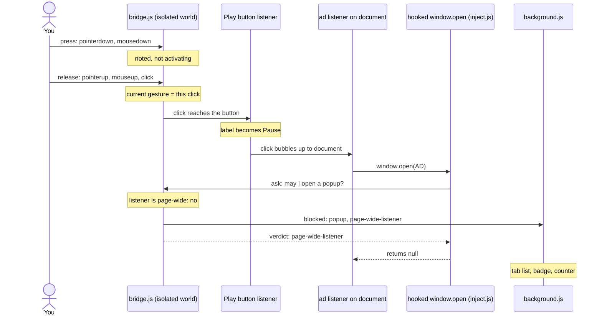
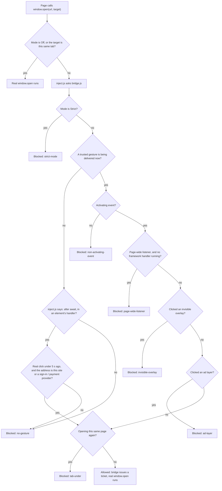
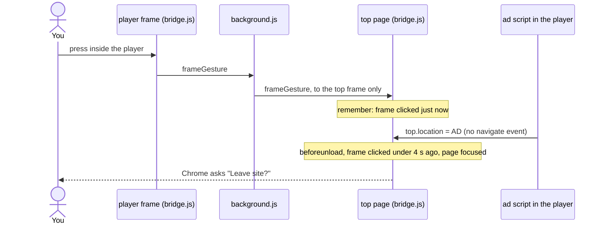

# Part III · How PopShield works

[Index](../LEARN.md) · [Part 0](00-basics.md) · [Part I](01-attacks.md) · [Part II](02-extensions.md) · **Part III** · [Part IV](04-decisions.md) · [Part V](05-contributing.md) · [Glossary](glossary.md)

You know the tricks (Part I) and the tools an extension has (Part II). Now we
put them together. Every claim here matches the code in [`src/`](../../src);
if you find a mismatch, the code wins, and a fix to this guide is welcome.

- [1. The bouncer's question](#1-the-bouncers-question)
- [2. Following one click from start to finish](#2-following-one-click-from-start-to-finish)
- [3. The defences, one trick at a time](#3-the-defences-one-trick-at-a-time)
- [4. Asking through the wall](#4-asking-through-the-wall)
- [5. Tickets for new tabs](#5-tickets-for-new-tabs)
- [6. What PopShield remembers, and what it forgets](#6-what-popshield-remembers-and-what-it-forgets)
- [7. Choosing how strict to be](#7-choosing-how-strict-to-be)
- [8. What PopShield can't do](#8-what-popshield-cant-do)

---

## 1. The bouncer's question

Picture a club with a bouncer at the door. Chrome's popup blocker is a lazy
bouncer: it only asks "did anyone knock in the last few seconds?" and lets in
whoever is standing there. PopShield is a careful bouncer. It asks: **"Is the
person at the door the one who was actually invited?"**

In browser terms, PopShield asks: *is the code running right now handling a
real click on a specific element?* A page may open a new tab only while all
four of these are true:

1. A **trusted** event (a real click, key press or tap, `isTrusted`) is being
   delivered right now.
2. It's a complete, **[activating](glossary.md#activating-event)** action: a
   click, a key press, a finger lifted. Not a `mousedown`, the moment you
   press the button before you've finished clicking.
3. The listener that's running belongs to a **specific element**, not to the
   whole page. A listener is
   **[page-wide](glossary.md#page-wide-listener)** if it sits on `window`, the
   `document`, `<html>`, `<body>`, or any ordinary element that covers at least
   half of the screen.
4. The click landed on something real: not an **invisible overlay**, and not
   an **ad layer** stacked over the page.

This is PopShield's **[intent model](glossary.md#intent-model)**. Links you
really click (including ctrl-click, middle-click and right-click "Open link in
new tab") always work. Two refinements keep real websites working, and you'll
meet them in chapter 3: some popular web frameworks run every button's code
from one page-wide listener, and some buttons wait for a server reply
(`await`) before opening a tab.

### Check your understanding

1. A Share button's own listener calls `window.open` during your click. Which
   of the four checks could fail?
2. Why is a `mousedown` not good enough?

<details><summary>Answers</summary>

1. None, unless the click landed on an overlay or ad layer covering the
   button. It's allowed.
2. Ads use it to open a tab the instant you press the button, before you've
   finished clicking on anything. Real "open" buttons react to the full click.

</details>

## 2. Following one click from start to finish

Let's follow one click on a page running the classic popunder from Part I. The
page has a player button and an ad:

```js
play.addEventListener('click', () => {         // the site's own listener, on the Play button
  play.textContent = 'Pause';                  // it changes the label to Pause
});                                            // end of the site's listener
document.addEventListener('click', () => {     // the ad's listener, on the whole document
  window.open(AD);                             // it opens the ad in a new tab
});                                            // end of the ad's listener
```

(This is the `doc-click-popunder` scenario.)

### Before the page's scripts run

Both PopShield content scripts start at `document_start`.

1. `inject.js`, in the page's MAIN world, first saves its own copy of every
   built-in tool it will need, before the page can swap any of them. Then it
   picks a random secret, the **[nonce](glossary.md#nonce)**, and hands it to
   `bridge.js`. From now on the two talk over a private channel whose name
   includes that secret.
2. `bridge.js`, in the isolated world, reads this site's mode (Smart, Strict
   or Off) from storage and puts its own listeners on `window` for every kind
   of click, tap and key press, in the capture phase, so it hears every
   gesture before any page listener does.
3. `inject.js` replaces `window.open` and the other tab-opening tools with its
   own versions, called **[hooks](glossary.md#hook)**.
4. Only now do the page's scripts run, adding the two listeners above.

### The press and the click

You press the mouse button: `pointerdown` and `mousedown` events travel
through the page. The bridge notes them, but they aren't activating, so
nothing else happens. You release: `pointerup`, `mouseup`, then `click`. The
bridge records the click as the current gesture and notes the time. It also
looks for a link under your pointer; there isn't one, you clicked a button.

The click travels on. At the target, the site's listener changes the label to
"Pause". Then the click bubbles up to `document`, and the ad's listener calls
`window.open(AD)`.

### The question and the answer

That call lands in PopShield's hook, inside the page's world. The hook doesn't
decide anything. It **asks** the bridge: "May this page open a popup to this
address?" It does this by sending a custom event on the private channel, and
because event delivery is synchronous ([Part 0](00-basics.md#6-how-a-click-travels-through-a-page)),
the bridge's listener runs right away, in the middle of the hook's call.

The bridge looks at the click event with its own clean tools:

| Check | What the bridge sees | Result |
|---|---|---|
| Is a trusted gesture being delivered now? | yes, the click | pass |
| Is it activating? | `click` | pass |
| Is the running listener page-wide? | `currentTarget` is `document` | **fail** |

The verdict is `page-wide-listener`. The bridge records the block, sends the
answer back down the channel, and the hook returns "nothing" (`null`) to the
ad, exactly as if a popup blocker had refused. No new tab.

### Writing it down

The bridge also tells the service worker: "blocked a popup on this tab,
reason: page-wide listener". The worker checks the message is well-formed,
adds it to this tab's list, raises the number on PopShield's button, and adds
one to the anonymous lifetime counter. Open PopShield's popup and you'll see
"Popup / new tab · opened by a page-wide click hook", with an **Open** button
in case you wanted it after all.



If the ad had put its listener on the Play button itself, `currentTarget`
would have been the button, and the open would have been allowed. From the
page's point of view that is identical to a Share button. Chapter 8 comes
back to this.

The whole decision, as a flowchart:



### Check your understanding

1. Which script decides that the popup is blocked?
2. Why does the bridge already know about the click when the ad calls
   `window.open`?

<details><summary>Answers</summary>

1. `bridge.js`. The hook in `inject.js` only asks and obeys.
2. Its capture listeners on `window` ran first, before any page listener, and
   recorded the click as the current gesture.

</details>

## 3. The defences, one trick at a time

Each trick from Part I, and how PopShield answers it. Scenario names are in
`code`; you can run any of them (see [Part V](05-contributing.md)).

### Page-wide hooks, including big wrappers

The bridge's `isPageWide()` treats as page-wide: `window`, any document,
`<html>`, `<body>`, a **[shadow root](glossary.md#shadow-root)** (the hidden
inside of a web component), and any ordinary element covering **at least 50%
of the viewport** (the visible part of the page). Buttons, links and form
fields are never page-wide, however big. An open from a page-wide listener
gets `page-wide-listener`. (`doc-click-popunder`, `body-pointerup-popunder`,
`wrapper-div-popunder`)

### Mouse-down popunders

Only activating events may open a tab: click, auxclick (middle click),
dblclick, mouseup, pointerup, touchend, keydown and keyup. A `mousedown` or
`pointerdown` gets `non-activating-event`. (`window-mousedown-popunder`)

### Invisible overlays

`isOverlay()` flags an element that covers at least 35% of the viewport, is
pinned in place (`position: fixed` or `absolute`, on itself or one of its three
nearest parents), and is effectively invisible. "Effectively" is the key
word. An ad can make its overlay invisible by setting a parent's opacity to 0,
so the bridge computes the **[effective opacity](glossary.md#effective-opacity)**:
the element's opacity multiplied by every parent's, including the
`filter: opacity()` trick.

```js
let o = 1;                                          // start fully visible
for (let n = el; n; n = n.parentElement) {          // walk up from the element through each parent
  o *= parseFloat(getComputedStyle(n).opacity);     // multiply by that parent's opacity
}                                                   // o is now how visible the element really is
```

An element counts as an overlay if its effective opacity is below 0.2, or if
it's a see-through box: no background picture, a background colour that's
almost fully transparent (alpha below 0.1), no visible text, and no visible
picture or video taking up at least 10% of it.

If you click a link that is an overlay, the bridge cancels the click before
any page listener hears it, and logs `overlay-link`. If an overlay's own
listener calls `window.open`, the verdict is `invisible-overlay`.
(`overlay-anchor`, `overlay-div-listener`)

### Visible ad layers

`isAdLayer()` flags a click that landed on non-interactive content (not a
button, link or form field) of something pinned at a z-index of 2147480000 or
more, covering at least 25% of the viewport. The "non-interactive" part is
why a cookie banner's buttons, which also sit on top of everything, keep
working. (`ad-layer-tab-under` blocked, `legit-max-z-modal` allowed)

### Clicks and forms faked by scripts

`inject.js` hooks `element.click()`, fake click events sent with
`dispatchEvent` (on normal links and on SVG drawing links), and
`form.submit()`. When the call would open a new tab, it asks the bridge, and
the answer depends on whether a real click is behind it. A button handler that
builds and clicks a link is allowed; a timer that does the same isn't.
Download links pass through. (`synthetic-anchor-timer`, `dispatch-anchor`,
`svg-link-dispatch`, `form-submit-blank` blocked; `legit-scripted-anchor`,
`legit-download-anchor` allowed)

Forms can also be sent without `submit()`: by a script clicking the hidden
submit button, or with `requestSubmit()`. Those fire a `submit` event that the
browser marks as trusted even when a script caused it, so the bridge judges
it by its cause. If a listener is still running, the usual rules apply;
otherwise the submit must follow, within one second, your own click on that
submit button or Enter inside that form. (`submit-button-click` blocked;
`legit-form-blank`, `legit-form-enter-key` allowed)

Chrome also has **Document Picture-in-Picture**, which lets a page open a
small always-on-top window. `inject.js` hooks its `requestWindow()` and asks
the bridge exactly as for a popup.

### Borrowing a clean `window.open` from a new frame

The `contentWindow` and `contentDocument` doors of every frame are wrapped:
before the page gets a new frame's window, `inject.js` installs its hooks in
it. And thanks to `match_origin_as_fallback`, PopShield's content scripts run
inside blank frames anyway. (`iframe-pristine-open`, `frames-index-open`)

### Telling real link clicks from decoys

When you really click a link that opens a new tab (or ctrl-click,
middle-click, or right-click it), the bridge gives the service worker a
**ticket** for that link's address (chapter 5). If the link's address was a
dead end at the moment you clicked (`#...`, empty, `javascript:`, or this
same page), the ticket is also marked "same site only". So when the ad swaps
the address mid-click, the new tab opens at the ad, finds no ticket that fits,
and is closed. A genuine "open this page in a new tab" link still works.
(`decoy-hash-swap` blocked, `legit-hash-blank` allowed)

Some links live inside a *closed* shadow root, where even the event's path
doesn't reveal them. The bridge can look inside with `chrome.dom`, a helper
only extensions have.

### Tab-unders

Two layers. First, opening **this same page** in a new tab during a click is
refused as `tab-under`. "Same page" ignores everything after `?` and `#` in
the address, so a cache-busting `?x=123` doesn't disguise it. Second, once any
script-opened tab has been allowed, the tab you're on may not be sent to
another site **until you click again**. (`tab-under`, `element-tab-under`)

### Redirects of the tab you're on

The **[Navigation API](glossary.md#navigation-api)** is a browser feature
that announces every navigation of the top frame with a `navigate` event
*before* it happens, and lets a listener cancel it. The bridge listens to it.
It never interferes with navigations the browser marks as yours (a link you
clicked, an address you typed), reloads, back and forward, downloads, or
moves within the same site. For the rest (script-driven moves to another
site), it blocks:

- a tab-under (above);
- a **popup hijack**: this is a popup nobody has clicked in yet, being sent to
  another site that isn't a sign-in or payment provider;
- a move made during a click by a page-wide listener, an overlay, an ad layer
  or a mouse-down;
- a move made by a timer or a `<meta refresh>` tag right after a click, unless
  it goes to a sign-in or payment provider.

A move with no click in the last 5 seconds (a redirect when the page loads, a
sign-in round trip) is left alone. (`click-redirect`, `open-self-redirect`
blocked; `legit-same-site-redirect`, `legit-onload-redirect` allowed)

### Hijacks from the video player

When a player frame from another site does `top.location = AD`, Chrome sends
**no** `navigate` event to the top page, so the guard above never sees it. The
top page does still get `beforeunload`, the event behind the "Leave site?"
question. PopShield asks Chrome to show that question when all of these hold:
your most recent click was inside a frame, less than 4 seconds ago; you
haven't clicked on the main page since; the page still has the keyboard
focus; and the page contains a frame from another site. Click **Cancel** and
you stay.

The focus check is what keeps the question away when *you* leave: reloading
or typing an address moves focus to Chrome's toolbar. To know when you clicked
inside the player, the top page watches focus moving into a frame, and the
player frame's own `bridge.js` reports later clicks through the service
worker (frames from different sites can't talk to each other directly).



If the frame you clicked into is large and nearly invisible, the click was
really meant for what's underneath. The top bridge then tells the worker to
refuse tickets from child frames of that tab for 1.5 seconds.
(`player-iframe-top-redirect`, `player-iframe-top-redirect-2nd` prompted;
`legit-player-then-reload`, `legit-player-then-type-url` not)

### Frameworks that delegate clicks

Some popular tools for building websites, called
**[frameworks](glossary.md#framework)**, deliberately use one page-wide
listener to run every button's code. Older React does this from `document`,
newer React from a page-sized root `<div>`, Solid from `document`, and jQuery
whenever a site writes `$(document).on('click', '.share', fn)`. To the
page-wide rule, every Share button on such a site would look like an ad.

The bridge can't see a framework's internals: they're page JavaScript objects,
and the bridge lives in the soundproof room. So `inject.js`, which sits at the
page's table, looks at the clicked element during each click, finds *that
element's own* handler in the framework's data, and wraps it for the duration
of the click:

```js
const orig = props.onClick;                    // the clicked element's own React click handler
props.onClick = function () {                  // replace it, for this click only, with a wrapper that...
  fw(+1);                                      // ...tells the bridge "a framework handler is running"
  try { return orig.apply(this, arguments); }  // ...runs the real handler
  finally { fw(-1); }                          // ...and then says "done"
};                                             // (the original is put back right after the click)
```

While a framework handler is running, the bridge doesn't count the page-wide
listener against the open. An ad's own listener on `document` runs outside
any wrapper, so it's still blocked. jQuery only gets this for a genuine jQuery
and for specific selectors (ones that name a class, id or attribute, match at
most 50 elements, and don't match `<body>`); a catch-all `*` gets nothing.
(`legit-react16`, `legit-react17-root`, `legit-jquery-delegated` allowed;
`react16-site-plus-popunder`, `jquery-star-popunder` blocked)

### Buttons that wait before opening

A checkout button often does `await` (waits for the server) and then
`window.open`. By then the click is over. Two halves handle this.

`inject.js` provides a hint. Chrome's JavaScript engine, V8, keeps a record of
who called whom (a **[stack trace](glossary.md#stack-trace)**), and across
`await` it remembers what the original listener was attached to:

```text
at async HTMLButtonElement.<anonymous>   <- this code started in a button's listener
at HTMLDocument.<anonymous>              <- this code started in a listener on document
```

If the trace names an element and not the page, the hint says "after await, in
an element's handler". But a page can fake stack traces, so the bridge never
trusts the hint alone. It also requires that you really clicked (not on an
overlay or ad layer) less than 5 seconds ago, and that the address is on this
same site or on a short built-in list of sign-in and payment providers
(`ASYNC_OK` in `bridge.js`: Google, Apple, Microsoft, GitHub, PayPal, Stripe
and others). (`legit-async-open`, `legit-react17-async` allowed;
`doc-async-await-popunder`, `async-cross-site-element` blocked)

### Check your understanding

1. An ad hides an overlay by giving its *parent* `opacity: 0`. How does
   PopShield still notice?
2. Why does framework attribution happen in `inject.js` and not in the bridge?
3. A button waits for the server, then opens `https://some-ad.example`. What
   happens?

<details><summary>Answers</summary>

1. It multiplies opacity up the whole parent chain (effective opacity), so the
   overlay's effective opacity is 0.
2. The bridge can't see page JavaScript objects such as React's data; only the
   MAIN world can.
3. Blocked: after `await`, only the same site or a sign-in/payment provider is
   allowed.

</details>

## 4. Asking through the wall

PopShield's hooks have to sit at the page's table, in the MAIN world, because
that's where the page's `window.open` lives. But remember the shared toolboxes
from [Part 0](00-basics.md#5-reading-just-enough-javascript): **anyone at that
table can swap the tools.** If the hooks also made the decisions, a hostile
page could feed them fake tools:

```js
Object.defineProperty(Event.prototype, 'currentTarget', {   // replace the shared "currentTarget" tool for all events...
  get() { return document.querySelector('button'); }        // ...so every listener claims to be on a button
});                                                         // now a document listener looks element-scoped
```

```js
Object.prototype.toJSON = function () {     // replace how every object turns itself into text...
  return { ...this, type: 'allow' };        // ...so a "blocked" message becomes an "allow" message
};                                          // end of the fake tool
```

`inject.js` saves its own copy of every tool before any page script runs, and
that blocks most of this. But one forgotten tool would be enough to fool it.
So PopShield doesn't rely on it: **the decision lives in the soundproof room.**

| | `inject.js` (page's table) | `bridge.js` (soundproof room) |
|---|---|---|
| Can the page tamper with it? | yes | no |
| Can it replace `window.open` for the page? | yes | no |
| Can it see framework data and stack traces? | yes | no |
| Has the extension's `chrome.*` abilities? | no | yes |
| Its job | hook, **ask**, give two hints | **decide**, issue tickets, guard redirects, keep the log |

The bridge sees the same DOM and the same event objects, through its own clean
tools. So it checks the click, the listener and the styles itself.

### A private line with a secret stamp

The two scripts share only the DOM, so they talk with custom events on
`document`. To keep page scripts off the line, the channel's name includes the
**nonce**: a random 128-bit number, like a **wax stamp** only the two of them
know. It's created and handed over once, at `document_start`, before any page
script exists:

```js
const b = new Uint8Array(16);                 // 16 bytes = 128 bits
crypto.getRandomValues(b);                    // fill them with random numbers from the browser
// ...turned into 32 hex characters, e.g. "9f3a...", the stamp
dispatchEvent(new CustomEvent('popshield:hello', { detail: nonce }));  // hand it to the bridge, once
```

The bridge accepts the first hello, and from then on both listen on
`ps-<nonce>-up` and `ps-<nonce>-down`. After that, `inject.js` never says
hello again, so a page script that starts later never sees the stamp. If the
bridge somehow never answered, every question gets "no" (the hooks **fail
closed**).

The question itself is **synchronous**. Sending a custom event runs its
listeners immediately, so the bridge's answer is back before the hook moves
on:

```js
function ask(kind, url) {                       // the hook asks: may I open "kind" at "url"?
  if (!connected) return 'no-bridge';           // no bridge, no permission
  answer = null;                                // clear the answer slot
  post({ type: 'ask', id: ++askSeq, kind, url, async: asyncOrigin() });  // send the question; the bridge runs NOW
  return typeof answer === 'string' ? answer : 'no-answer';  // by this line the bridge has filled the slot
}
```

A stamp on its own isn't a lock, though. It's held by code at the page's
table, and a clever enough page might find a way to read it. That's why the
stamp only keeps casual scripts away. The real protection is that **the
decision and the tickets come from the soundproof room**, and the service
worker accepts tickets only from there.

### Two hints, taken with a pinch of salt

Some facts can only be seen from the page's table, so `inject.js` reports
them. The bridge treats them as claims, and each can only loosen one rule a
little:

- "The clicked element's framework handler is running" only lifts the
  page-wide rule. Overlays, ad layers and the need for a real click still
  apply.
- "This is after `await`, in an element's handler" only allows the same site
  or a sign-in/payment provider, within 5 seconds of a real click. And if the
  page has tampered with how stack traces are written, `inject.js` reports
  "no".

### What if a page breaks `inject.js` anyway?

Suppose a page finds a way around the hook and calls the real `window.open`.
It skipped the early block, but the new tab still needs a ticket, and **only
the bridge issues tickets**. The service worker closes the tab. The worst the
page gets is a tab that flickers open and shut.

The one trick the safety net can't catch is a page that *fakes a framework*:
for example, planting fake React data on the button you're about to click. The
bridge then approves honestly, based on a lie. That has to be aimed at
PopShield on purpose, and only works on the element you click; it's listed in
chapter 8.

### Check your understanding

1. Why isn't saving copies of the tools enough on its own?
2. What does the nonce protect against, and what doesn't it protect against?
3. A page reaches the real `window.open` without going through the hook. What
   happens to the new tab?

<details><summary>Answers</summary>

1. One forgotten tool is enough for the page to fool the code, and there are
   very many tools. Moving the decision to the isolated world removes the
   problem instead of patching it tool by tool.
2. It keeps ordinary page scripts from joining the private channel. It can't
   make decisions in the MAIN world trustworthy, because the code holding it
   is at the page's table.
3. The bridge issued no ticket for it, so the service worker closes it.

</details>

## 5. Tickets for new tabs

No list of hooks is ever complete. So PopShield has a safety net, the
**[backstop](glossary.md#backstop)**, in the service worker.

Think of a **ticket** at a theatre. Every time the bridge approves a new tab,
or sees you really click a link, it gives the service worker a ticket for
that tab: an **[allow token](glossary.md#allow-token)**. When the browser
reports that a tab opened a new tab, the worker looks for a ticket that fits.
No ticket: it waits 400 milliseconds in case a ticket is on its way, looks
again, and then closes the new tab and logs `new-tab` / `no-user-intent`.

```js
if (takeToken(sourceTab, newTabUrl, sourceSite)) return;  // a ticket fits: the user wanted this tab
await sleep(400);                                         // none yet: wait 0.4 s for a late ticket
if (takeToken(sourceTab, newTabUrl, sourceSite)) return;  // look again
chrome.tabs.remove(newTab);                               // still none: close the tab nobody approved
```

The tickets are deliberately hard to misuse:

| Rule | Why |
|---|---|
| A ticket names a destination; the new tab must open on that site | a ticket for the link you clicked can't be spent on an ad tab opened in the same instant |
| Valid for 3 seconds (15 seconds for right-click "Open link in new tab") | short enough not to become a standing permission; right-click menus take a human a moment |
| At most 4 per tab | a page can't stockpile them |
| "Same site only" for dead-end links and for modifier-clicks where no link was seen | an address swapped mid-click can't use it |
| Refused from child frames for 1.5 s after a click into a near-invisible frame | that click wasn't meant for the frame |
| Accepted only from PopShield's own scripts, at most 12 per 10 s per tab | the page's world can't send messages to the worker at all |

The backstop stays on when the opener is a blank, `data:`, `blob:` or local
file page, and is off for sites in Off mode and for the browser's own pages.
It does nothing for redirects of the tab you're on; those rely on the guards in
chapter 3.

### Check your understanding

1. You click a link to a news site. In the same instant, an ad script opens a
   tab to an ad site by a route PopShield didn't hook. What happens to each
   tab?

<details><summary>Answer</summary>

The news tab spends the ticket minted for that link. The ad tab needs a ticket
for the ad site; there is none, so the backstop closes it.

</details>

## 6. What PopShield remembers, and what it forgets

**PopShield never records which sites you visit.** Here is everything it
stores, all inside your browser:

```js
// chrome.storage.local: kept until you change it or remove PopShield
{
  defaultMode: 'smart',                  // your default mode for all sites
  sites: { 'example.com': 'strict' },    // only sites where YOU picked a mode, nothing else
  stats: {                               // an anonymous counter:
    total: 1234,                         //   blocks since counting started
    since: 1763683200000,                //   when counting started (install or Reset stats)
    days: { '2026-11-21': 17 },          //   blocks per day, last 30 days
    kinds: { popup: 900, redirect: 200 } //   blocks per kind
  }
}

// chrome.storage.session: memory only, under each tab
{
  'log:42': [ { kind: 'popup', reason: 'page-wide-listener', url, frameUrl, time } ],  // what was blocked in tab 42
  'count:42': 3                          // the number on PopShield's button for tab 42
}
```

The counter is just numbers. The per-tab list does contain addresses (the
blocked address, and the page's address without anything after `?`), because
that's what lets you press **Open**. But it lives only in that tab's slot in
memory: it is wiped when the tab goes to a new page, when the tab closes, and
when the browser exits.

PopShield makes no network requests and has no telemetry. The **Report**
buttons in the popup only open a pre-filled GitHub issue page in a new tab;
nothing is sent unless you submit that form yourself. There are no share
buttons.

Ad scripts often retry a blocked popup hundreds of times. To keep the list
readable, the bridge writes each distinct block at most once every 5 seconds
and at most 20 per 10 seconds per frame, and the worker accepts at most 30 per
10 seconds per tab (`retry-loop-popunder`).

### Check your understanding

1. Where is the list of what was blocked on a page kept, and when does it
   disappear?

<details><summary>Answer</summary>

In session memory, under that tab only. It disappears when the tab navigates
to a new page, when the tab closes, and when the browser exits.

</details>

## 7. Choosing how strict to be

The popup lets you pick a mode for each site, and a default for all others.
Frames inside a page (such as a video player) follow the page's mode.

| Mode | Scripts opening tabs | Links and forms you use | Redirects of your tab |
|---|---|---|---|
| **Smart** (default) | the bouncer's rules | allowed | the guards in chapter 3 |
| **Strict** | never | allowed, including ctrl-click, middle-click and right-click "Open link in new tab" | as Smart, and redirects to sign-in/payment providers right after a click are blocked too |
| **Off** | untouched | untouched | untouched; the backstop is off too |

The popup also shows the lifetime counter ("N popups & redirects blocked since
<date> · N today") with a 14-day bar chart and a **Reset stats** link, the
list for the current page with **Open** buttons, the two **Report** buttons
and a **Feedback** link.

### Check your understanding

1. In Strict mode, does a Share button that calls `window.open` work?

<details><summary>Answer</summary>

No. Strict allows no script-opened tabs at all. Links you click yourself still
work.

</details>

## 8. What PopShield can't do

- **Ads that are real links.** An ordinary link to an ad, styled as the site's
  own "Download" button, is a link you really clicked. PopShield allows it by
  design. A content blocker with a list of ad addresses is the right tool;
  use one alongside PopShield.
- **Fake dialogs and banner ads** inside the page aren't hidden. PopShield
  stops tabs and redirects, not page content.
- **Faked frameworks.** A page that plants fake framework data on the element
  you click, specifically to fool PopShield, gets the framework exemption, and
  the safety net can't help because the bridge really approved.
- **Waiting, then opening an unrelated site.** After `await`, only the same
  site and the sign-in/payment list are allowed. Timers (`setTimeout`) and
  `.then()` callbacks are blocked entirely. Use **Open** in the popup.
- **Honest redirects right after a click** to another site (other than
  sign-in/payment) are blocked in Smart.
- **Unknown frameworks.** A page-sized container that runs every button's code
  is treated as page-wide unless it belongs to React, Solid or jQuery.
- **Player hijacks** still show "Leave site?" instead of being cancelled
  silently.
- **Same-tab redirects have no safety net**: they rely on the bridge's guards.

### Check your understanding

1. Why doesn't the backstop help against faked frameworks?

<details><summary>Answer</summary>

The backstop closes tabs the bridge didn't approve. With faked framework data,
the bridge itself is fooled into approving, so a ticket exists.

</details>

---

Next: [Part IV · Every design decision, and why](04-decisions.md)
