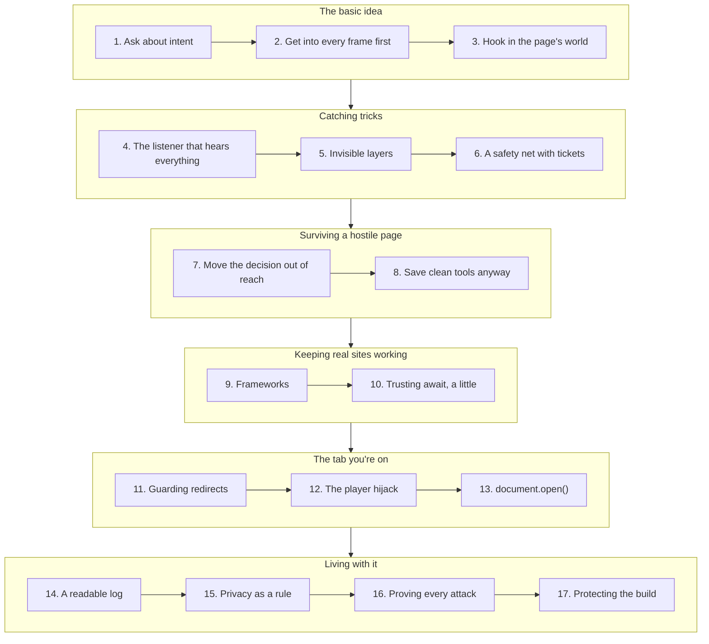
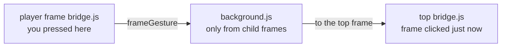

# Part IV · Every design decision, and why

[Index](../LEARN.md) · [Part 0](00-basics.md) · [Part I](01-attacks.md) · [Part II](02-extensions.md) · [Part III](03-popshield.md) · **Part IV** · [Part V](05-contributing.md) · [Glossary](glossary.md)

Part III described what PopShield does. This part tells the story of how it
got that way: each decision, roughly in the order it was made, starting with
the problem that forced it, the obvious answer and why that answer failed,
what was chosen instead, and what that choice costs. At the end of each story
you'll find the test scenarios that prove it (run any of them with
`npm run test:e2e -- <name>`, see [Part V](05-contributing.md)).

Reading this part is the difference between knowing how PopShield works and
being able to change it safely.

### Where each decision sits



- [1. Asking about intent instead of keeping a blacklist](#1-asking-about-intent-instead-of-keeping-a-blacklist)
- [2. Getting into every frame before the ads do](#2-getting-into-every-frame-before-the-ads-do)
- [3. Why the hooks have to live in the page's world](#3-why-the-hooks-have-to-live-in-the-pages-world)
- [4. Spotting the listener that hears everything](#4-spotting-the-listener-that-hears-everything)
- [5. Seeing through invisible layers](#5-seeing-through-invisible-layers)
- [6. A safety net with tickets](#6-a-safety-net-with-tickets)
- [7. Moving the decision out of the page's reach](#7-moving-the-decision-out-of-the-pages-reach)
- [8. Saving clean tools anyway](#8-saving-clean-tools-anyway)
- [9. Making room for frameworks](#9-making-room-for-frameworks)
- [10. Trusting `await`, but only a little](#10-trusting-await-but-only-a-little)
- [11. Guarding the tab you're on](#11-guarding-the-tab-youre-on)
- [12. Catching the player that hijacks the whole tab](#12-catching-the-player-that-hijacks-the-whole-tab)
- [13. Surviving `document.open()`](#13-surviving-documentopen)
- [14. Keeping the log readable](#14-keeping-the-log-readable)
- [15. Privacy as a design rule](#15-privacy-as-a-design-rule)
- [16. Proving every attack before blocking it](#16-proving-every-attack-before-blocking-it)
- [17. Protecting the build itself](#17-protecting-the-build-itself)

---

## 1. Asking about intent instead of keeping a blacklist

It started with a video player. On a free streaming site, every click on the
player, even on Play, opened an ad tab, and Chrome's own blocker let every one
through because a real click had happened.

```js
document.addEventListener('click', () => {   // the ad listens to every click in the page
  window.open('https://ad.example/');        // and opens an ad each time
});                                          // end of the ad's listener
```

The bluntest fix is to block every new tab a page opens. It works for about a
minute, until you try to share a video, sign in with Google, or pay for
something, all of which open a window. People would switch it off.

The usual fix is the one content blockers use: a list of known ad addresses.
But ad networks change addresses constantly, so the list has to be downloaded
and refreshed, which means network requests and someone else deciding what
runs in your browser. PopShield wanted neither. Asking you to approve each
tab was rejected too: people click "Allow" by reflex.

So PopShield asks a different question, the one Chrome doesn't: was the code
that's running right now handling a real click **on this specific element**?
A Share button's own listener passes. A listener on the whole document, which
fires whatever you click, doesn't.

```js
if (!event || event.eventPhase === 0) return 'no-gesture';       // no click is being delivered right now
if (!ACTIVATING.has(event.type)) return 'non-activating-event';  // it's a press, not a full click
if (isPageWide(event.currentTarget)) return 'page-wide-listener';// the running listener hears every click
return 'ok';                                                     // a real click on a specific element
```

The cost: an ad attached to the button itself looks exactly like a Share
button, and gets through. In return, PopShield needs no lists, no network and
no updates to keep up with new ad addresses.

Proof: `doc-click-popunder` (blocked), `legit-button-open` (allowed).

## 2. Getting into every frame before the ads do

A hook is useless if the ad already holds the original. Ad scripts that load
first save their own copy of `window.open`, and ads also live inside frames,
including blank frames created only to get a fresh `window.open`:

```js
const f = document.createElement('iframe');   // make a new blank frame
document.body.append(f);                      // put it in the page so it gets its own window
f.contentWindow.open('https://ad.example/');  // use that window's untouched open()
```

Injecting later, or only in the top frame, misses all of this. And a blank
frame has no web address for the extension's site-matching to work with, so a
normal content script wouldn't run there at all.

PopShield's content scripts run at `document_start`, before any page script,
in every frame (`all_frames`), and in blank and script-built frames too
(`match_origin_as_fallback`). On top of that, `inject.js` wraps the doors into
a frame (`contentWindow`, `contentDocument`) and installs its hooks in a new
frame's window before handing it to the page.

The cost: PopShield needs access to every site, which makes store review
stricter, and `match_origin_as_fallback` needs a recent Chrome (119+).

Proof: `iframe-pristine-open`, `frames-index-open`.

## 3. Why the hooks have to live in the page's world

Content scripts normally run in the isolated world, the soundproof room from
[Part II](02-extensions.md#4-two-worlds-inside-one-page). But the page calls
*its own* `window.open`, at its own table. Replacing `window.open` inside the
soundproof room changes nothing for the page.

Watching from outside isn't enough either. The service worker can see a new
tab appear and close it, but by then the ad's call has already succeeded and
the tab has flashed open. Adding a `<script>` tag to the page from the
outside is too late and can be refused by the page's security settings.

So a second content script, `inject.js`, is declared with `"world": "MAIN"`:
Chrome runs it at the page's table, first.

```js
const hookedOpen = function open(url, target) {               // PopShield's version of window.open
  if (ask('popup', absUrl(url)) !== 'ok') return null;        // ask the bridge; if refused, return nothing
  return R_apply(realOpen, this, arguments);                  // if allowed, call the real window.open
};                                                            // end of the hook
Object.defineProperty(window, 'open', {                       // install it as window.open...
  get: () => hookedOpen, set() {}, configurable: false        // ...so the page can't swap it back
});                                                           // end of the installation
```

The cost: the page's table belongs to the page, so whatever PopShield puts
there can be watched and tampered with. That single fact drives decisions 7
and 8.

Proof: nearly every `*-popunder` scenario.

## 4. Spotting the listener that hears everything

Popunder scripts don't know what you'll click, so they listen to *everything*,
and the cheapest way to do that is one listener high up in the page. The first
version of the rule only looked at `window`, `document`, `<html>` and
`<body>`. Then an ad moved its listener onto the `<div>` that wraps the whole
page, and it worked again:

```js
document.querySelector('#app')        // the page-sized wrapper around all the content
  .addEventListener('click', () => {  // hears every click, just like document would
    window.open(AD);                  // opens the ad
  });                                 // end of the listener
```

Blocking every open during a click would break Share buttons, so the rule had
to stay about *where* the listener is. The answer was to look at size. Any
ordinary element covering at least half of the visible page is treated as
page-wide, as are shadow roots. Buttons, links and form fields never are,
however big, because a giant "Download" button is still a button.

The cost: a site whose own code runs every button from a page-sized container
looks like an ad. Newer React does exactly that, which is why framework
recognition (decision 9) had to cover it.

Proof: `wrapper-div-popunder` (blocked), `legit-react17-root` (allowed).

## 5. Seeing through invisible layers

An ad that puts a transparent element over the whole page doesn't need a
page-wide listener: you click the ad's element itself, so its listener looks
perfectly "element-scoped". A related trick on a link shortener: a large,
visible ad image placed at the top of the stacking order, right over the
site's Continue button.

The first overlay check looked at the clicked element's own opacity. Ads
answered by making a *parent* transparent, or using `filter: opacity(0)`,
which leaves the element's own opacity at 1. And simply blocking anything at
the maximum stacking level (z-index) would break cookie banners, which sit
there legitimately.

So the bridge computes **effective opacity**, multiplied up the whole chain of
parents:

```js
let o = 1;                                          // start fully visible
for (let n = el; n; n = n.parentElement) {          // for the element and each parent above it
  o *= parseFloat(getComputedStyle(n).opacity);     // multiply by that one's opacity (filters count too)
}                                                   // o is how visible the element really is
```

An overlay is pinned in place, covers at least 35% of the view, and is either
effectively invisible (below 0.2) or an empty see-through box. A visible ad
layer counts only when the click hit non-interactive content, so a cookie
banner's buttons still work.

The cost: a few style lookups per click, and thresholds that are judgement
calls. An ad that is visible and small can still win; it just can't pretend
to be the page.

Proof: `overlay-anchor`, `overlay-div-listener`, `ad-layer-tab-under`
(blocked); `legit-max-z-modal`, `legit-big-image-link` (allowed).

## 6. A safety net with tickets

Every hook is a guess about how ads will open tabs, and sooner or later one
will find a way nobody guessed. Closing every new tab that PopShield didn't
open itself would break your own ctrl-clicks. Trusting that the hooks catch
everything means one miss and the protection is gone.

So PopShield added **defence in depth**: a second, independent layer. Every
time the bridge approves a tab, or sees you really click a link, it gives the
service worker a ticket. When the browser reports a new tab, the worker spends
a fitting ticket or closes the tab after a short grace period.

```js
if (takeToken(sourceTab, newTabUrl, sourceSite)) return;  // a fitting ticket: the user wanted it
await sleep(400);                                         // none: wait 0.4 s for a ticket on its way
if (takeToken(sourceTab, newTabUrl, sourceSite)) return;  // check again
chrome.tabs.remove(newTab);                               // still none: close it
```

A ticket that said only "one new tab, any address" could be stolen: you click
a link to a news site, and in the same instant an ad opens its own tab by
another route and spends your ticket. So each ticket names its destination,
and only a tab on that site may use it. Tickets last 3 seconds (15 for the
right-click menu, which takes a human a moment), and a tab holds at most four,
so none of them becomes a standing permission. Clicks on dead-end `#` links,
whose address an ad may swap mid-click, get "same site only" tickets.

The cost: a tab nobody approved may flicker open before it closes. Tickets
live in the worker's memory; if the worker were restarted between the ticket
and the tab, the tab would be closed (unlikely, since the ticket message
itself wakes the worker).

Proof: `backstop`, `decoy-hash-swap`.

## 7. Moving the decision out of the page's reach

This is the biggest change in PopShield's history.

Originally, `inject.js` made every decision itself, at the page's table. A
security audit then asked one question: *what if the page swaps the tools
PopShield uses?* Recall the shared toolboxes from
[Part 0](00-basics.md#5-reading-just-enough-javascript): one line of page
code can replace a tool for everyone. The audit found eight places where that
changed PopShield's verdict:

| Tool the page could swap | What the page would gain |
|---|---|
| the `currentTarget` reader on every event | a listener on `document` claims to be on a button |
| `toJSON` on every object | messages are rewritten as they're turned into text, a block becomes an allow |
| `Array.prototype.find` | "finds" a link that you never clicked, earning a ticket |
| `Error.prepareStackTrace` | forges a stack trace that looks like a button's handler |
| the readers on navigation events | a hijack redirect claims to be one you started |
| `String.prototype.trim` | changes how a link's address looks, fooling the dead-end link check |
| `RegExp.prototype.test` | every pattern check answers whatever the page wants |
| `UserActivation` | pretends you just clicked |

Two of them, written out:

```js
Object.defineProperty(Event.prototype, 'currentTarget', {   // swap the shared currentTarget reader...
  get() { return document.querySelector('button'); }        // ...so every event claims a button is listening
});                                                         // end of the swap
Object.prototype.toJSON = function () {                     // swap how every object becomes text...
  return { ...this, type: 'allow' };                        // ...turning any message into "allow"
};                                                          // end of the swap
```

The audit found one more hole, in the secret stamp. `document.open()` (decision
13) wipes a document's listeners, and the old code reconnected by saying hello
again, stamp included. By then page scripts were running, and one listening
for the hello could copy the stamp and forge messages on the private line.

That last finding explains why a stamp alone is never a security boundary.
It's a secret held by code at the page's table. If any tool that code uses is
fake, the secret can leak or the message can be changed. The stamp keeps
casual scripts out; it can't make decisions made at the page's table
trustworthy.

There were three possible answers. Patch each hole by saving that tool early:
necessary (decision 8), but there are hundreds of tools and one forgotten one
reopens everything. Lock the page's toolboxes: breaks real sites, which
legitimately add to them. Or move the decision somewhere the page can't
reach.

PopShield did the third. The isolated world, the soundproof room, sees the
same page and the same events, with its own clean tools. Now `inject.js` keeps
only what has to be at the page's table (the hooks, and two hints that only it
can see), and every decision, every ticket, the redirect guards and the log
live in `bridge.js`. The hook asks, synchronously:

```js
// in inject.js, at the page's table
function ask(kind, url) {                                   // may I open "kind" at "url"?
  if (!connected) return 'no-bridge';                       // no bridge: no
  answer = null;                                            // clear the answer slot
  post({ type: 'ask', id: ++askSeq, kind, url });           // send a custom event; the bridge runs right now
  return typeof answer === 'string' ? answer : 'no-answer'; // the bridge has already answered
}

// in bridge.js, in the soundproof room
document.addEventListener('ps-' + nonce + '-up', (e) => {   // listen on the private line
  const m = JSON.parse(e.detail);                           // read the question with clean tools
  const v = judge(m.url, m.async === true);                 // judge with clean tools
  down({ type: 'verdict', id: m.id, v });                   // send the answer back, also synchronously
});                                                         // end of the listener
```

Because sending an event runs its listeners before returning, the answer is
back before the hook decides whether to call the real `window.open`, while
your click is still being delivered.

The stamp leak was fixed by never saying hello twice: after `document.open()`,
both scripts reattach their listeners using the stamp they already share. And
the bridge stopped trusting `navigator.userActivation`: it tracks recent clicks
itself, from trusted events.

The result is the threat model PopShield has today. If a page breaks
`inject.js` completely, the worst it gets is skipping the early block: any tab
it opens has no ticket from the bridge, and the safety net closes it.

The cost: each hooked call now makes a round trip through two custom events
(still instant, and only when a page tries to open something). And one gap
remains: a page that fakes framework data (decision 9).

Proof: the whole suite passes with the decision in the bridge, and the attack
ideas above became regression tests.

## 8. Saving clean tools anyway

With no decisions left in `inject.js`, why bother protecting it? Because it
still has to work. If a page could make the hooks misbehave, it could break
the site's own legitimate popups, send garbage hints, or stop questions from
reaching the bridge. That would fail closed, so it's not a security hole, but
it's still a broken page.

So `inject.js` saves every built-in tool it will use at `document_start`,
before any page script, and always calls the saved copy, never the live one in
the shared toolbox:

```js
const R_apply = Reflect.apply;                                    // a saved "call this function" tool
const origDispatch = EventTarget.prototype.dispatchEvent;         // a saved copy of dispatchEvent
const evType = Object.getOwnPropertyDescriptor(Event.prototype, 'type').get;  // a saved reader for event.type
R_apply(origDispatch, document, [event]);                         // later: send an event with the saved copy
const type = R_apply(evType, e, []);                              // later: read e.type with the saved reader
```

Messages are built on objects with no shared toolbox at all
(`Object.create(null)`), so a swapped `toJSON` has nothing to attach to.

The cost: the code is harder to read (`R_apply(strToLower, s, [])` instead of
`s.toLowerCase()`), and every new tool must be added to the saved list. A
mistake here is now a reliability bug, not a security hole.

## 9. Making room for frameworks

Frameworks such as React, Solid and jQuery often run every button's code from
one high listener. Older React uses `document`; newer React uses a page-sized
root `<div>`; Solid uses `document` and keeps each handler on the element as
`$$click`; jQuery does it whenever a site writes
`$(document).on('click', '.share', fn)`. To the page-wide rule, the Share
button on such a site is indistinguishable from a popunder.

Allowing page-wide listeners whenever a framework is present would hand the
ad script on the same page a free pass. Reading the framework's data from the
bridge is impossible: it's page JavaScript, out of sight of the soundproof
room.

So `inject.js`, which can see it, finds the clicked element's *own* handler and
wraps it for that one click, telling the bridge when it starts and stops:

```js
const orig = props.onClick;                    // the clicked element's own handler (React's data)
props.onClick = function () {                  // a temporary wrapper around it that...
  fw(+1);                                      // ...tells the bridge "framework handler running"
  try { return orig.apply(this, arguments); }  // ...runs the real handler
  finally { fw(-1); }                          // ...and tells the bridge "done"
};                                             // the original is restored right after the click
```

While that's running, the bridge lifts only the page-wide rule. The ad's own
listener runs outside any wrapper and stays blocked.

jQuery needed stricter checks after review. A selector like `*` or `div`
matches nearly everything, so an ad using `$(document).on('click', '*', ...)`
would have been wrapped as a "framework handler". Now it must be a genuine
jQuery, and the selector must name a class, id or attribute, contain no
`:not(`, not match `<body>` or `<html>`, and match at most 50 elements.

The cost is a known gap. A page targeting PopShield can plant fake data on
the element you're about to click:

```js
play.__reactProps$x = {                  // fake React data on the Play button...
  onClick: () => window.open(AD)         // ...whose "handler" opens an ad
};                                       // the bridge will see a framework handler running
```

The bridge then approves honestly, so the safety net can't help. It only works
on the element you click, and only by aiming at PopShield on purpose.

Proof: `legit-react16`, `legit-jquery-delegated` (allowed);
`react16-site-plus-popunder`, `jquery-star-popunder` (blocked).

## 10. Trusting `await`, but only a little

A checkout button waits for the server, then opens the payment page:

```js
btn.addEventListener('click', async () => {   // an async click listener on the button
  await fetch('/order');                      // wait for the server; the click finishes meanwhile
  window.open('/pay');                        // open the payment tab afterwards
});                                           // end of the listener
```

By the time `window.open` runs, the click is over, and the bouncer says "no
click". Allowing any open within a few seconds of a click would let a
page-wide hook just wait a moment with a timer. Tracking every promise in the
page would be heavy and fragile.

Chrome's engine, V8, offered a better clue. Its stack traces survive `await`
and name what the original listener was attached to:

```text
at async HTMLButtonElement.<anonymous>   <- started in a button's listener
at HTMLDocument.<anonymous>              <- started in a listener on document
```

`inject.js` reads this and reports "after await, from an element". But stack
traces can be faked: a page can install `Error.prepareStackTrace` to rewrite
them, or call a function in a way that makes it look like it belongs to an
element. So the hint is treated as a claim. If `prepareStackTrace` is set, the
hint is simply "no". Even when it says "yes", the bridge only allows the open
if you really clicked (not on an overlay or ad layer) less than 5 seconds ago,
and the address is on this site or on a short list of sign-in and payment
providers (`ASYNC_OK`). That last rule came from a red-team test: a button
that waited, then opened an ad site.

```js
btn.addEventListener('click', async () => {   // a button's listener...
  await sleep(30);                            // ...waits a moment...
  window.open(AD);                            // ...then opens an ad site: blocked
});                                           // end of the listener
```

The cost: a site that waits and then opens an unrelated third-party site is
blocked; you can use **Open** in the popup.

Proof: `legit-async-open`, `legit-react17-async` (allowed);
`doc-async-await-popunder`, `async-cross-site-element` (blocked).

## 11. Guarding the tab you're on

Some ads don't open anything. They take your tab:

```js
document.addEventListener('click', () => {   // on any click...
  location.href = AD;                        // ...send this tab to the ad
});                                          // end of the listener
```

`location.href` can't be replaced by scripts, so there's nothing to hook. The
`beforeunload` event can only make Chrome ask "Leave site?", not cancel
quietly. The tool that fits is the Navigation API: its `navigate` event
announces a navigation of the top frame before it happens, and can cancel it.
The guard lives in the bridge, not the page's world, because the readers on
navigation events were one of the swappable tools in decision 7.

The guard leaves alone everything that's yours (links you click, addresses you
type, reloads, back and forward, downloads) and every move within the same
site. Of the rest, it blocks moves made during a click by a page-wide hook, an
overlay, an ad layer or a mouse-down, and moves made by a timer or
`<meta refresh>` right after a click, except to sign-in and payment providers.

Tab-unders taught a lesson about time limits. The first version blocked a
redirect for 2 seconds after a script-opened tab. An ad that waits 3 seconds
walks straight through. Now, after a script-opened tab, cross-site redirects
stay blocked **until your next real click**: there's no timer to wait out.
And since "open this same page in a new tab" is the signature of a tab-under,
that's blocked too, with anything after `?` ignored so a cache-busting
address doesn't disguise it.

The same thinking produced the popup-hijack rule: a popup that nobody has
clicked in yet may not be sent to another site (sign-in providers excepted,
because sign-in flows bounce between them).

The cost: an honest site that sends you to a partner site by timer right
after a click is blocked in Smart mode.

Proof: `click-redirect`, `open-self-redirect`, `tab-under`,
`element-tab-under` (blocked); `legit-same-site-redirect`,
`legit-onload-redirect`, `legit-link-navigation` (allowed).

## 12. Catching the player that hijacks the whole tab

The player frame from another site runs `top.location = AD` when you click
inside it:

```js
// this runs inside the player frame, which comes from another site
document.addEventListener('click', () => {   // on any click inside the player...
  top.location.href = AD;                    // ...send the whole tab to the ad
});                                          // end of the listener
```

Chrome sends **no** `navigate` event to the top page when a frame from another
origin starts the navigation, so decision 11's guard never hears about it.
Assigning to `location` can't be hooked. Doing nothing means losing the page.

What the top page does still get is `beforeunload`, and cancelling that makes
Chrome ask "Leave site?". A prompt is worse than a silent block, but much
better than losing the page. The hard part was asking only when the ad is
responsible, and never when you're leaving on purpose:

- **Within 4 seconds** of a click inside a frame, with no click on the main
  page since. Long enough for a slow ad script, short enough not to linger.
- **Only while the page has focus.** When you reload or type an address, the
  focus moves to Chrome's toolbar, so `document.hasFocus()` is false. An ad
  redirecting from inside the player leaves the focus on the page.
- **Only if the page contains a frame from another site.**

How does the top page know you clicked inside the frame? Your first click
moves focus into the frame, which the top page sees as a `blur`. Later clicks
don't move focus, so the frame's own `bridge.js` reports them. Frames from
different sites can't talk to each other directly, and the page's own
messaging (`postMessage`) could be forged by any script, so the report goes
through the service worker, which forwards it only from a child frame to the
top frame of the same tab, at most four times a second:



The cost: you see a question and must click **Cancel**.

Proof: `player-iframe-top-redirect`, `player-iframe-top-redirect-2nd`
(prompt); `legit-player-then-reload`, `legit-player-then-type-url`,
`legit-leave-after-player` (no prompt).

## 13. Surviving `document.open()`

Ad boxes and chat widgets often build a frame by writing its contents from a
script:

```js
const d = frame.contentDocument;   // the new frame's document
d.open();                          // start writing: this wipes the document, listeners included
d.write('<a href="#">...</a>');    // write the new contents
d.close();                         // finish writing
```

`document.open()` removes every listener on the document, including
PopShield's private line and click listeners. The frame would be left
unprotected. The old fix, saying hello again, leaked the stamp (decision 7).

Now both scripts watch the document with a `MutationObserver` (a browser tool
that reports changes to the DOM). When the document's root element is
replaced, they reattach their listeners with the stamp they already share. No
second hello.

```js
new MutationObserver(() => {                                // report changes to the document's children
  if (document.documentElement === root) return;            // root unchanged: nothing to do
  root = document.documentElement;                          // remember the new root
  document.addEventListener('ps-' + nonce + '-up', onUp);   // reattach the private line, same stamp
  armWindow();                                              // reattach the click listeners
}).observe(document, { childList: true });                   // watch the document's direct children
```

`inject.js` also wraps `document.open`, `write` and `writeln` to reattach its
framework listeners.

The cost: a little extra code in both scripts.

Proof: `adbox-frame`, `legit-chat-widget-link`.

## 14. Keeping the log readable

On a real streaming site, a blocked ad script retried `window.open` hundreds
of times per click. Every attempt became a message, a storage write and a
badge update. The popup filled with copies, and the service worker was
flooded.

Limits now apply at both ends. The bridge writes each distinct block (same
kind, reason and address) at most once every 5 seconds, and at most 20 per 10
seconds per frame. The worker accepts at most 30 block messages (and 12 ticket
messages) per 10 seconds per tab, and writes the list through a single queue
so simultaneous blocks don't overwrite each other.

The cost: during a retry storm the badge undercounts, which is what you'd
want anyway.

Proof: `retry-loop-popunder` (301 attempts, a handful of entries).

## 15. Privacy as a design rule

An extension that runs on every page sees everything you browse. The easy
path, "send usage data to improve the product", "keep a history of blocked
sites", "share your stats", turns a blocker into a tracker. PopShield treats
privacy as a rule, not a setting:

- **No telemetry, no network requests, ever.** The CI pipeline searches the
  source for network calls and fails if it finds one.
- **Never record which sites you visit.** Persistent storage holds your mode
  choices and an anonymous counter (total, per day, per kind) and nothing
  else. When a per-site counter was considered, it was dropped for this
  reason.
- **The per-tab list dies with the tab**: memory only, wiped when the tab
  moves on or closes, gone when the browser exits.
- **Report buttons instead of telemetry.** To learn where ads get through, the
  popup opens a pre-filled public GitHub issue that you read, edit and submit
  yourself. The pre-filled address has everything after `?` removed, because
  that part can hold personal tokens.
- **No share buttons or social features.** They'd need network access or leak
  where you've been, and protect nothing.

The cost: the project learns only what users choose to report.

## 16. Proving every attack before blocking it

A test that says "with PopShield, no ad tab opened" proves nothing if the
attack never worked; Chrome's own blocker may already stop it. So every attack
scenario runs twice in real Chromium: first **without** PopShield, where the
attack must succeed (the **baseline**), then with it, where it must fail. Every
rule that could hit real sites has a `legit-*` twin that must keep working
and log nothing, which is how false positives are caught.

Reviewers also act as a **red team**: they write new ways to get past
PopShield. Each one that works becomes a scenario (`wrapper-div-popunder`,
`svg-link-dispatch` and `async-cross-site-element` started this way), stays
red until fixed, and then guards against regressions forever.

Real browsers are slow, so the suite runs many of them in parallel
(`E2E_WORKERS`, sized from the machine's processors and memory), splitting the
work between the baseline and PopShield runs.

The cost: browser tests take longer than plain code tests, and the fixture
server's fixed ports allow only one test run at a time per machine.

## 17. Protecting the build itself

An extension with access to every site is a prize. If the pipeline that builds
it were compromised (a hijacked automation step, a malicious install script in
a dependency, a leaked access token), the published package could contain
anything. The GitHub workflows are hardened against that:

```yaml
- uses: actions/checkout@11d5960a326750d5838078e36cf38b85af677262 # v4   # pinned to one exact commit
  with:                                                                    # options for this step:
    persist-credentials: false                                             # don't leave the access token on disk
- run: npm ci --ignore-scripts                                             # install exact versions, run no install scripts
```

- Each third-party step is pinned to an exact commit **SHA** (a fingerprint of
  the code), not a version tag. A tag can be moved to different code; a SHA
  can't.
- `persist-credentials: false` keeps the repository's access token from being
  left behind for later steps to pick up.
- `npm ci --ignore-scripts` installs exactly what the lockfile lists and runs
  none of the packages' own install scripts.
- A release is split in two. A read-only **build** job runs all the
  third-party code (npm, Playwright, the tests) and builds the zip. A small
  **publish** job, the only one allowed to write, runs nothing but the
  download of that zip, a **build-provenance attestation** (a signed record of
  which workflow and commit produced it), and the release command.

The cost: pinned SHAs must be bumped (Dependabot does that), and the release
workflow is a little longer.

### Check your understanding

1. Why did the decision move to the isolated world, when saving clean tools in
   `inject.js` already blocked most attacks?
2. Why does tab-under protection last until your next click instead of a few
   seconds?
3. Why does the frame-click report travel through the service worker?
4. What's the one attack the safety net can't stop, and why?

<details><summary>Answers</summary>

1. One forgotten tool would be enough to fool decisions made at the page's
   table. In the isolated world every tool is clean, so there's nothing to
   forget.
2. A time limit can simply be waited out by the ad.
3. Frames from different sites can't talk directly, and page messaging could
   be forged; the worker only forwards reports from child frames to the top
   frame of the same tab.
4. Faked framework data on the element you click: the bridge is fooled into
   approving, so a ticket exists.

</details>

---

Next: [Part V · Becoming a contributor](05-contributing.md)
