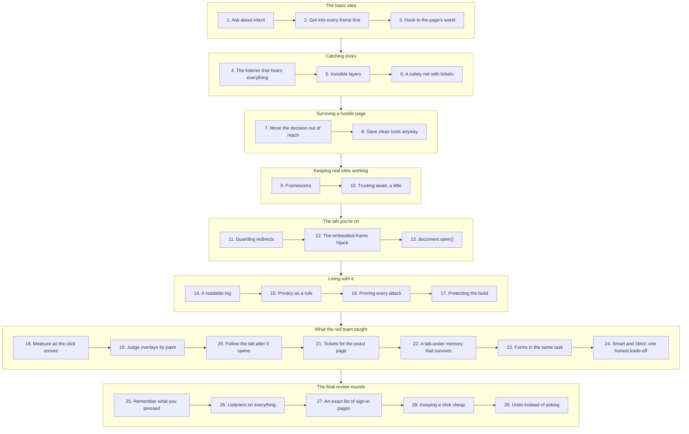
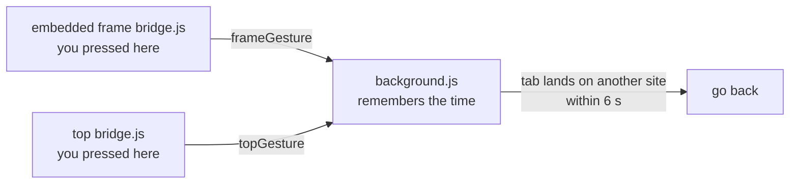

# Part IV · Every design decision, and why

[Index](../LEARN.md) · [Part 0](00-basics.md) · [Part I](01-attacks.md) · [Part II](02-extensions.md) · [Part III](03-popshield.md) · **Part IV** · [Part V](05-contributing.md) · [Glossary](glossary.md)

Part III described what PopShield does. This part tells the story of how it
got that way: each decision, roughly in the order it was made, starting with
the problem that forced it, the obvious answer and why that answer failed,
what was chosen instead, and what that choice costs. At the end of each story
you'll find the test scenarios that prove it (run any of them with
`npm run test:e2e -- <name>`, see [Part V](05-contributing.md)).

Reading this part is the difference between knowing how PopShield works and
being able to change it safely.

### Where each decision sits



- [1. Asking about intent instead of keeping a blacklist](#1-asking-about-intent-instead-of-keeping-a-blacklist)
- [2. Getting into every frame before the ads do](#2-getting-into-every-frame-before-the-ads-do)
- [3. Why the hooks have to live in the page's world](#3-why-the-hooks-have-to-live-in-the-pages-world)
- [4. Spotting the listener that hears everything](#4-spotting-the-listener-that-hears-everything)
- [5. Seeing through invisible layers](#5-seeing-through-invisible-layers)
- [6. A safety net with tickets](#6-a-safety-net-with-tickets)
- [7. Moving the decision out of the page's reach](#7-moving-the-decision-out-of-the-pages-reach)
- [8. Saving clean tools anyway](#8-saving-clean-tools-anyway)
- [9. Making room for frameworks](#9-making-room-for-frameworks)
- [10. Trusting `await`, but only a little](#10-trusting-await-but-only-a-little)
- [11. Guarding the tab you're on](#11-guarding-the-tab-youre-on)
- [12. Catching the embedded frame that hijacks the whole tab](#12-catching-the-embedded-frame-that-hijacks-the-whole-tab)
- [13. Surviving `document.open()`](#13-surviving-documentopen)
- [14. Keeping the log readable](#14-keeping-the-log-readable)
- [15. Privacy as a design rule](#15-privacy-as-a-design-rule)
- [16. Proving every attack before blocking it](#16-proving-every-attack-before-blocking-it)
- [17. Protecting the build itself](#17-protecting-the-build-itself)
- [18. Measuring the page as your click arrives](#18-measuring-the-page-as-your-click-arrives)
- [19. Judging overlays by what they paint](#19-judging-overlays-by-what-they-paint)
- [20. Following a tab after it opens](#20-following-a-tab-after-it-opens)
- [21. Tickets for the exact page you clicked](#21-tickets-for-the-exact-page-you-clicked)
- [22. A tab-under memory that survives a page change](#22-a-tab-under-memory-that-survives-a-page-change)
- [23. Forms count only in the same task as your action](#23-forms-count-only-in-the-same-task-as-your-action)
- [24. Smart and Strict: one honest trade-off](#24-smart-and-strict-one-honest-trade-off)
- [25. Remembering what you pressed](#25-remembering-what-you-pressed)
- [26. Listeners on everything](#26-listeners-on-everything)
- [27. An exact list of sign-in and payment pages](#27-an-exact-list-of-sign-in-and-payment-pages)
- [28. Keeping a click cheap](#28-keeping-a-click-cheap)
- [29. Undoing a frame takeover instead of asking](#29-undoing-a-frame-takeover-instead-of-asking)

---

## 1. Asking about intent instead of keeping a blacklist

It started with a page where every click opened an ad tab: a click on a
button, on a link, anywhere on the page. Chrome's own blocker let every one
through, because a real click had happened.

```js
document.addEventListener('click', () => {   // the ad listens to every click in the page
  window.open('https://ad.example/');        // and opens an ad each time
});                                          // end of the ad's listener
```

The bluntest fix is to block every new tab a page opens. It works for about a
minute, until you try to share a page, sign in with Google, or pay for
something, all of which open a window. People would switch it off.

The usual fix is the one content blockers use: a list of known ad addresses.
But ad networks change addresses constantly, so the list has to be downloaded
and refreshed, which means network requests and someone else deciding what
runs in your browser. PopShield wanted neither. Asking you to approve each
tab was rejected too: people click "Allow" by reflex.

So PopShield asks a different question, the one Chrome doesn't: was the code
that's running right now handling a real click **on this specific element**?
A Share button's own listener passes. A listener on the whole document, which
fires whatever you click, doesn't.

```js
if (!event || event.eventPhase === 0) return 'no-gesture';       // no click is being delivered right now
if (!ACTIVATING.has(event.type)) return 'non-activating-event';  // it's a press, not a full click
if (isPageWide(event.currentTarget)) return 'page-wide-listener';// the running listener hears every click
return 'ok';                                                     // a real click on a specific element
```

The cost: an ad attached to the button itself looks exactly like a Share
button, and gets through. In return, PopShield needs no lists, no network and
no updates to keep up with new ad addresses.

Proof: `doc-click-popunder` (blocked), `legit-button-open` (allowed).

## 2. Getting into every frame before the ads do

A hook is useless if the ad already holds the original. Ad scripts that load
first save their own copy of `window.open`, and ads also live inside frames,
including blank frames created only to get a fresh `window.open`:

```js
const f = document.createElement('iframe');   // make a new blank frame
document.body.append(f);                      // put it in the page so it gets its own window
f.contentWindow.open('https://ad.example/');  // use that window's untouched open()
```

Injecting later, or only in the top frame, misses all of this. And a blank
frame has no web address for the extension's site-matching to work with, so a
normal content script wouldn't run there at all.

PopShield's content scripts run at `document_start`, before any page script,
in every frame (`all_frames`), and in blank and script-built frames too
(`match_origin_as_fallback`). On top of that, `inject.js` wraps the doors into
a frame (`contentWindow`, `contentDocument`) and installs its hooks in a new
frame's window before handing it to the page.

The cost: PopShield needs access to every site, which makes store review
stricter, and `match_origin_as_fallback` needs a recent Chrome (119+).

Proof: `iframe-pristine-open`, `frames-index-open`.

## 3. Why the hooks have to live in the page's world

Content scripts normally run in the isolated world, the soundproof room from
[Part II](02-extensions.md#4-two-worlds-inside-one-page). But the page calls
*its own* `window.open`, at its own table. Replacing `window.open` inside the
soundproof room changes nothing for the page.

Observing from outside isn't enough either. The service worker can see a new
tab appear and close it, but by then the ad's call has already succeeded and
the tab has flashed open. Adding a `<script>` tag to the page from the
outside is too late and can be refused by the page's security settings.

So a second content script, `inject.js`, is declared with `"world": "MAIN"`:
Chrome runs it at the page's table, first.

```js
const hookedOpen = function open(url, target) {               // PopShield's version of window.open
  if (ask('popup', absUrl(url)) !== 'ok') return null;        // ask the bridge; if refused, return nothing
  return R_apply(realOpen, this, arguments);                  // if allowed, call the real window.open
};                                                            // end of the hook
Object.defineProperty(window, 'open', {                       // install it as window.open...
  get: () => hookedOpen, set() {}, configurable: false        // ...so the page can't swap it back
});                                                           // end of the installation
```

The cost: the page's table belongs to the page, so whatever PopShield puts
there can be seen and tampered with. That single fact drives decisions 7
and 8.

Proof: nearly every `*-popunder` scenario.

## 4. Spotting the listener that hears everything

Popunder scripts don't know what you'll click, so they listen to *everything*,
and the cheapest way to do that is one listener high up in the page. The first
version of the rule only looked at `window`, `document`, `<html>` and
`<body>`. Then an ad moved its listener onto the `<div>` that wraps the whole
page, and it worked again:

```js
document.querySelector('#app')        // the page-sized wrapper around all the content
  .addEventListener('click', () => {  // hears every click, just like document would
    window.open(AD);                  // opens the ad
  });                                 // end of the listener
```

Blocking every open during a click would break Share buttons, so the rule had
to stay about *where* the listener is. The answer was to look at size. Any
ordinary element covering a large part of the visible page is treated as
page-wide, as are shadow roots. Buttons, links and form fields never are,
however big, because a giant "Download" button is still a button.

The first line was drawn at half the page. A red team answered with two
wrappers stacked one above the other, each covering 49%: neither crossed the
line, and together they heard every click. The line now sits at 40%, which
leaves no room for two wrappers to share the page between them. Decision 18
explains why the size is measured as your click arrives, not when the ad asks.

The cost: a site whose own code runs every button from a page-sized container
looks like an ad. Newer React does exactly that, which is why framework
recognition (decision 9) had to cover it.

Proof: `wrapper-div-popunder` (blocked), `legit-react17-root` (allowed).

## 5. Seeing through invisible layers

An ad that puts a transparent element over the whole page doesn't need a
page-wide listener: you click the ad's element itself, so its listener looks
perfectly "element-scoped". A related trick seen on a page: a large,
visible ad image placed at the top of the stacking order, right over the
site's Continue button.

The first overlay check looked at the clicked element's own opacity. Ads
answered by making a *parent* transparent, or using `filter: opacity(0)`,
which leaves the element's own opacity at 1. And simply blocking anything at
the maximum stacking level (z-index) would break cookie banners, which sit
there legitimately.

So the bridge computes **effective opacity**, multiplied up the whole chain of
parents:

```js
let o = 1;                                          // start fully visible
for (let n = el; n; n = n.parentElement) {          // for the element and each parent above it
  o *= parseFloat(getComputedStyle(n).opacity);     // multiply by that one's opacity (filters count too)
}                                                   // o is how visible the element really is
```

An overlay covers at least 35% of the view and is either effectively
invisible (below 0.2) or paints nothing you could see. (The first version
also required it to be pinned in place, and checked only a few obvious kinds
of content; decision 19 tells how both changed.) A visible ad layer counts
only when the click hit non-interactive content, so a cookie banner's buttons
still work.

The cost: a few style lookups per click, and thresholds that are judgement
calls. An ad that is visible and small can still win; it just can't pretend
to be the page.

Proof: `overlay-anchor`, `overlay-div-listener`, `ad-layer-tab-under`,
`rt-overlay-parent-opacity` (blocked); `legit-max-z-modal`,
`legit-big-image-link` (allowed).

## 6. A safety net with tickets

Every hook is a guess about how ads will open tabs, and sooner or later one
will find a way nobody guessed. Closing every new tab that PopShield didn't
open itself would break your own ctrl-clicks. Trusting that the hooks catch
everything means one miss and the protection is gone.

So PopShield added **defence in depth**: a second, independent layer. Every
time the bridge approves a tab, or sees you really click a link, it gives the
service worker a ticket. When the browser reports a new tab, the worker spends
a fitting ticket or closes the tab after a short grace period.

```js
if (takeToken(sourceTab, newTabUrl, sourceSite)) return;  // a fitting ticket: the user wanted it
await sleep(400);                                         // none: wait 0.4 s for a ticket on its way
if (takeToken(sourceTab, newTabUrl, sourceSite)) return;  // check again
chrome.tabs.remove(newTab);                               // still none: close it
```

A ticket that said only "one new tab, any address" could be stolen: you click
a link to a news site, and in the same instant an ad opens its own tab by
another route and spends your ticket. So each ticket names its destination,
and only a tab on that site may use it. (Tickets for links you click later
became stricter still, naming the exact page: decision 21.) Tickets last 3
seconds (8 for the right-click menu, which takes a human a moment; that one
started at 15 and was shortened, as decision 21 tells), and a tab holds at
most four, so none of them becomes a standing permission. Clicks on dead-end `#` links,
whose address an ad may swap mid-click, get "same site only" tickets.

The cost: a tab nobody approved may flicker open before it closes. Tickets
live in the worker's memory; if the worker were restarted between the ticket
and the tab, the tab would be closed (unlikely, since the ticket message
itself wakes the worker).

Proof: `backstop`, `decoy-hash-swap`, `rt-real-link-token-race`.

## 7. Moving the decision out of the page's reach

This is the biggest change in PopShield's history.

Originally, `inject.js` made every decision itself, at the page's table. An
internal security review then asked one question: *what if the page swaps the tools
PopShield uses?* Recall the shared toolboxes from
[Part 0](00-basics.md#5-reading-just-enough-javascript): one line of page
code can replace a tool for everyone. The review found eight places where that
changed PopShield's verdict:

| Tool the page could swap | What the page would gain |
|---|---|
| the `currentTarget` reader on every event | a listener on `document` claims to be on a button |
| `toJSON` on every object | messages are rewritten as they're turned into text, a block becomes an allow |
| `Array.prototype.find` | "finds" a link that you never clicked, earning a ticket |
| `Error.prepareStackTrace` | forges a stack trace that looks like a button's handler |
| the readers on navigation events | a hijack redirect claims to be one you started |
| `String.prototype.trim` | changes how a link's address looks, fooling the dead-end link check |
| `RegExp.prototype.test` | every pattern check answers whatever the page wants |
| `UserActivation` | pretends you just clicked |

Two of them, written out:

```js
Object.defineProperty(Event.prototype, 'currentTarget', {   // swap the shared currentTarget reader...
  get() { return document.querySelector('button'); }        // ...so every event claims a button is listening
});                                                         // end of the swap
Object.prototype.toJSON = function () {                     // swap how every object becomes text...
  return { ...this, type: 'allow' };                        // ...turning any message into "allow"
};                                                          // end of the swap
```

The review found one more hole, in the secret stamp. `document.open()` (decision
13) wipes a document's listeners, and the old code reconnected by saying hello
again, stamp included. By then page scripts were running, and one listening
for the hello could copy the stamp and forge messages on the private line.

That last finding explains why a stamp alone is never a security boundary.
It's a secret held by code at the page's table. If any tool that code uses is
fake, the secret can leak or the message can be changed. The stamp keeps
casual scripts out; it can't make decisions made at the page's table
trustworthy.

There were three possible answers. Patch each hole by saving that tool early:
necessary (decision 8), but there are hundreds of tools and one forgotten one
reopens everything. Lock the page's toolboxes: breaks real sites, which
legitimately add to them. Or move the decision somewhere the page can't
reach.

PopShield did the third. The isolated world, the soundproof room, sees the
same page and the same events, with its own clean tools. Now `inject.js` keeps
only what has to be at the page's table (the hooks, and two hints that only it
can see), and every decision, every ticket, the redirect guards and the log
live in `bridge.js`. The hook asks, synchronously:

```js
// in inject.js, at the page's table
function ask(kind, url) {                                   // may I open "kind" at "url"?
  if (!connected) return 'no-bridge';                       // no bridge: no
  answer = null;                                            // clear the answer slot
  post({ type: 'ask', id: ++askSeq, kind, url });           // send a custom event; the bridge runs right now
  return typeof answer === 'string' ? answer : 'no-answer'; // the bridge has already answered
}

// in bridge.js, in the soundproof room
document.addEventListener('ps-' + nonce + '-up', (e) => {   // listen on the private line
  const m = JSON.parse(e.detail);                           // read the question with clean tools
  const v = judge(m.url, m.async === true);                 // judge with clean tools
  down({ type: 'verdict', id: m.id, v });                   // send the answer back, also synchronously
});                                                         // end of the listener
```

Because sending an event runs its listeners before returning, the answer is
back before the hook decides whether to call the real `window.open`, while
your click is still being delivered.

The stamp leak was fixed by never saying hello twice: after `document.open()`,
both scripts reattach their listeners using the stamp they already share. And
the bridge stopped trusting `navigator.userActivation`: it tracks recent clicks
itself, from trusted events.

The result is the threat model PopShield has today. If a page breaks
`inject.js` completely, the worst it gets is skipping the early block: any tab
it opens has no ticket from the bridge, and the safety net closes it.

The cost: each hooked call now makes a round trip through two custom events
(still instant, and only when a page tries to open something). And one gap
remains: a page that fakes framework data (decision 9).

Proof: the whole suite passes with the decision in the bridge, and the attack
ideas above became regression tests.

## 8. Saving clean tools anyway

With no decisions left in `inject.js`, why bother protecting it? Because it
still has to work. If a page could make the hooks misbehave, it could break
the site's own legitimate popups, send garbage hints, or stop questions from
reaching the bridge. That would fail closed, so it's not a security hole, but
it's still a broken page.

So `inject.js` saves every built-in tool it will use at `document_start`,
before any page script, and always calls the saved copy, never the live one in
the shared toolbox:

```js
const R_apply = Reflect.apply;                                    // a saved "call this function" tool
const origDispatch = EventTarget.prototype.dispatchEvent;         // a saved copy of dispatchEvent
const evType = Object.getOwnPropertyDescriptor(Event.prototype, 'type').get;  // a saved reader for event.type
R_apply(origDispatch, document, [event]);                         // later: send an event with the saved copy
const type = R_apply(evType, e, []);                              // later: read e.type with the saved reader
```

Messages are built on objects with no shared toolbox at all
(`Object.create(null)`), so a swapped `toJSON` has nothing to attach to.

The rule is "every tool", and the final security review held the code to it.
It found a few tools still used live: the pattern matcher (a saved
`RegExp.prototype.test` quietly looks up the *live* `exec` inside, so the
saved copy is now `exec` itself), `querySelectorAll`, the readers for
`document.body` and `document.documentElement`, `Object.getPrototypeOf`,
`Promise.reject` and `DOMException`. All are saved now. Even `for...of` loops
were replaced with plain counting loops, because `for...of` asks the shared
array toolbox for its iterator, and a page can swap that too.

The cost: the code is harder to read (`R_apply(strToLower, s, [])` instead of
`s.toLowerCase()`), and every new tool must be added to the saved list. A
mistake here is now a reliability bug, not a security hole.

## 9. Making room for frameworks

Frameworks such as React, Solid and jQuery often run every button's code from
one high listener. Older React uses `document`; newer React uses a page-sized
root `<div>`; Solid uses `document` and keeps each handler on the element as
`$$click`; jQuery does it whenever a site writes
`$(document).on('click', '.share', fn)`. To the page-wide rule, the Share
button on such a site is indistinguishable from a popunder.

Allowing page-wide listeners whenever a framework is present would hand the
ad script on the same page a free pass. Reading the framework's data from the
bridge is impossible: it's page JavaScript, out of sight of the soundproof
room.

So `inject.js`, which can see it, finds the clicked element's *own* handler and
wraps it for that one click, telling the bridge when it starts and stops:

```js
const orig = props.onClick;                    // the clicked element's own handler (React's data)
props.onClick = function () {                  // a temporary wrapper around it that...
  fw(+1);                                      // ...tells the bridge "framework handler running"
  try { return orig.apply(this, arguments); }  // ...runs the real handler
  finally { fw(-1); }                          // ...and tells the bridge "done"
};                                             // the original is restored right after the click
```

While that's running, the bridge lifts only the page-wide rule. The ad's own
listener runs outside any wrapper and stays blocked.

jQuery needed stricter checks after review. A selector like `*` or `div`
matches nearly everything, so an ad using `$(document).on('click', '*', ...)`
would have been wrapped as a "framework handler". Now it must be a genuine
jQuery, and the selector must name a class, id or attribute, contain no
`:not(`, not match `<body>` or `<html>`, and match at most 50 elements.

Framework data is only a property on an element, so a page can write its
own. The red team did exactly that, at the last possible moment: a listener
on `pointerdown` planted fake React data on whatever you were pressing, and a
`document` listener called it on `click`.

```js
document.addEventListener('pointerdown', (e) => {      // when you press anywhere...
  e.target.__reactProps$x = {                          // ...plant fake React data on what you pressed
    onClick: () => window.open(AD),                    // ...whose "handler" opens an ad
  };
}, true);                                              // (in the capture phase, so it runs early)
document.addEventListener('click', (e) => {            // then, on the click...
  e.target.__reactProps$x.onClick();                   // ...call the planted "handler" from a page-wide listener
});
```

The answer is a snapshot of its own. `inject.js` listens for the **first press
event** of every click (normally `pointerdown`, before any page listener),
and notes which React data objects are already on the elements under your
pointer. Only those may be wrapped later in the click; anything planted after
the press is ignored.

```js
function onPress(e) {                                  // runs first on every pointerdown (and touchstart, keydown)
  propsAtPress = new WeakSet();                        // forget the previous click's list
  for (const n of e.composedPath()) {                  // for every element under the pointer...
    for (const k of Object.keys(n)) {                  // ...look at its own properties
      if (k.startsWith('__react')) propsAtPress.add(n[k]);  // remember each React data object found
    }
  }
}
```

The cost is a gap that remains. A page targeting PopShield can still plant
fake data on the element ahead of time, before you press, or fake a Solid or
jQuery handler, which isn't snapshotted. The bridge then approves honestly.
The ticket it issues is weak, so the worker follows the new tab (decision
20), which catches a bounce through a redirector, but not an open straight to
the ad. It only works on the element you click, and only by aiming at
PopShield on purpose.

Proof: `legit-react16`, `legit-jquery-delegated` (allowed);
`react16-site-plus-popunder`, `jquery-star-popunder`, `rt-fake-react-props`,
`rt-fake-jquery` (blocked).

## 10. Trusting `await`, but only a little

A checkout button waits for the server, then opens the payment page:

```js
btn.addEventListener('click', async () => {   // an async click listener on the button
  await fetch('/order');                      // wait for the server; the click finishes meanwhile
  window.open('/pay');                        // open the payment tab afterwards
});                                           // end of the listener
```

By the time `window.open` runs, the click is over, and the bouncer says "no
click". Allowing any open within a few seconds of a click would let a
page-wide hook just wait a moment with a timer. Tracking every promise in the
page would be heavy and fragile.

Chrome's engine, V8, offered a better clue. Its stack traces survive `await`
and name what the original listener was attached to:

```text
at async HTMLButtonElement.<anonymous>   <- started in a button's listener
at HTMLDocument.<anonymous>              <- started in a listener on document
```

`inject.js` reads this and reports "after await, from an element". But stack
traces can be faked: a page can install `Error.prepareStackTrace` to rewrite
them, or call a function in a way that makes it look like it belongs to an
element. So the hint is treated as a claim. If `prepareStackTrace` is set, the
hint is simply "no".

A red team found a subtler forgery. A timer can't resume an `await`, but it can
call into an element's listener, by sending a fake event to a button:

```js
const b = document.createElement('button');            // a button that is never shown
b.addEventListener('x', () => window.open(AD));        // its listener opens the ad
document.addEventListener('click', () => {             // on any click...
  setTimeout(() => b.dispatchEvent(new Event('x')), 0); // ...a timer pokes the button a moment later
});
```

The stack trace then does contain a button's listener, just not at the
**bottom**. When an `await` resumes, the element's listener is the very first
thing running, the bottom of the stack; when a timer calls in, the timer's
own function sits underneath. So the hint now requires the element's listener
to be the bottom of the synchronous stack.

Even when the hint says "yes", the bridge only allows the open if you really
clicked (not on an overlay or ad layer) less than 5 seconds ago, and the
address is on this site or is a sign-in or payment page of a known provider.
That last rule came from another red-team test: a button that waited, then
opened an ad site. What exactly counts as a "sign-in or payment page" was
tightened twice more; decision 27 tells that story. And because the whole
decision rests on a hint, the ticket is weak, and the worker follows the tab
(decision 20).

```js
btn.addEventListener('click', async () => {   // a button's listener...
  await sleep(30);                            // ...waits a moment...
  window.open(AD);                            // ...then opens an ad site: blocked
});                                           // end of the listener
```

The cost: a site that waits and then opens an unrelated third-party site is
blocked; you can use **Open** in the popup.

Proof: `legit-async-open`, `legit-react17-async` (allowed);
`doc-async-await-popunder`, `async-cross-site-element`,
`rt-prepare-stack-trace`, `rt-bound-element-receiver`,
`rt-async-forge-redirector` (blocked).

## 11. Guarding the tab you're on

Some ads don't open anything. They take your tab:

```js
document.addEventListener('click', () => {   // on any click...
  location.href = AD;                        // ...send this tab to the ad
});                                          // end of the listener
```

`location.href` can't be replaced by scripts, so there's nothing to hook. The
tool that fits is the Navigation API: its `navigate` event
announces a navigation of the top frame before it happens, and can cancel it.
The guard lives in the bridge, not the page's world, because the readers on
navigation events were one of the swappable tools in decision 7.

The guard leaves alone everything that's yours (links you click, addresses you
type, reloads, back and forward, downloads) and every move within the same
site. Of the rest, it blocks moves made during a click by a page-wide hook, an
overlay, an ad layer or a mouse-down, and moves made by a timer or
`<meta refresh>` right after a click, except to sign-in and payment pages
(decision 27).

Tab-unders taught a lesson about time limits. The first version blocked a
redirect for 2 seconds after a script-opened tab. An ad that waits 3 seconds
walks straight through. So the rule became: after a new tab leaves this tab,
cross-site redirects stay blocked **until you press something again**, so
there's no short timer to wait out. Decision 22 tells how that rule had to
grow to cover any new tab, survive a hop to another page, and why it now has
a 60-second limit. And since "open this same page in a new tab" is the
signature of a tab-under, that's blocked too, with anything after `?` ignored
so a cache-busting address doesn't disguise it.

The same thinking produced the popup-hijack rule: a popup that nobody has
clicked in yet may not be sent to another site. It used to make an exception
for sign-in pages, and so did the tab-under rule; decision 27 explains why
they no longer do. A page can also open its popup with `noopener`, which hides
from the popup who opened it. So when the worker allows a new tab on thin
evidence (decision 20), it tells the tab's first page so, and the
popup-hijack rule applies there as well.

A move to the **same site** is never cancelled, because sites hop between
their own pages constantly. But a red team sent the tab to a same-site
redirector that bounced on to an ad, so a suspicious same-site move is now
let through and *followed* (decision 20).

The cost: an honest site that sends you to a partner site by timer right
after a click is blocked. And the guard deliberately lets a script redirect
through more than 5 seconds after a click in Smart mode (decision 24).

Proof: `click-redirect`, `open-self-redirect`, `tab-under`,
`element-tab-under` (blocked); `legit-same-site-redirect`,
`legit-onload-redirect`, `legit-link-navigation` (allowed).

## 12. Catching the embedded frame that hijacks the whole tab

A frame embedded from another site (a widget, for example) runs
`top.location = AD` when you click inside it:

```js
// this runs inside the embedded frame, which comes from another site
document.addEventListener('click', () => {   // on any click inside the frame...
  top.location.href = AD;                    // ...send the whole tab to the ad
});                                          // end of the listener
```

Chrome sends **no** `navigate` event to the top page when a frame from another
origin starts the navigation, so decision 11's guard never hears about it.
Assigning to `location` can't be hooked. Doing nothing means losing the page.

What PopShield can still do is notice afterwards. The service worker hears
every time the tab lands on a new page (`webNavigation.onCommitted`), and it
can press Back for the tab (`chrome.tabs.goBack`). So the worker undoes the
hijack, and the hard part is undoing it only when the ad is responsible,
never when you're leaving on purpose:

- **Within 6 seconds** of a press inside a frame, with no press on the page
  itself since. Long enough for a slow ad script, short enough not to linger.
  (It was 4 seconds until a red-team frame simply waited 4.5.)
- **Only to a different site**, and never to the start of a sign-in or
  payment flow (decision 27), or on a site you set to Off.
- **Never your own navigation.** Chrome tells the worker how each page was
  reached: typed into the address bar, picked from bookmarks, reloaded, Back
  or Forward. Those are always left alone.
- **Never a real link you clicked in the frame.** A link with
  `target="_top"` is a frame's honest way to open something in the whole tab.
  When you click one, the frame's bridge reports its address, and a landing on
  that same page (origin and path) is left alone.

How does the worker know you pressed inside the frame? Each frame's own
`bridge.js` tells it: `frameGesture` from an embedded frame, `topGesture`
from the page itself. Frames from different sites can't talk to each other
directly, and the page's own messaging (`postMessage`) could be forged by any
script, so the reports go to the service worker, which accepts each kind only
from the right sort of frame, at most four times a second. It also passes the
frame report on to the top page, whose redirect guard (decision 11) uses it
too:



One more frame trick: a frame from another site made fully transparent and
placed exactly over a button on the page. It's small, so a size rule wouldn't
notice it, but you can't see it, and you clicked it. So any frame with an
effective opacity below 0.5 that receives your click is treated as an
overlay, whatever its size: for 1.5 seconds the worker refuses tickets from
the tab's child frames.

The cost: the ad's page may start loading for a moment before the tab is sent
back, and going back loads the original page again. Decision 29 explains why
this replaced an earlier design that asked you a question instead.

Proof: `player-iframe-top-redirect`, `player-iframe-top-redirect-2nd`,
`rt-frame-redirect-after-4s` (sent back, no dialog); `rt-small-invisible-xframe`,
`rt-transparent-xframe` (blocked); `legit-player-then-reload`, `legit-player-then-type-url`,
`legit-leave-after-player`, `legit-frame-top-link` (left alone).

## 13. Surviving `document.open()`

Ad boxes and chat widgets often build a frame by writing its contents from a
script:

```js
const d = frame.contentDocument;   // the new frame's document
d.open();                          // start writing: this wipes the document, listeners included
d.write('<a href="#">...</a>');    // write the new contents
d.close();                         // finish writing
```

`document.open()` removes every listener on the document, including
PopShield's private line and click listeners. The frame would be left
unprotected. The old fix, saying hello again, leaked the stamp (decision 7).

Now both scripts observe the document with a `MutationObserver` (a browser tool
that reports changes to the DOM). When the document's root element is
replaced, they reattach their listeners with the stamp they already share. No
second hello.

```js
new MutationObserver(() => {                                // report changes to the document's children
  if (document.documentElement === root) return;            // root unchanged: nothing to do
  root = document.documentElement;                          // remember the new root
  document.addEventListener('ps-' + nonce + '-up', onUp);   // reattach the private line, same stamp
  armWindow();                                              // reattach the click listeners
}).observe(document, { childList: true });                   // observe the document's direct children
```

`inject.js` also wraps `document.open`, `write` and `writeln` to reattach its
framework listeners.

The cost: a little extra code in both scripts.

Proof: `adbox-frame`, `legit-chat-widget-link`.

## 14. Keeping the log readable

In testing, a blocked ad script retried `window.open` hundreds of times per
click. Every attempt became a message, a storage write and a
badge update. The popup filled with copies, and the service worker was
flooded.

Limits now apply at both ends. The bridge writes each distinct block (same
kind, reason and address) at most once every 5 seconds, and at most 20 per 10
seconds per frame. The worker accepts at most 30 block messages (and 12 ticket
messages) per 10 seconds per tab, and writes the list through a single queue
so simultaneous blocks don't overwrite each other. That queue gathers blocks
for a quarter of a second and saves them together: one storage write, one
badge update and one counter update per burst, instead of several per block.

The cost: during a retry storm the badge undercounts, which is what you'd
want anyway.

Proof: `retry-loop-popunder` (301 attempts, a handful of entries).

## 15. Privacy as a design rule

An extension that runs on every page sees everything you browse. The easy
path, "send usage data to improve the product", "keep a history of blocked
sites", "share your stats", turns a blocker into a tracker. PopShield treats
privacy as a rule, not a setting:

- **No telemetry, and no network requests from PopShield's own code.** The
  CI pipeline searches the source for network calls and fails if it finds
  one.
- **Keep no browsing history.** The only site names PopShield saves are the
  ones you choose a mode for; everything else in persistent storage is an
  anonymous count (total, per day, per kind). When a per-site counter was
  considered, it was dropped for this reason.
- **The per-tab list doesn't outlast the page**: memory only, cleared when
  you go to a new page or close the tab (reloads and in-page route changes
  keep it), gone when the browser exits.
- **Working memory stays working memory.** Following a tab (decision 20) or
  matching a ticket needs the worker to hold an address or a site name for a
  few seconds. It is kept in the worker's memory only, never written to
  storage, and dropped when the tab closes. The tab-under memory (decision 22)
  is just a timestamp per tab.
- **Incognito stays incognito.** Your mode choices are the one place a site
  name is saved, because you asked for it. But a choice made in a private
  window would reveal a site you visited privately. So per-site modes chosen
  in incognito live in session memory only and vanish when the browser
  closes. Incognito pages ask the worker for their mode, since only the
  worker can tell which memory applies.
- **Honest about being visible.** A page can notice PopShield (its popups get
  refused, `window.open` has been replaced) and use that as one more clue to
  recognise your browser, which is called fingerprinting. Hiding an extension
  completely isn't possible, and pretending otherwise would be dishonest, so
  the privacy policy says so.
- **Report buttons instead of telemetry.** To learn where ads get through, the
  popup can open a GitHub issue form that arrives already filled in. The
  details travel in the address of the GitHub page: the page's address with
  everything after `?` and `#` removed (that part can hold personal tokens),
  your mode, the version numbers, and the types and ad hostnames of what was
  blocked. That has a consequence which is easy to miss: GitHub receives
  those details as soon as the tab opens, whether or not you submit the
  form. So the button shows what will be shared and asks first, nothing
  becomes public unless you sign in and submit, and the buttons are hidden in
  incognito windows, where offering to share the address of a privately
  opened page would defeat the point.
- **No share buttons or social features.** They'd need network access or leak
  where you've been, and protect nothing.

The cost: the project learns only what users choose to report.

## 16. Proving every attack before blocking it

A test that says "with PopShield, no ad tab opened" proves nothing if the
attack never worked; Chrome's own blocker may already stop it. So every attack
scenario runs twice in real Chromium: first **without** PopShield, where the
attack must succeed (the **baseline**), then with it, where it must fail. Every
rule that could hit real sites has a `legit-*` twin that must keep working
and log nothing, which is how false positives are caught.

Reviewers also act as a **red team**: they write new ways to get past
PopShield. Each one that works becomes a scenario (`wrapper-div-popunder`,
`svg-link-dispatch` and `async-cross-site-element` started this way), stays
red until fixed, and then guards against regressions forever. Three internal
red-team rounds added 58 `rt-*` scenarios; decisions 18 to 24 are what they
forced.

Sometimes the honest answer to an attack is "we choose not to block this".
Such a case is marked `knownBypass`. It still runs on every test run, and the
output says `OPEN` while PopShield doesn't stop it (and `FIXD` if a later
change does), but it doesn't fail the suite. Hiding it would be worse:
everyone reading the output sees the trade-off. Only one remains today
(decision 24).

Every scenario is a local page. The suite never visits a public website, so
nothing in it depends on, or measures, anyone else's site.

Real browsers are slow, so the suite runs many of them in parallel
(`E2E_WORKERS`, sized from the machine's processors and memory), splitting the
work between the baseline and PopShield runs. All 225 checks finish in about
50 seconds.

The cost: browser tests take longer than plain code tests, and the fixture
server's fixed ports allow only one test run at a time per machine.

## 17. Protecting the build itself

An extension with access to every site is a prize. If the pipeline that builds
it were compromised (a hijacked automation step, a malicious install script in
a dependency, a leaked access token), the published package could contain
anything. The GitHub workflows are hardened against that:

```yaml
- uses: actions/checkout@11d5960a326750d5838078e36cf38b85af677262 # v4   # pinned to one exact commit
  with:                                                                    # options for this step:
    persist-credentials: false                                             # don't leave the access token on disk
- run: npm ci --ignore-scripts                                             # install exact versions, run no install scripts
```

- Each third-party step is pinned to an exact commit **SHA** (a fingerprint of
  the code), not a version tag. A tag can be moved to different code; a SHA
  can't.
- `persist-credentials: false` keeps the repository's access token from being
  left behind for later steps to pick up.
- `npm ci --ignore-scripts` installs exactly what the lockfile lists and runs
  none of the packages' own install scripts.
- A release is split in two. A read-only **build** job runs all the
  third-party code (npm, Playwright, the tests) and builds the zip. A small
  **publish** job, the only one allowed to write, runs nothing but the
  download of that zip, a **build-provenance attestation** (a signed record of
  which workflow and commit produced it), and the release command.

The cost: pinned SHAs must be bumped (Dependabot does that), and the release
workflow is a little longer.

## 18. Measuring the page as your click arrives

Several of PopShield's checks are about geometry: how big is the listener's
element, is the clicked element an invisible overlay? The first versions
measured when the ad **asked** to open a tab. A red team pointed out what
happens in between. Your click arrives as three events (`pointerup`,
`mouseup`, `click`), and page code runs during each of them, before the ad
asks:

```js
overlay.addEventListener('click', () => {      // the invisible overlay's own listener...
  overlay.remove();                            // ...deletes the overlay first...
  window.open(AD);                             // ...and only then asks: "what overlay?"
});
app.addEventListener('click', () => {          // a page-sized wrapper's listener...
  app.style.height = '1px';                    // ...shrinks the wrapper to almost nothing...
  window.open(AD);                             // ...asks while it looks tiny...
  app.style.height = '';                       // ...and grows back before anyone notices
});
```

Measuring later means measuring the disguise. So the bridge measures early.
Its capture listener on `window` runs before any page listener, and on the
first activating event of a click it takes a **snapshot**: the element really
under the pointer (looking inside closed shadow roots), whether that element
is an overlay or an ad layer, every element on the event's path, and which of
those are big enough to count as page-wide. The `mouseup` and `click` of the
same physical click (same target, within a second) reuse that one snapshot.

```js
function snapshotFor(e) {                                   // called for each trusted activating event
  if (snap && snap.e === e) return snap;                    // this very event: already measured
  const t = targetOf(e);                                    // the element really under the pointer
  if (snap && snap.t === t && e.timeStamp - snap.ts < 1000) // same target, within a second:
    return snap;                                            //   same physical click, reuse the photo
  return (snap = {                                          // otherwise take a new photo:
    e, t, ts: e.timeStamp,                                  //   which event, which target, when
    path: everyNodeOnThePath(e),                            //   every element the event passes through
    big: pathElementsCovering40Percent(e),                  //   which of them count as page-wide
    target: isOverlay(t) ? 'invisible-overlay' : isAdLayer(t) ? 'ad-layer' : 'ok',
  });
}
```

The path in the photo also closes a second door. If the element whose
listener is running wasn't on the path when your click arrived (the page moved it, or
it was never there), it can't be the thing you meant to click, so it counts
as page-wide.

The cost: a few more style lookups at the start of each click, and a little
state to keep the three events of one click together.

Proof: `rt-overlay-detach-before-open`, `rt-wrapper-shrink-before-open`,
`rt-two-49pct-wrappers`, `rt-closed-shadow-overlay`.

## 19. Judging overlays by what they paint

The overlay check started with two questions: is the element pinned in place
(`position: fixed` or `absolute`), and is it see-through? Red teams answered
both.

Pinning turned out not to matter. CSS grid can put two elements in the same
cell, one on top of the other, with no positioning at all; so can negative
margins and transforms. An invisible link stacked over the page by grid
walked straight past the "is it pinned?" question.

"See-through" turned out to be about more than opacity and a background
colour. An element can be fully opaque and still paint nothing:

```html
<!-- an overlay link with "content", none of which you can see -->
<a href="AD" target="_blank" style="position:fixed; inset:0;
   -webkit-text-fill-color: transparent;                       /* the text is painted transparent */
   background: linear-gradient(transparent, transparent)">     <!-- a "background" made of nothing -->
  Click to continue
</a>
```

The old check saw text and a background image, and concluded "visible".

So the question changed to the one that matters to you: **does this element
paint anything you could see?** The positioning requirement was dropped.
`hasVisiblePaint()` walks the element and everything inside it (up to 300
nodes) and stops at the first thing that shows: text whose colour *and* fill colour are visible, at a readable size; a
background colour or picture that shows, where a gradient counts only if one
of its colours does; or a picture, canvas or other media element covering a
real share of the element. Each also needs an effective opacity of at least 0.2.

What if the walk reaches 300 nodes and has found nothing? The first version
said "a subtree that big must show something", and a review pointed out the
obvious trick: pad an invisible overlay with 300 empty elements. Now it
**fails closed**: nothing visible within the first 300 nodes means glass.
Real content almost always shows something early on, so this costs honest
pages nothing.

The cost: walking an element's contents takes a little longer than reading
one style, and "a real share" (10%) and "readable" (6 pixels) are judgement
calls.

Proof: `rt-grid-overlay-link`, `rt-overlay-transparent-text`,
`rt-overlay-transparent-gradient`, `rt-overlay-link-pixel`,
`rt-overlay-near-threshold`.

## 20. Following a tab after it opens

A ticket (decision 6) checks the **first** address a new tab opens at. That
was fine until a red team used an address that looks innocent and isn't: a
**redirector**, a page on the same site whose only job is to forward the
visitor somewhere else.

```js
window.open('/go?to=' + encodeURIComponent(AD));   // same site as the page: the ticket fits...
// ...and a moment later /go forwards the new tab to the ad
```

The same trick works on the tab you're on: send it to a same-site redirector,
which the redirect guard (decision 11) always let through.

Blocking every same-site address would break ordinary websites. Teaching
PopShield which addresses are redirectors would need a list, and lists are
what decision 1 avoided. Instead, the service worker **follows** the tab for
a few seconds and looks at where it actually lands, using
`webNavigation.onCommitted`, which the browser fires every time a tab commits
to a new page.

Following every tab would be wasteful and would make PopShield look over your
shoulder all day. So only thin evidence earns a tail:

- a new tab approved on a **weak** ticket, one that rests on a hint the page
  could influence (a framework handler, or `await`);
- a new tab approved on a **same site only** ticket (a decoy link, or a
  modifier-click where no link was seen);
- the tab you're on, after the redirect guard let a **suspicious same-site
  move**, or a hand-off to a sign-in or payment page, through.

For 8 seconds, landing on the opener's site, the ticket's site (or the
provider's site, for a hand-off), or a listed sign-in or payment page is
fine. Landing anywhere else closes the new tab, or sends your tab back, and
logs `redirect-chain`.

A review found that the tail was too eager. It judged *every* page the tab
landed on, including pages you went to yourself: type an address into a
followed tab within 8 seconds and the worker would "undo" your own
navigation. The browser labels each navigation with how it happened, so the
tail now acts only on **redirect hops**, the ones the browser marks as a
server or script redirect. A typed address, a bookmark, a link click, Back,
Forward or Reload is never treated as part of the chain.

The cost: when your own tab is the one being followed, the ad page has
already loaded by the time the worker presses Back; you may see it flash. And
8 seconds is a judgement call: a redirector that waits longer than that, with
no other rule in its way, isn't caught by this tail.

Proof: `rt-async-forge-redirector`, `rt-redirector-navigation` (both modes).

## 21. Tickets for the exact page you clicked

Tickets used to name a site. For a link you click, that's too loose. A red
team let you click a real link to a page on the same site, and during the
click a page-wide listener swapped the link's address for that site's
redirector. Same site, so the ticket fitted; then the redirector forwarded
the new tab to an ad.

So a ticket minted for a link you clicked (or right-clicked) now names the
**exact page**: the same origin and path. A swapped address no longer fits.

That raises a question the old design never had to answer: what should happen
to the tab? You did click a real link; you just didn't get it. Closing the ad
tab and leaving you with nothing would be correct but annoying. So the worker,
finding no ticket that fits but an exact link ticket for a different address,
closes the ad tab and **opens the page you actually clicked**, in the same
place in the tab strip, and logs `link-swapped`.

```js
const swapped = takeSwappedLink(sourceTab, newTabUrl);   // a real link ticket for another address?
chrome.tabs.remove(newTab);                              // close the tab the script hijacked
if (swapped) chrome.tabs.create({                        // and if the user did click a real link...
  url: swapped.url,                                      // ...open the page they clicked
  index: hijackedTab.index,                              // ...where the hijacked tab was
});
```

Decoy links (`#`, `javascript:`) are left out of the repair, because their
"real" address is just this page. So are right-clicks: the context menu can
stay open for seconds, and the "Open link in new tab" you pick may come from
another link than the one the ticket was minted for, so there is no reliable
"page you meant". Their tickets also live a shorter 8 seconds now, instead of
15, which is plenty for a human and less for an ad to aim at. Decision 25
adds a second, earlier line of defence against swaps.

The cost: the repair opens a tab the page didn't ask for (but you did). And a
site that honestly rewrites a link's address during your click, as some
click-tracking scripts do, now gets the address you saw opened instead of the
rewritten one.

Proof: `rt-link-href-swap-redirector` (both modes), `decoy-hash-swap`.

## 22. A tab-under memory that survives a page change

Decision 11 left the tab-under rule as "after a script-opened tab, block
cross-site redirects until you click again". Three red-team attacks bent it.

**The rule lived in the wrong place.** It was a flag inside the bridge, which
belongs to one page. The ad opened its tab, then moved the opener to another
page of the same site (always allowed), and that fresh page, with a fresh
bridge and no flag, did the redirect. The fix moved the memory to the service
worker, which outlives pages: it records, per tab, when that tab last opened
a new tab, and every new page in the tab asks it at startup.

```js
// in the worker, when a ticket is spent on a new tab:
newTabAt.set(sourceTab, Date.now());                   // remember: this tab just opened a tab
// in the bridge of every new top-level page:
chrome.runtime.sendMessage({ type: 'tabState' })       // "did this tab open a tab recently?"
  .then((r) => { if (r.newTabAgo < 60000) lastNewTabAt = now - r.newTabAgo; });
```

**"Script-opened" was too narrow.** An ad waited for you to open a tab
yourself, with a real link, and redirected the tab you'd left behind. The
rule now applies after **any** new tab leaves the tab.

**"Click again" was too easy to fake.** A tab opened on `pointerup` was
followed by the `click` of the very same press, which reset the rule. Now it
takes a new **press** (a button, a key, a finger), at least half a second
after the new tab, which the click of the same press can't provide.

The final review then looked at when the memory starts and ends. It starts the
moment the bridge allows a *script* to open a tab, because the ad's redirect
can follow in the same breath. For a link you click or right-click, it starts
only once the worker confirms that a new tab really opened: a right-click
menu you close without choosing anything shouldn't freeze your tab. And it
ends when you take the tab somewhere yourself, by typing an address, using a
bookmark or the address bar; a script's navigation can't end it, because the
browser doesn't label those as yours.

Why a 60-second limit, after decision 11 warned against time limits? Because
the limit is now a ceiling, not the main defence. The rule still ends the
moment you press something; the minute is there so that a tab you've left
alone doesn't stay frozen forever. An ad that waits more than a minute is
caught in Strict (decision 24).

The cost: within that minute, an honest page that redirects your old tab
without you pressing anything is blocked; you can use **Open** in the popup.

Proof: `rt-tabunder-samesite-hop`, `rt-tabunder-after-user-link`,
`rt-tabunder-pointerup-reset`, `rt-delayed-tab-under`.

## 23. Forms count only in the same task as your action

A `target="_blank"` form submitted by the browser fires a **trusted**
`submit` event, even when a script started it, so `isTrusted` can't tell who
submitted it. The first rule allowed a submit within a second of a key press
or click inside the form. A red team made a search box submit itself a moment
after you typed any letter into it, and laid an invisible submit button over
the page.

The browser's work loop provided a sharper line. Each **task** handles one
event and everything it triggers; a timer always runs in a later task. When
you click a submit button, the browser's submit happens in the same task as
your click. When a page's timer submits, it doesn't. So the bridge marks your
click (or Enter) as "current", clears the mark with a zero-length timer, and
accepts a native submit only while the mark is there, only if your click was
inside the form's submit button, on a real target, and that button isn't an
overlay. Decision 25 adds one more condition: the button must still be wired
to the same form it was when you pressed it.

The cost: a site that submits a new-tab form from its own timer after your
click is blocked.

Proof: `rt-keystroke-requestsubmit`, `rt-overlay-submit-button`,
`rt-requestsubmit-formtarget`, `rt-submitter-click-post` (blocked);
`legit-form-blank`, `legit-form-enter-key` (allowed).

## 24. Smart and Strict: one honest trade-off

One red-team attack is still standing in Smart mode, on purpose:

```js
more.addEventListener('click', () => {               // a button's own listener...
  setTimeout(() => { location.href = AD; }, 5300);   // ...waits just over 5 seconds, then takes the tab
});
```

The redirect guard objects to script moves **near** a click; 5 seconds is the
same window Chrome itself uses for "the user just did something". Past it,
Smart lets the move through. Closing the gap is easy: block every
script-driven cross-site move once you've interacted with the page. The
trouble is what that breaks. Paying online often goes: you click "Pay", the
shop talks to the payment company, and a few seconds later a script moves
your tab to your bank to confirm. That's exactly the shape of the attack
above.

A blocker that breaks payments in its default mode gets switched off, and then
protects nothing. So the choice is explicit:

- **Smart** (the default) allows a script redirect more than ~5 seconds after
  your last click. Checkouts keep working; a patient ad gets through.
- **Strict** blocks every script-driven move to another site once you've
  interacted with the page, however long it waits, sign-in and payment pages
  included (decision 27). Only moves made by the element you clicked while
  your click is still being delivered go through.

The attack stays in the test suite as a `knownBypass` (decision 16), and its
Strict twin must pass. Anyone reading the test output sees the trade-off
every time.

The popup and the welcome page explain the two modes in exactly these terms:
Smart keeps payment pages that hand you off to your bank a few seconds after
your click working; Strict is maximum protection, and no script may move a
page you've used to another site.

The cost: Smart users are exposed to patient redirects; Strict users may have
to press **Open** in the popup for a bank hand-off.

Proof: `rt-delayed-redirect` (known bypass in Smart, blocked in Strict).

## 25. Remembering what you pressed

Decision 18 measured the page as your click arrives, at `pointerup`. The
third security review pointed at the moment before that: the time between
pressing and releasing, when your finger is down and your mind is made up.
Page code runs on `pointerdown` and `mousedown` too, and in that moment it can:

```js
link.addEventListener('pointerdown', () => {        // you've just pressed a real link...
  link.href = AD;                                   // ...it now points at the ad
});
button.addEventListener('pointerdown', () => {      // you've just pressed "Search"...
  button.setAttribute('form', 'hidden-ad-form');    // ...it now submits the ad's hidden form
});
```

When you release, the browser follows the link or submits the form, and it is
a genuine click by you. Every check after that says "yes".

So the bridge now takes a small **press-time snapshot**. On the press, before
any page listener runs, it notes the link under your pointer and its address,
and the button you pressed with its form, its type and its `formtarget` /
`formaction` settings. When the click arrives, it compares. A link that now
points to **another site** is cancelled (`link-swapped`), and a button whose
wiring changed has its submit refused (`form-swapped`). A link changed to
another page of the same site is left alone; some sites legitimately add
tracking details to their own links, and decision 21's exact-page ticket
already covers new tabs.

Keys needed care. Enter and Space can activate a link or button, so they take
a snapshot. Every other key just throws the old snapshot away, which means
typing in a search box costs nothing extra.

The cost: a short walk along the event's path at each press, and a
same-site link rewrite during a press is still allowed.

## 26. Listeners on everything

The page-wide rule (decision 4) catches one listener that hears every click.
A review described the opposite pattern: an ad script that attaches a small
listener to **every** element on the page. Each listener is on a small
element, so none is page-wide; together they hear everything, and the click
you made on a paragraph of text opens an ad.

What separates a real "open" button from a paragraph? It looks clickable.
Websites mark clickable things either by using a link, button or form field,
or by giving them a pointing-hand mouse cursor. So for a popup to **another
site**, the bridge walks from the element you clicked up to the element whose
listener is running, and asks whether anything along that short route looks
clickable: an interactive element, or a cursor other than the normal arrow or
text cursor. If nothing does, the open is refused as
`non-interactive-listener`.

The rule is deliberately narrow. Same-site opens are untouched, and so is any
open made inside a recognised framework handler (decision 9), whose wrapper
element often isn't clickable itself.

The cost: a site that opens another site from a listener on plain text or a
picture, with no pointer cursor, is blocked in Smart. And it's a heuristic a
determined page can satisfy: an ad layer styled with `cursor: pointer` passes.
That has to be aimed at PopShield on purpose, and the other rules still
apply.

## 27. An exact list of sign-in and payment pages

Logging in with a big provider, or paying through one, often moves your tab
to another site without a fresh click: after an `await`, after a server
round trip, after a few seconds. PopShield has always made room for that. How
it recognised those pages changed three times.

First it trusted a list of **provider domains**. The red team pointed out
that a provider's domain can also contain pages that forward elsewhere
(decision 10), so the address also had to
**look like** a sign-in or payment: a path containing `/login` or `/checkout`,
or a `client_id=` parameter. The final security review found that still too
loose, in three ways:

- **Pages write the query string.** Anything after `?` is chosen by whoever
  builds the address, so "has `client_id=`" proved nothing.
- **Paths are broad.** A provider runs thousands of pages; plenty contain
  `/login` or `/pay` and also forward visitors elsewhere.
- **Some domains belong to everyone.** Hosted sign-in services give each
  customer a sub-address on the service's domain. Anyone can sign up, put
  content there and borrow the trust.

Now `PROVIDER_FLOWS` in `common.js` is a list of **exact host names, each
with the path where its flow begins**: GitHub's authorize page, Stripe's
checkout host, a Microsoft tenant's `oauth2` path, and so on. Only `https:`
counts. Multi-tenant services aren't on the list at all.

```js
['github.com', /^\/login\/oauth\/authorize/],   // exactly this host, and a path starting like this
['checkout.stripe.com', /^\//],                   // this whole host is the checkout
```

The review also looked at the **order** of the redirect guard's questions.
The sign-in exemption used to be asked first, so a tab-under or a popup
hijack aimed at a sign-in page went through, and Strict's "no script may move
this page" had a hole shaped like every provider. Now the exemption is asked
only after the tab-under, popup-hijack and Strict checks. And when it does
allow a move, the bridge asks the worker to follow the tab (decision 20),
with the provider's site added to the allowed landings, in case the
"sign-in page" forwards somewhere else.

The cost: a sign-in or payment service not on the list (a smaller provider,
a company's own hosted sign-in) is treated like any other site; an `await`
before opening it is blocked, and you may need **Open** in the popup. In
Strict mode, even listed sign-in pages need a direct click.

## 28. Keeping a click cheap

PopShield runs on every press, click and key of every page, so its own cost
matters. A second internal performance review measured it after all the
changes above, and a few small things added up:

- Asking Chrome to look inside a shadow root (decision 5's closed-shadow-root
  helper) takes a few microseconds, and it was asked several times per click.
  Only some elements can host a shadow root at all (custom elements, `div`,
  `span`, `section` and a handful of others), so links, buttons, pictures and
  form fields are no longer asked.
- The most common "transparent" colour value is now recognised directly
  instead of being parsed by a pattern each time, and the list of media tags
  is a set rather than a pattern.
- Typing doesn't take press snapshots (decision 25), in the bridge or in
  `inject.js`.

The result, in our own benchmarks: about **0.1 milliseconds** of PopShield
work per click, no forced page layouts, and no memory growth observed. The
same round included a third security review; with decisions 25 to 27 in
place, neither found anything that should block a release. These were
internal review rounds by the author. No independent third-party audit has
been done.

The cost: the "which elements can host a shadow root" list must follow the
web standard if it ever grows.

## 29. Undoing a frame takeover instead of asking

The first answer to decision 12 lived in the top page. Just before a page is
left, it gets an event called `beforeunload`, and a page that cancels it makes
Chrome ask "Leave site?". PopShield used that: within 6 seconds of a press
inside a frame, it made Chrome ask, and you clicked **Cancel** to stay.

In use, that question turned up at the wrong moments. Click inside some
embedded content, then close the tab or type a new address a few seconds
later, and the question appeared anyway: `beforeunload` can't tell *who* is
leaving the page, only that it is being left. Checks on keyboard focus helped
with typed addresses but not with closing a tab. A guard that interrupts you
when you're doing exactly what you meant to do is a bad guard.

So the decision moved to the service worker, which *can* tell who is
leaving. Chrome labels each landing with how it happened (typed, bookmark,
reload, Back or Forward), and closing a tab isn't a landing at all. The worker
lets the hijack happen and then sends the tab back, and PopShield never shows
a "leave this page" question for anything.

What was traded away: the ad's page may load for a moment, and going back
loads the original page again, so anything unsaved on it can be lost. With
the old question, the page stayed exactly as it was, if you clicked Cancel.
A new risk also needed a rule: a frame's honest `target="_top"` link would
now be sent back too, which is why a real link click inside a frame is
reported and let through (`legit-frame-top-link`).

The tests changed with it. The frame-hijack cases now check that **no**
dialog appears and that the tab ends up on the original page.

### Check your understanding

1. Why did the decision move to the isolated world, when saving clean tools in
   `inject.js` already blocked most attacks?
2. Why does tab-under protection end with your next press rather than after
   a few seconds, and why does the service worker, not the page, remember it?
3. Why does the frame-click report travel through the service worker?
4. What's the one attack the safety net can't fully stop, and why?
5. Why is the geometry measured as your click arrives, and not when the ad asks?
6. Which attack does Smart mode let through on purpose, and what would
   blocking it break?
7. Why isn't "the address contains `client_id=`" enough to call it a sign-in
   page?

<details><summary>Answers</summary>

1. One forgotten tool would be enough to fool decisions made at the page's
   table. In the isolated world every tool is clean, so there's nothing to
   forget.
2. A short time limit can simply be waited out by the ad, while a press is
   something only you can provide. The page forgets everything when the tab
   moves to another page, so the worker keeps the memory per tab.
3. Frames from different sites can't talk directly, and page messaging could
   be forged; the worker accepts frame reports only from child frames, keeps
   the times itself, and is the one that sees where the tab lands.
4. Framework data planted on the element you click before you press it: the
   bridge is fooled into approving, so a ticket exists. The worker follows the
   weak ticket's tab, which catches a redirect chain, but not an open straight
   to the ad.
5. Page code runs between your press and the ad's question, and could remove
   an overlay or shrink a wrapper in that moment. The snapshot is taken before
   any page code runs.
6. A script redirect more than about 5 seconds after your click. Blocking it
   in the default mode would break payment pages that hand you off to your
   bank after a wait; Strict blocks it for sites you don't trust.
7. Everything after `?` is written by whoever builds the address, including
   an ad script. PopShield trusts only exact hosts and paths it knows.

</details>

---

Next: [Part V · Becoming a contributor](05-contributing.md)
